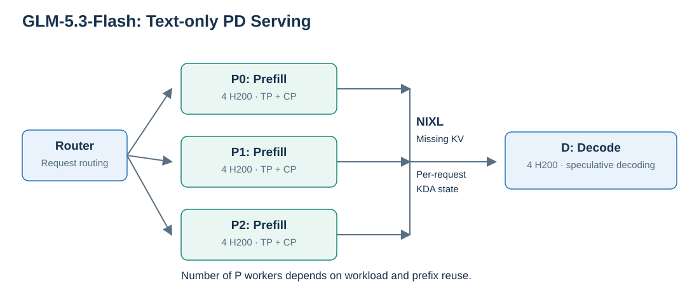
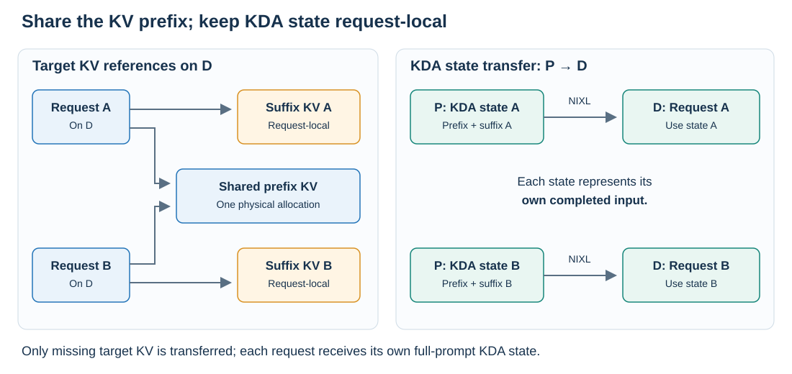
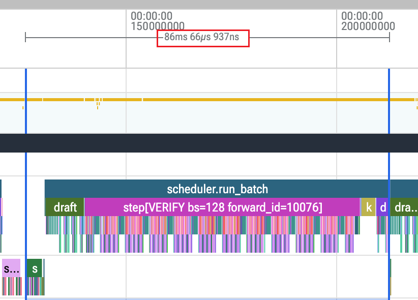
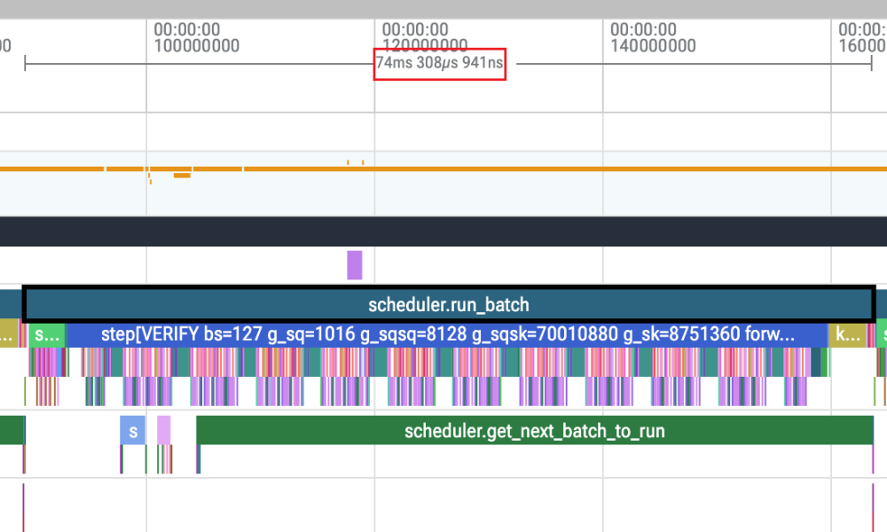
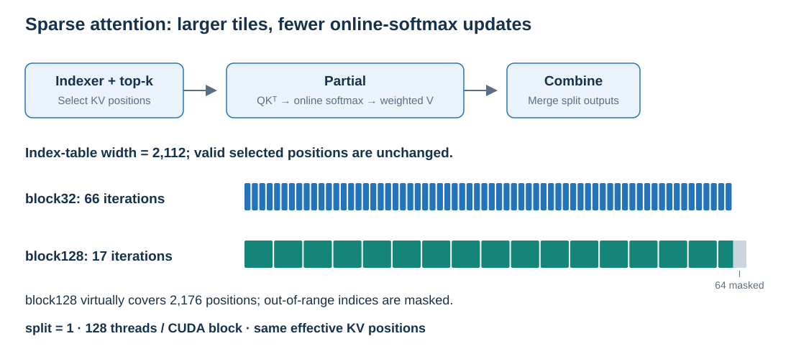
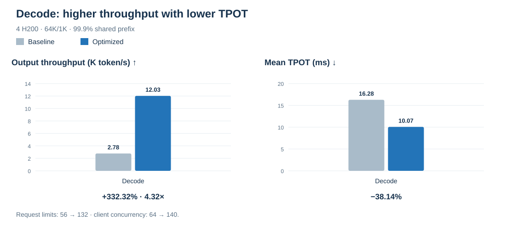
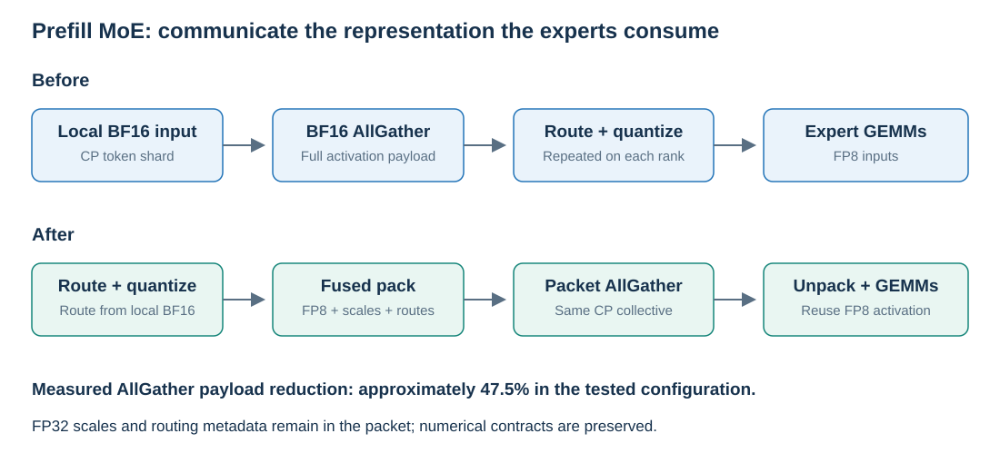
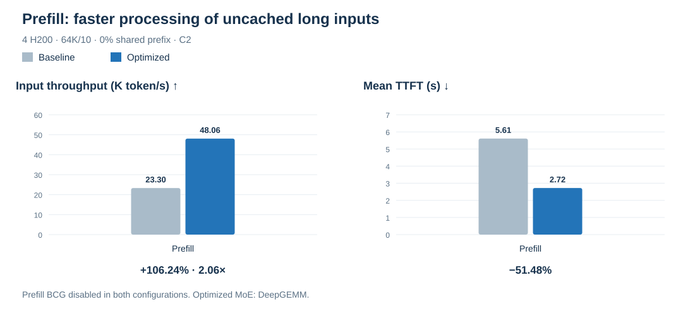
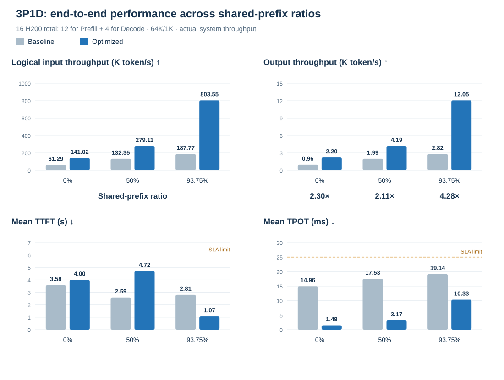

GLM-5.3-Flash combines sparse attention, recurrent linear attention, and MoE. Serving it efficiently at long context lengths requires sufficient memory to sustain high concurrency, low execution cost per output token, and sufficient prefill throughput to keep decode busy.

We address these constraints in SGLang on NVIDIA H200 through hybrid-cache reuse, faster speculative execution, targeted kernel tuning, and FP8 prefill communication. Our results include:

- **2.06× prefill input throughput:** 48,064 tokens/s on four H200s with 64K input, 10-token output, and no shared prefix.
- **4.32× decode output throughput:** 12,027 tokens/s on four H200s with 64K/1K requests and a 99.9% shared prefix, relative to a baseline already configured for long-context cache capacity.
- **2.11×–4.28× end-to-end output throughput** across three shared-prefix ratios with three prefill instances and one decode instance (3P1D).

Our approach separates shared KV storage from request-local recurrent state, then reduces execution cost in speculative decoding and prefill. The integrated results also show the remaining constraint: low-prefix-reuse workloads are still prefill-bound, even with three prefill instances.

## 1. Architecture and workloads

GLM-5.3-Flash has two attention-state representations. Sparse attention (DSA) stores historical KV and uses an indexer to select relevant positions. Linear attention (KDA) maintains recurrent state that advances with the sequence. Both consume memory, but their reuse semantics differ: KV belongs to historical positions; recurrent state represents the sequence at a particular boundary.

Prefill–decode (PD) disaggregation lets each side choose its tensor (TP), expert (EP), and context (CP) parallelism and execution backends. Each instance uses four H200s, with NIXL transferring cache and state from prefill to decode.



*Figure 1. Three prefill instances use 12 GPUs; one decode instance uses four. This work covers text inputs. The image encoder is outside its scope.*

We use **64K input / 10-token output with no shared prefix** to measure prefill throughput while keeping the output phase short. For decode capacity, **64K/1K with a 99.9% shared prefix** reduces the prefill supply constraint. Integrated 3P1D tests use 64K/1K at 0%, 50%, and 93.75% shared prefix to measure how the role-specific gains translate into system throughput. Latency metrics are time to first token (TTFT) and time per output token excluding the first token (TPOT).

## 2. Turning cache capacity into concurrency

### Budgeting KV and recurrent state

Both KV and recurrent-state pools constrain concurrency. In the initial long-context configuration, KV was nearly full while only about 5% of SGLang’s recurrent-state (Mamba) pool was occupied. Raising the request limit alone could reserve more state memory and further squeeze KV.

We rebalanced the pools for the context length and combined FP8 KV, BF16 recurrent state, and ReplaySSM speculative-state management. [TileLang FP8 KV support on CUDA](https://github.com/sgl-project/sglang/pull/42957) reduces historical-cache storage. ReplaySSM keeps compact replay information and advances state after acceptance, avoiding full state-matrix snapshots for speculative steps. This frees capacity for active requests while retaining headroom for CUDA Graphs and dynamic workspaces.

### KV-only decode RadixCache

Cross-request reuse provides another source of capacity. Consider requests A and B with the same prefix and different suffixes. Their prefix KV can be shared, but their recurrent states at the end of the full prompt differ. Reusing prefix KV must therefore preserve each request's recurrent state.

Our decode cache matches and references existing target-model prefix KV, allocating space and receiving transfers only for missing KV. Prefill independently supplies **each request's recurrent state at the end of its full input**. Decode continues from that state without replaying the cached prefix through KDA.



*Figure 2. Decode requests share prefix KV and retain separate suffix KV. Prefill supplies a distinct full-prompt KDA state for each request.*

For N requests sharing a prefix of length Lp, each with a suffix of length Ls, target-model KV storage measured in token slots falls from **N × (Lp + Ls)** to **Lp + N × Ls**, ignoring page alignment and similar overheads. Recurrent state remains request-local. Savings grow with prefix length and concurrency; requests without a shared prefix retain their full KV footprint.

Speculative execution adds requirements around draft-cache boundaries, accepted-state commits, and request cleanup. We reuse upstream KV ownership and transfer logic, support single-chain EAGLE/MTP (top-k=1) and DFlash2, and budget state slots for both running and in-flight requests. See [KV-only hybrid decode RadixCache](https://github.com/sgl-project/sglang/pull/44889).

## 3. Lowering the cost of useful output

Once requests fit, throughput depends on what each cycle accomplishes. Near saturation:

$$
\text{Output throughput} \approx
\frac{\text{Active requests}\times\text{Useful output tokens per request per cycle}}
{\text{Full cycle time}}
$$

We optimize both drafting overhead and target verification, evaluating acceptance length together with cycle time.

### DFlash2 and speculative cycle time

MTP extends a candidate chain through serial drafting. A longer chain can increase acceptance, but also adds work. We use [Inco's DFlash2 checkpoint](https://huggingface.co/incoai/GLM-5.3-Flash-DFlash2), reuse SGLang's block-drafting and verification paths, and integrate them with hybrid-cache PD serving.

To compare execution costs at the same verification width, we configure MTP with seven serial draft steps, top-k=1, and eight verification tokens—MTP718—and compare it with DFlash2 block8. Each request verifies one anchor token plus seven candidates. Both configurations run close to 128 active requests and use the same M1024 MoE configuration.

| MTP718 | DFlash2 block8 |
|:---:|:---:|
| [](/images/blog/glm53-h200-pd/03a_mtp718_trace.png) | [](/images/blog/glm53-h200-pd/03b_dflash2_block8_trace.png) |

*Figure 3. Execution traces at the same verification width (click to enlarge). The screenshots use independent zoom levels; phase times below are wall-clock means across cycles and ranks.*

Target verification costs are similar: **65.16 ms for MTP718 and 66.30 ms for DFlash2**. The larger difference is drafting. DFlash2 generates its block in one forward pass, taking **3.15 ms versus MTP718's 9.13 ms—a 65.5% reduction**. After verification, DFlash2 projects target context features into draft KV instead of running MTP's separate full draft-extend forward. Including cache updates, state commits, and stage gaps, the full cycle falls from **86.94 ms to 74.14 ms, down 14.7%**.

Acceptance lengths are approximately **7.37 for MTP718 and 7.03 for DFlash2**. Dividing cycle time by acceptance length gives an estimated amortized cost of **11.80 versus 10.55 ms per accepted token**, a 10.6% reduction. DFlash2 accepts slightly fewer tokens per cycle, but completes cycles faster.

Output throughput increases from **10,570 to 11,459 tokens/s, up 8.4%**. The shorter execution cycle outweighs the slightly lower acceptance length.

### Tuning MoE against real routing

MoE is a major target-verification hotspot. With MTP516—five draft steps, top-k=1, and six verification tokens—128 requests produce M=128×6=768 input rows. MoE accounts for approximately **43% of verification's cumulative GPU kernel time** at this shape. Within MoE, routed-expert Up/Down GEMMs account for nearly 80% of cumulative kernel time.

The right GEMM configuration depends on expert routing as well as total token count. For DFlash2 block8, a CUDA Graph batch of 128 produces **M=128×8=1024** MoE input rows. Those rows are routed unevenly across experts, and tile alignment introduces padding. Different routing distributions therefore change the effective GEMM shapes even at the same M.

We jointly tune Up/Down GEMM tile sizes, warp counts, and pipeline settings using real routing samples from multiple layers, ranks, and execution points, then check the selected configurations on held-out routes. Nonuniform-scale numerical checks ensure compatibility with block quantization.

With the rest of the DFlash2 service configuration unchanged, M1024 tuning raises output throughput from **11,112 to 11,459 tokens/s, up 3.12%**. Reusable settings for standard token counts are available in the [H200 block-FP8 Triton configurations](https://github.com/sgl-project/sglang/pull/45591).

### Larger KV tiles for DSA Partial

After the indexer selects KV positions, the Partial kernel loads them and computes QKᵀ, online softmax, and the weighted value sum. In the M768 profile, Partial accounts for **58.6% of cumulative DSA verification kernel time**.

For SM90 FP8 workloads with sufficient query parallelism, we increase the KV tile from 32 to 128 entries, retaining one KV split and 128 threads per CUDA block.



*Figure 4. An index width of 2112 requires 66 block32 iterations or 17 block128 iterations. The block128 path virtually covers 2176 columns; its final 64 are padding, shown in gray. The physical index tensor is unchanged.*

Larger tiles reduce loop iterations, online-softmax updates, and accumulator rescaling. They still process the same effective KV positions. Query rows already supply sufficient parallelism; adding KV splits would introduce more intermediate writes and Combine work. The dispatch rule uses architecture, layout, and available query parallelism, so neighboring query counts can use the same optimization.

At M1024, shape-matched Partial + Combine microbenchmarks achieve approximately **1.12× speedup** with both shared-prefix and independent-KV layouts. See [the FP8 KV tiling optimization](https://github.com/sgl-project/sglang/pull/47761).

### Combined decode results

Hybrid-cache management, speculation, and kernel optimization together raise four-GPU output throughput from **2,782 to 12,027 tokens/s (4.32×)**, while mean TPOT falls from **16.28 to 10.07 ms**. The baseline already has static memory and cache-pool budgets adjusted for long contexts. The optimized configuration raises the running-request limit from 56 to 132.

We use 64K/1K requests with a 99.9% shared prefix to minimize prefill supply constraints and measure decode throughput near saturation.

Client concurrency is set slightly above the decode running-request limit to keep decode busy while other requests are in prefill, cache transfer, or waiting for admission.

| Configuration | Max running requests | Output throughput (tokens/s) | Mean TPOT (ms) | Notes |
| --- | :---: | :---: | :---: | --- |
| Capacity-adjusted baseline | 56 | 2,781.88 | 16.28 | KV and state pools sized for long contexts. |
| FP8 KV cache | 96 | 3,881.60 | 22.98 | Smaller KV footprint increases capacity. |
| FP8 KV + MTP516 | 56 | 5,625.32 | 8.91 | Draft KV and verification states consume memory, reducing concurrency. |
| + ReplaySSM and BF16 recurrent state | 88 | 7,721.79 | 10.49 | ReplaySSM trims speculative buffers; BF16 halves SSM storage per slot. |
| + KV-only decode RadixCache | 128 | 9,529.15 | 12.47 | Prefix KV reuse is combined with retuned memory and concurrency budgets. |
| **DFlash2 + tuned MoE + DSA Partial** | **132** | **12,026.62** | **10.07** | Block drafting and tuned kernels reduce output-token cost. |

The memory change is a shift in reuse and budgeting, rather than a larger KV pool alone. Per GPU, the baseline allocates **46.72 GB of target KV** and **1.96 GB of recurrent/conv state across 56 slots**. The final configuration allocates **14.00 GB of target KV**, **11.96 GB of draft KV**, and **7.37 GB of recurrent/conv state across 414 slots**, plus speculative workspaces. Despite the smaller target KV pool, sharing the long prefix allows more requests to fit. At the selected operating points, scheduler samples report median KV occupancy of approximately **98% versus 7%**.



*Figure 5. Four-GPU decode throughput and TPOT at 64K/1K and 99.9% shared prefix.*

## 4. Prefill dataflow optimization

Long-input prefill depends on data movement and synchronization as well as GEMM efficiency. We use **TP4/EP1/CP4**, [Q8 sparse attention](https://github.com/sgl-project/sglang/pull/44217), and DeepGEMM, with [CP/NIXL PD integration](https://github.com/sgl-project/sglang/pull/44293) supporting the combined DFlash2 deployment. Large prefill chunks and speculative verification have different shapes, so P and D use backends suited to their respective workloads.

### Communicate and reuse FP8 activations

CP distributes token shards across ranks. The original MoE path gathers BF16 activations with AllGather, then routes and quantizes them on each rank. This transfers a larger tensor and duplicates input preparation.

We move routing and quantization to the local token shards. **Routing uses the original BF16 input; activations are quantized to FP8.** We pack the FP8 values with scales, routing weights, and expert IDs for AllGather, then reuse the quantized values directly in expert GEMMs.



*Figure 6. FP8 activation packets move between CP ranks. P-to-D cache transfer remains on NIXL.*

For hidden dimension H, activation storage per token falls from 2H to H bytes, plus scale and routing metadata. In the measured configuration, **this AllGather's payload falls by approximately 47.5%**. Fused packing and unpacking further reduce copies and produce the layout consumed by expert computation. See [CP MoE FP8 transport and fused packing](https://github.com/sgl-project/sglang/pull/46813).

### Fuse computation and overlap dependencies

The DeepGEMM path fuses GLM clamp/SwiGLU activation with FP8 quantization. It preserves BF16 rounding semantics and directly produces quantized values and the scale layout needed by the down projection, avoiding an intermediate BF16 write, reread, and extra kernel launch. For forward passes processing 8192 tokens, this activation-and-quantization region drops from **6.76 to 3.19 ms** in mean cumulative kernel time. See [SwiGLU and FP8 quantization fusion](https://github.com/sgl-project/sglang/pull/46776).

KDA preparation follows the same principle: [fuse Q/K L2 normalization with QKV layout preparation](https://github.com/sgl-project/sglang/pull/45992), reducing temporary copies and launches while preserving FP32 normalization and BF16 writeback.

We increase the prefill chunk size and `--max-prefill-tokens` to **32K**. On supported large-chunk paths, [KDA input Async-TP](https://github.com/sgl-project/sglang/pull/46842) starts projection as communication tiles arrive, overlapping AllGather and GEMM. Reusing logical token metadata on the CPU removes per-layer GPU-scalar reads. [PD scheduling changes](https://github.com/sgl-project/sglang/pull/46220) delay the write-after-read (WAR) barrier protecting buffer reuse, overlapping previous-batch result processing with current GPU computation while preserving the synchronization needed before scheduling the next batch.

### Combined prefill results

Parallelism, low-precision communication, fusion, and scheduling together raise four-GPU input throughput from **23,305 to 48,064 tokens/s (2.06×)** at 64K input, 10-token output, and no shared prefix. Mean TTFT falls from **5.61 to 2.72 seconds**.

| Configuration | Input throughput (tokens/s) | Notes |
| --- | :---: | --- |
| Baseline | 23,304.96 | No CP; prefill BCG disabled. |
| CP + BCG | 31,661.00 | Parallel input processing and CUDA Graph execution. |
| Execution preparation and MoE optimizations | 35,661.29 | Fewer synchronizations and KV copies; MoE tuning and activation/quantization fusion. |
| 32K prefill chunks + Async-TP | 43,575.32 | Larger prefill batches with communication/projection overlap. |
| DeepGEMM + fused KDA QKV preparation | 45,913.28 | Faster expert computation and input preparation. |
| **FP8 communication, fusion, and scheduling optimizations** | **48,064.24** | **Reuse quantized activations and reduce synchronization.** |



*Figure 7. Four-GPU prefill throughput and TTFT at client concurrency 2. Prefill BCG is disabled in both the baseline and the final optimized configuration.*

## 5. End-to-end 3P1D performance

We evaluate the integrated service with three prefill instances and one decode instance on 16 H200s, using 64K/1K requests at three shared-prefix ratios. Each configuration uses a measured high-throughput operating point satisfying mean **TTFT < 6 seconds and TPOT < 25 ms**.



*Figure 8. End-to-end 3P1D throughput and latency. Dashed lines indicate the latency targets.*

P95/P99 latencies are:

| Shared prefix | Configuration | TTFT P95 / P99 (s) | TPOT P95 / P99 (ms) |
| --- | --- | :---: | :---: |
| 0% | Baseline | 5.65 / 6.06 | 16.36 / 16.46 |
| 0% | Optimized | 4.54 / 5.45 | 1.90 / 3.45 |
| 50% | Baseline | 2.98 / 3.20 | 17.94 / 18.02 |
| 50% | Optimized | 6.24 / 7.56 | 4.42 / 8.56 |
| 93.75% | Baseline | 5.13 / 5.67 | 19.70 / 20.06 |
| 93.75% | Optimized | 1.71 / 5.13 | 12.56 / 20.13 |

**At 0% and 50% shared prefix, prefill remains the bottleneck.** Output reaches **2.20K and 4.19K tokens/s**, respectively—**2.30× and 2.11× the baseline**—but three prefill instances still cannot saturate decode. Faster input processing and request delivery remain the primary ways to increase system throughput.

**At 93.75% shared prefix, the bottleneck shifts toward decode.** With less uncached prefill work and sufficient supply, the final decode configuration, capped at 132 running requests, reaches **12.05K tokens/s, 4.28× the baseline**, with lower mean TTFT and TPOT. More decode concurrency and lower output cost now translate more fully into end-to-end gains.

Throughput uses actual token counts; 64K is the configured input length. Input throughput includes cache hits, so **803.55K input tokens/s** at high prefix reuse is a logical input-processing rate. Integrated throughput covers all 16 GPUs; the isolated P and D results each use four. The optimized 3P1D stack achieves **95.7% and 95.4% accuracy** on two GSM8K runs, each with 1,314 examples and 5-shot prompting.

The integrated baseline uses SGLang v0.5.20 with TP4/EP4 decode. The optimized deployment uses custom build `0.5.22.dev1872+g3cb45d3dc`, pinned to commit [`3cb45d3dc`](https://github.com/Jzz1943/sglang/commit/3cb45d3dc4e9a0d6aae90c4efc0e87aa9db75f2e). The implementation is available on the [`glm-np1d` branch](https://github.com/Jzz1943/sglang/tree/glm-np1d).

## 6. Future directions

Four directions remain worth pursuing:

- **mHC kernels.** Reduce normalization, residual mixing, and layout-conversion costs through further fusion and tuning for verification shapes, while preserving numerical stability.
- **HiSparse efficiency.** Our [hybrid PD support](https://github.com/sgl-project/sglang/pull/43533) and [MTP integration](https://github.com/sgl-project/sglang/pull/44488) provide the basis for capacity expansion. Next, measure PD handoff, decode-time KV-miss fetches, and cache-management costs separately, then improve residency, candidate-level KV reuse, and asynchronous prefetch. DFlash2 integration could extend these benefits to the current decode path.
- **Scheduling and synchronization.** Trace dependencies across host submission, metadata preparation, and state commits, and remove or hide waits that stall the full speculative cycle.
- **Workload-aware P/D allocation.** Adapt routing and resource ratios to prefix reuse, input/output lengths, and queue state, balancing cache locality with load distribution.

## 7. Takeaways

The gains on GLM-5.3-Flash come from combining correct hybrid-cache reuse with more efficient execution. KV-only RadixCache shares prefix storage while keeping recurrent state request-local. DFlash2 and MoE/DSA optimizations reduce cost per useful output token. FP8 data reuse, fusion, and overlap improve prefill supply.

The 3P1D results show why workload matters: low-prefix-reuse traffic still needs more prefill capacity, while high-prefix-reuse traffic approaches the decode ceiling. Choosing P/D allocation, parallelism, and backends together is what turns these optimizations into higher delivered throughput within latency limits.

## Configurations and launch commands

<details>
<summary>Baseline and optimized configurations</summary>

**Prefill**

| Setting | Baseline | Optimized |
|---|---|---|
| TP / EP / CP | 4 / 4 / 1 | 4 / 1 / 4, interleave |
| MoE runner / A2A | Triton / none | DeepGEMM / none |
| DSA prefill backend | TileLang | FlashMLA sparse Q8 (`flashmla_sparse_q8`) |
| KDA prefill backend | Triton | Triton |
| KV cache dtype | BF16 | FP8 E4M3 |
| Recurrent-state dtype | FP32 | BF16 |
| Static memory fraction | 0.75 | 0.75 |
| `--chunked-prefill-size` | 8,192 | 32,768 |
| `--max-prefill-tokens` | 16,384 | 32,768 |
| Prefill CUDA Graph | Disabled | Disabled |
| Benchmark concurrency | 2 | 2 |

**Decode**

| Setting | Isolated baseline | Optimized |
|---|---|---|
| TP / EP | 4 / 1 | 4 / 4 |
| MoE runner / A2A | Triton / none | Tuned Triton / none |
| DSA decode backend | TileLang | TileLang |
| KDA decode / verify backend | Triton | Triton |
| KV cache dtype | BF16 | FP8 E4M3 |
| Recurrent-state dtype | FP32 | BF16 |
| Speculative decoding | Off | DFlash2 block8 |
| Draft attention / KV dtype | Not applicable | FA3 / BF16 |
| ReplaySSM-spec | Off | On |
| Decode RadixCache | Off | KV-only hybrid cache |
| Static memory fraction | 0.90 | 0.84 |
| Running-request limit | 56 | 132 |
| State slots | 56 | 414 |
| Decode CUDA Graph max batch | 56 | 132 |
| Benchmark concurrency | 64 | 140; 3P1D: 12 / 33 / 140 |

All P/D transfers use NIXL. The optimized D state budget covers six extra in-flight requests.

</details>

<details>
<summary>Decode baseline launch commands (SGLang v0.5.20)</summary>

Launch P and D in separate terminals using SGLang v0.5.20.

```bash
export MODEL_PATH=/path/to/GLM-5.3-Flash
export UCX_NET_DEVICES=lo
export UCX_TLS=tcp,cuda_copy,cuda_ipc,self,sm

# P, in one terminal:
CUDA_VISIBLE_DEVICES=0,1,2,3 sglang serve \
  --model-path "$MODEL_PATH" \
  --served-model-name llm \
  --tp-size 4 \
  --moe-runner-backend triton \
  --dsa-prefill-backend tilelang \
  --dsa-decode-backend tilelang \
  --kv-cache-dtype bfloat16 \
  --mem-fraction-static 0.75 \
  --disaggregation-mode prefill \
  --disaggregation-transfer-backend nixl \
  --disaggregation-bootstrap-port 8998 \
  --host 127.0.0.1 \
  --port 31000 \
  --nccl-port 29500

# D, in another terminal with the same MODEL_PATH and UCX variables:
CUDA_VISIBLE_DEVICES=4,5,6,7 sglang serve \
  --model-path "$MODEL_PATH" \
  --served-model-name llm \
  --tp-size 4 \
  --moe-runner-backend triton \
  --dsa-prefill-backend tilelang \
  --dsa-decode-backend tilelang \
  --kv-cache-dtype bfloat16 \
  --mem-fraction-static 0.90 \
  --max-running-requests 56 \
  --max-mamba-cache-size 56 \
  --cuda-graph-max-bs-decode 56 \
  --disaggregation-mode decode \
  --disaggregation-transfer-backend nixl \
  --host 127.0.0.1 \
  --port 32000 \
  --nccl-port 29501
```

Use the 1P1D router command below with decode port 32000.

</details>

<details>
<summary>Optimized P and D launch commands</summary>

Replace the checkpoint paths and run the following shared setup in each role’s Bash terminal before launching P or D.

```bash
export MODEL_PATH=/path/to/GLM-5.3-Flash
export DRAFT_MODEL_PATH=/path/to/GLM-5.3-Flash-DFlash2
export SGLANG_UNIFIED_RADIX_TREE_CORE_BACKEND=python
export SGLANG_DISAGGREGATION_NIXL_BACKEND=UCX
export SGLANG_DISAGGREGATION_ENGINE_INIT_TIMEOUT=300
export NO_PROXY=127.0.0.1,localhost
export no_proxy="$NO_PROXY"
unset SGLANG_MOE_CONFIG_DIR MOE_CONFIG_DIR MOE_ROUTE_CAPTURE_CONFIG
```

P (GPU 0–3):

```bash
export P_HOST=127.0.0.1
export P_PORT=31000
export BOOTSTRAP_PORT=8998
export P_NCCL_PORT=29500
export CUDA_VISIBLE_DEVICES=0,1,2,3
export SGLANG_HOST_IP="$P_HOST"
export SGLANG_CP_KDA_ASYNC_TP=1
export SGLANG_KDA_FUSED_QKV_PACK=1
export SGLANG_OPT_MOE_ACT_QUANT_FUSION=0
export SGLANG_CP_MOE_FP8_TRANSPORT=1
export SGLANG_CP_DG_ACT_QUANT_FUSION=1
export SGLANG_CP_FP8_FUSED_PACKET=1
export SGLANG_DISAGG_STAGING_BUFFER=0

sglang serve \
  --model-path "$MODEL_PATH" \
  --served-model-name llm \
  --trust-remote-code \
  --tp-size 4 \
  --ep-size 1 \
  --enable-prefill-cp \
  --cp-strategy interleave \
  --attn-cp-size 4 \
  --moe-runner-backend deep_gemm \
  --moe-a2a-backend none \
  --dsa-prefill-backend flashmla_sparse_q8 \
  --dsa-decode-backend tilelang \
  --linear-attn-prefill-backend triton \
  --linear-attn-decode-backend triton \
  --kv-cache-dtype fp8_e4m3 \
  --mamba-ssm-dtype bfloat16 \
  --mem-fraction-static 0.75 \
  --chunked-prefill-size 32768 \
  --max-prefill-tokens 32768 \
  --cuda-graph-backend-prefill disabled \
  --speculative-algorithm DFLASH \
  --speculative-draft-model-path "$DRAFT_MODEL_PATH" \
  --speculative-dflash-block-size 8 \
  --speculative-draft-attention-backend fa3 \
  --speculative-draft-kv-cache-dtype bfloat16 \
  --disaggregation-mode prefill \
  --disaggregation-transfer-backend nixl \
  --disaggregation-bootstrap-port "$BOOTSTRAP_PORT" \
  --reasoning-parser glm45 \
  --tool-call-parser glm47 \
  --tokenizer-worker-num 8 \
  --host "$P_HOST" \
  --port "$P_PORT" \
  --nccl-port "$P_NCCL_PORT"
```

D (GPU 4–7):

```bash
export D_HOST=127.0.0.1
export D_PORT=31500
export D_NCCL_PORT=29501
export CUDA_VISIBLE_DEVICES=4,5,6,7
export SGLANG_HOST_IP="$D_HOST"
unset SGLANG_CP_KDA_ASYNC_TP SGLANG_KDA_FUSED_QKV_PACK
unset SGLANG_OPT_MOE_ACT_QUANT_FUSION SGLANG_DISAGG_STAGING_BUFFER
unset SGLANG_CP_MOE_FP8_TRANSPORT SGLANG_CP_DG_ACT_QUANT_FUSION SGLANG_CP_FP8_FUSED_PACKET

sglang serve \
  --model-path "$MODEL_PATH" \
  --served-model-name llm \
  --trust-remote-code \
  --tp-size 4 \
  --ep-size 4 \
  --moe-runner-backend triton \
  --moe-a2a-backend none \
  --dsa-prefill-backend tilelang \
  --dsa-decode-backend tilelang \
  --linear-attn-prefill-backend triton \
  --linear-attn-decode-backend triton \
  --linear-attn-verify-backend triton \
  --kv-cache-dtype fp8_e4m3 \
  --mamba-ssm-dtype bfloat16 \
  --mem-fraction-static 0.84 \
  --max-running-requests 132 \
  --max-mamba-cache-size 414 \
  --chunked-prefill-size 8192 \
  --cuda-graph-max-bs-decode 132 \
  --cuda-graph-bs-decode 1 2 4 8 16 24 32 48 64 80 88 96 104 112 116 120 128 132 \
  --speculative-algorithm DFLASH \
  --speculative-draft-model-path "$DRAFT_MODEL_PATH" \
  --speculative-dflash-block-size 8 \
  --speculative-draft-attention-backend fa3 \
  --speculative-draft-kv-cache-dtype bfloat16 \
  --enable-linear-replayssm-spec \
  --disaggregation-mode decode \
  --disaggregation-transfer-backend nixl \
  --disaggregation-decode-enable-radix-cache \
  --disaggregation-decode-extra-slots 6 \
  --disaggregation-decode-polling-interval 1 \
  --reasoning-parser glm45 \
  --tool-call-parser glm47 \
  --tokenizer-worker-num 8 \
  --host "$D_HOST" \
  --port "$D_PORT" \
  --nccl-port "$D_NCCL_PORT"
```

For single-node P/D transfer, set `UCX_NET_DEVICES=lo` and `UCX_TLS=tcp,cuda_copy,cuda_ipc,self,sm` in both terminals before launch. Cross-node transfer typically uses RDMA when supported by the hardware and network; leave these variables unset so UCX can select the available devices and transports.

</details>

<details>
<summary>Router and 3P1D placement</summary>

For 1P1D:

```bash
python -m sglang_router.launch_router \
  --pd-disaggregation \
  --mini-lb \
  --prefill http://127.0.0.1:31000 8998 \
  --decode http://127.0.0.1:31500 \
  --host 127.0.0.1 \
  --port 8090
```

For 3P1D, use two eight-GPU nodes. On node A, launch P0 on GPU 0–3 (port 31000, bootstrap 8998, NCCL 29500) and P1 on GPU 4–7 (31001, 8999, 29501). On node B, launch P2 on GPU 0–3 (31000, 8998, 29500) and D on GPU 4–7 (31500, NCCL 29501). Set each role's host/IP variables to its node's reachable IP. P2 uses `UCX_TLS=tcp,cuda_copy,cuda_ipc,self,sm`; other roles retain UCX network auto-selection.

Launch the router on node A, replacing the example IPs with your node addresses:

```bash
NODE_A=192.0.2.10
NODE_B=192.0.2.11
export NO_PROXY="127.0.0.1,localhost,$NODE_A,$NODE_B"
export no_proxy="$NO_PROXY"
python -m sglang_router.launch_router \
  --pd-disaggregation \
  --policy round_robin \
  --prefill "http://$NODE_A:31000" 8998 \
  --prefill "http://$NODE_A:31001" 8999 \
  --prefill "http://$NODE_B:31000" 8998 \
  --decode "http://$NODE_B:31500" \
  --host "$NODE_A" \
  --port 8090
```

</details>

<details>
<summary>Benchmark example: 93.75% shared prefix</summary>

For 64K/1K requests, GSP is configured with a 61,440-token shared prefix and a 4,096-token question per request. Flush all P/D caches before each run; 12 warmup requests populate the cache before measurement.

```bash
BENCH_HOST=192.0.2.10
export NO_PROXY="127.0.0.1,localhost,$BENCH_HOST"
export no_proxy="$NO_PROXY"

python -m sglang.benchmark.serving \
  --backend sglang \
  --host "$BENCH_HOST" \
  --port 8090 \
  --model /path/to/GLM-5.3-Flash \
  --served-model-name llm \
  --dataset-name generated-shared-prefix \
  --gsp-num-groups 1 \
  --gsp-prompts-per-group 3072 \
  --gsp-system-prompt-len 61440 \
  --gsp-question-len 4096 \
  --gsp-output-len 1024 \
  --gsp-range-ratio 1 \
  --num-prompts 3072 \
  --request-rate inf \
  --max-concurrency 140 \
  --warmup-requests 12 \
  --temperature 0 \
  --seed 42 \
  --cache-report \
  --output-file benchmark_sp93_75.jsonl
```

</details>

## Acknowledgments

We thank [BBuf](https://github.com/BBuf), [Fridge003](https://github.com/Fridge003), [yuan-luo](https://github.com/yuan-luo), [alphabetc1](https://github.com/alphabetc1), [hzh0425](https://github.com/hzh0425), [huangtingwei9988](https://github.com/huangtingwei9988), [ShangmingCai](https://github.com/ShangmingCai), and other SGLang community contributors for supporting this work.

Contact: [Zhongze Jiang](https://github.com/Jzz1943) — [jiangzhongze.jzz@ant-intl.com](mailto:jiangzhongze.jzz@ant-intl.com).
