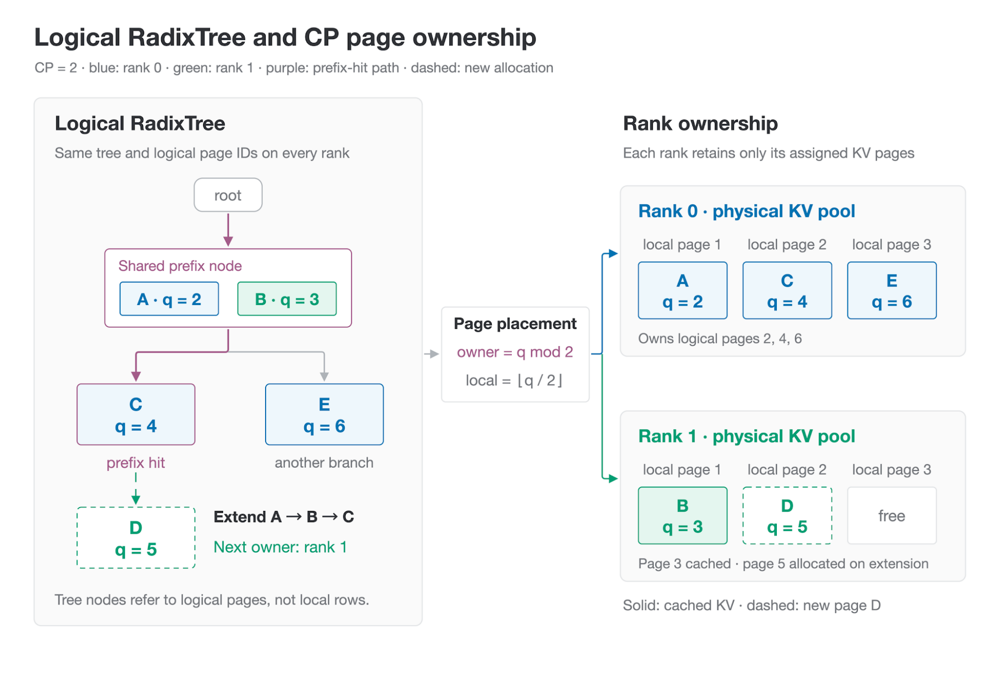
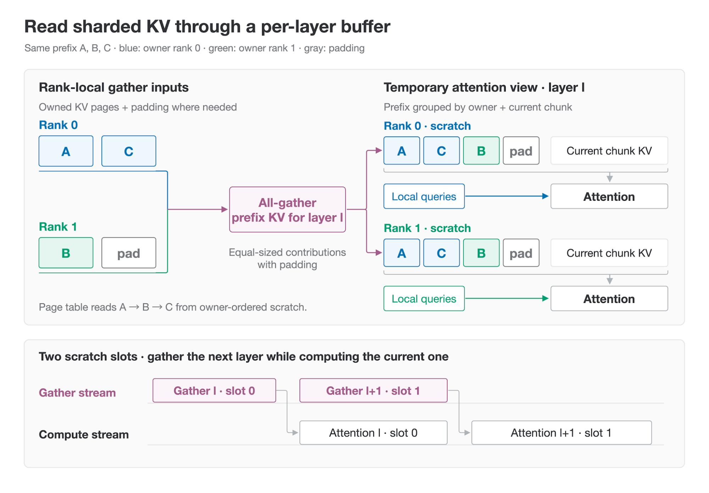
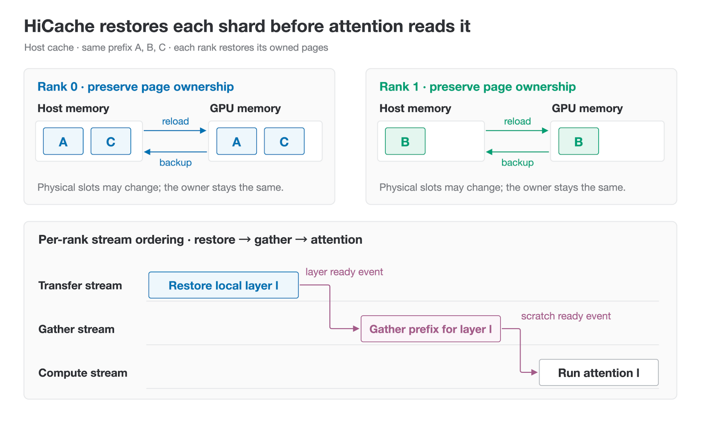
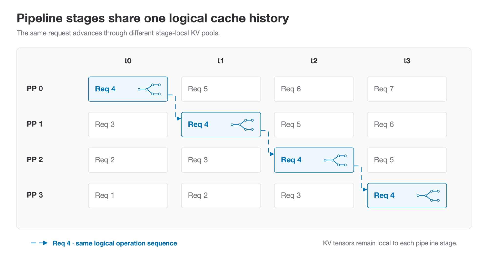
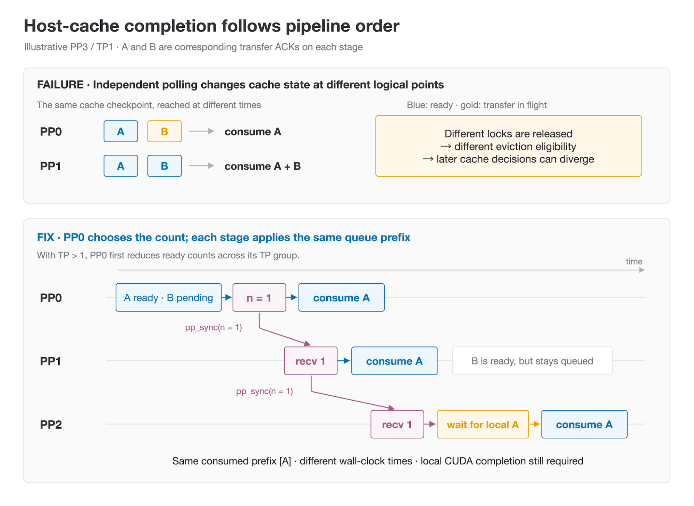
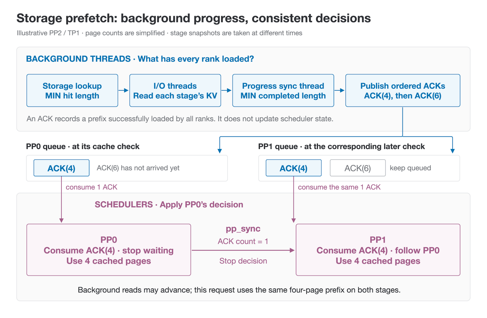
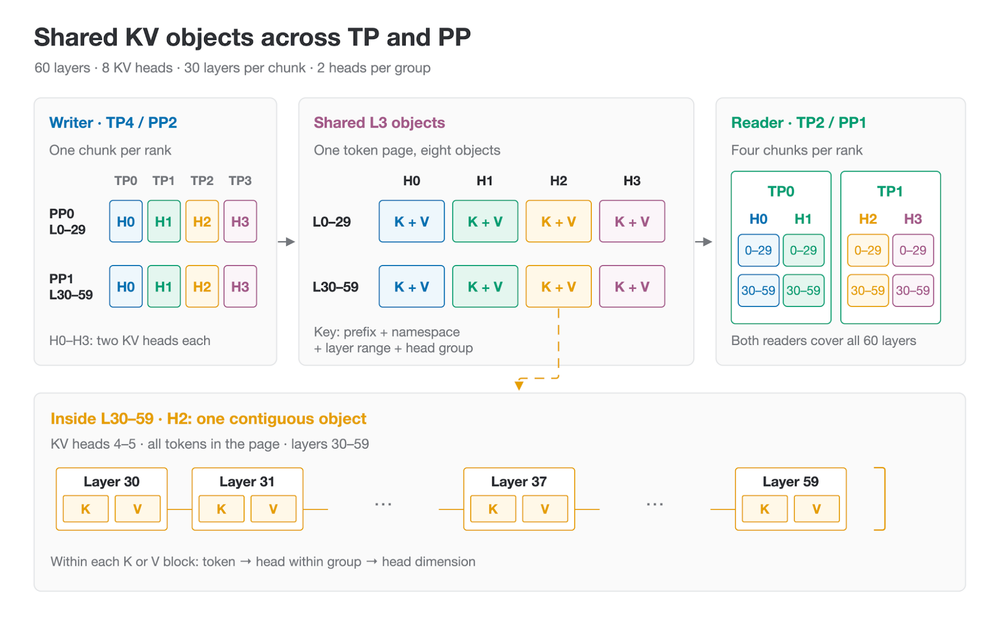
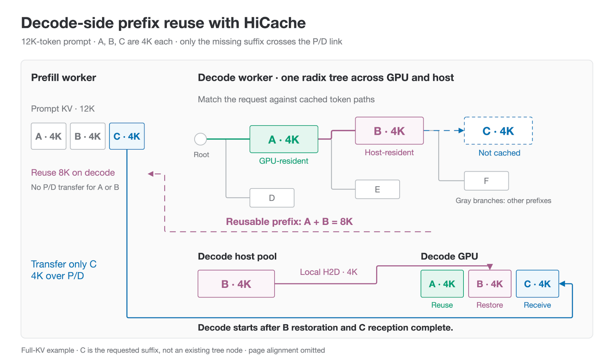
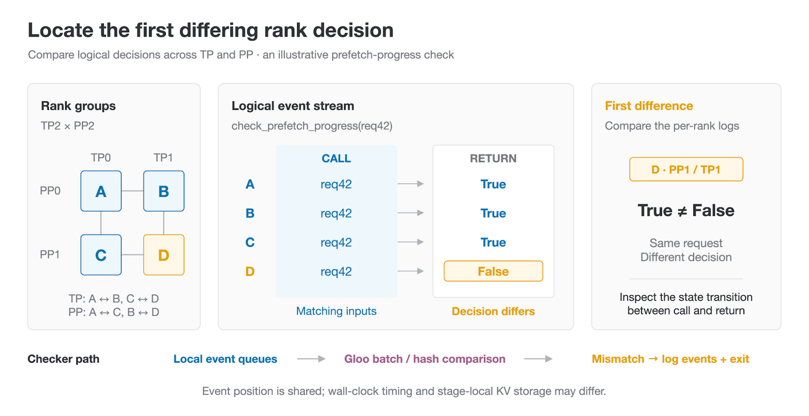

Agentic workloads repeatedly send long, mostly unchanged histories to the model. Radix cache reuses prefix KV in GPU memory, and [HiCache](https://lmsys.org/blog/2025-09-10-sglang-hicache/) extends that reuse to host memory and external storage. In production, this must also work with parallelism, speculative decoding, and prefill-decode disaggregation. That requires consistent cache decisions across ranks, restoration of draft state, and coordination between local cache reuse and remote KV transfer.

This article explains how HiCache handles these requirements:

- **Context Parallelism (CP)**: Preserve a shared logical prefix while storing and restoring KV pages on their owner ranks.
- **Pipeline Parallelism (PP)**: Keep cache decisions consistent across stages as asynchronous transfers complete independently.
- **Speculative decoding**: Restore the draft model's required state alongside the target cache.
- **Unified KV layout**: Share stored KV across compatible parallel configurations.
- **Prefill-decode disaggregation (P/D)**: Reuse decode-side prefixes so prefill transfers only the missing KV.
- **Debugging**: Use `rank_consensus_checker` to locate inconsistent cache decisions across ranks.

In production serving, the Iflytek Astron MaaS team combines pipeline parallelism, prefill-decode disaggregation, and MTP to serve GLM-5.1/5.2 CodingPlan workloads. Requests typically contain 30K to 200K input tokens, with some reaching 1M. Without HiCache, the deployment's cache hit rate was around 30%, and users faced long waits for responses. The team reports that adding HiCache with external storage increased the hit rate to 95% and brought median TTFT below 3 seconds.

## 1. CP × HiCache: Page-based KV sharding

Context parallelism distributes prefill computation across ranks, but the KV cache can still be replicated across those ranks. Page-based KV sharding removes these duplicate copies while preserving a common logical view of each request. HiCache must preserve this page ownership when backing up and restoring the cache.

### 1.1 Logical radix tree and page ownership

In Figure 1a, requests A/B/C and A/B/E share the A/B prefix node and then follow different branches. Every CP rank maintains the same logical radix tree, including the same logical page IDs. A hit on A/B/C therefore identifies the same three cached pages on every rank, even though their KV data is stored on different GPUs.

The GPU pools on the right store pages according to their logical IDs. With two ranks, even-numbered pages belong to rank 0 and odd-numbered pages to rank 1. Rank 0 stores A, C, and E at local pages 1, 2, and 3; rank 1 stores B at local page 1. The tree and request tables retain logical indices, and the memory pool translates them into an owner and a local address.

For $N$ shard ranks, a page size of $p$ tokens, and an allocated logical slot $x$:

$$q = \lfloor x / p \rfloor$$

$$r = q \bmod N$$

$$\ell = \lfloor q / N \rfloor \times p + (x \bmod p)$$

Here, $q$ is the logical cache page ID, and rank $r$ stores the token's KV at local row $\ell$. This mapping is arithmetic and requires no per-page lookup table. [\[Page placement and shard groups\]](https://github.com/sgl-project/sglang/blob/d8f852234850ac01a36adbb1c337a0acc0ff3912/python/sglang/srt/mem_cache/page_interleave.py#L79)

When a request reuses A/B/C and adds page D, the allocator continues the prefix's owner sequence: 0, 1, 0, then 1. In the example, D receives logical page ID 5 and occupies local page 2 on rank 1. The tree records the ownership rotation so extensions follow the cached path; it rejects insertions that would combine incompatible rotations.

With prefill CP enabled, ownership is distributed across the CP group. Interleave and zigzag determine the computation assigned to each rank independently of this page placement. MLA can also shard replicated latent KV across attention-TP ranks when CP is disabled.



<p style="text-align: center; color: #6b7280; font-size: 0.875rem; font-style: italic; margin-top: 0.25rem;">Figure 1a. Every CP rank maintains the same logical radix tree. Logical page ID q determines its owner and owner-local page. Requests share A/B and branch to C or E; extending the matched A/B/C prefix allocates D on rank 1, preserving the ownership cycle. Dashed outlines mark the new allocation.</p>

### 1.2 Reading sharded KV: Gather one layer at a time

After sharding, a rank's local cache contains only part of the history needed by attention. Before reading a layer's cached prefix, each rank contributes its owned pages to an all-gather. The result is placed in a temporary buffer for that layer.

Using the same example, rank 0 contributes A and C, while rank 1 contributes B and a padding page. The gathered buffer groups pages by owner. A page-table mapping lets attention read the logical sequence A, B, C without physically rearranging those pages. KV for the current chunk is staged alongside the prefix from the full chunk already available at the cache-write boundary.

Two temporary buffers alternate across layers, allowing the next layer's gather to overlap with computation on the current layer. This keeps the assembled KV limited to two layer buffers. Their memory cost is included in the cache budget, and the scheduler checks that each batch fits before admitting it.

On supported configurations, the gather uses GPU copy engines instead of NCCL SM kernels, reducing competition with model computation. A prefix hit therefore saves recomputation while still paying the cost of gathering its distributed KV. \[[zero-SM gather](https://github.com/sgl-project/sglang/pull/44029)\]



<p style="text-align: center; color: #6b7280; font-size: 0.875rem; font-style: italic; margin-top: 0.25rem;">Figure 1b. Each rank contributes its own pages for the current layer. All-gather produces the same owner-ordered prefix buffer on both ranks; page-table mapping preserves the logical sequence A, B, C. Two scratch slots allow the next layer's gather to overlap with current-layer attention.</p>

### 1.3 HiCache integration: Restore each shard before gathering

HiCache must preserve page ownership when moving KV between GPU and host memory. Otherwise, a restored page could end up on a rank that will not contribute it to the next gathering. In the three-page example, rank 0 backs up A and C to its own host pool, while rank 1 backs up B. Reload allocates GPU pages with the same owners, even if their physical addresses have changed.

The cache tree and transfer queues continue to use logical indices. At the copy boundary, each rank selects its own source–destination page pairs and translates them into local addresses. The ranks can then move distinct shards concurrently through their local GPU–host paths.

The gather must also wait for the restored data. HiCache loads KV on a transfer stream, while prefix gathering runs on a separate stream. For each layer, the gather waits for that layer's restore-completion event; attention then waits for the gathered buffer. The order is restore local pages → gather the prefix → run attention. The scheduler reserves the required gather buffers before queuing a reload.



<p style="text-align: center; color: #6b7280; font-size: 0.875rem; font-style: italic; margin-top: 0.25rem;">Figure 1c. Host backup and reload preserve page ownership. On each rank, the gather stream waits for the current layer's restore-completion event, and attention waits for the gathered buffer. The required order is restore local pages → gather the prefix → run attention.</p>

### 1.4 Performance practices

For a GLM-5.3 deployment example with CP sharding and HiCache, see the [configuration guide in PR #46789](https://github.com/sgl-project/sglang/pull/46789/changes#diff-f9e557da7c88d004d7a2f473a9950200f07059edc801b431c6eb85b410533ac4). The performance evaluation below uses GLM-5.2-NVFP4.

**Performance comparison using production traffic**

We compared the open-source CP-sharded HiCache implementation with a baseline that replicated KV on GPUs and deduplicated MLA KV in host memory. Both deployments used GLM-5.2-NVFP4, TP4/CP4, EAGLE MTP, and a static memory fraction of 0.9. Each deployment had two prefill engines, each running on four NVIDIA GB300 GPUs.

Each deployment had a target host-cache budget of 960 GB per engine: one deduplicated pool in the baseline, versus 240 GB per rank across four shard ranks. Across the three-hour traffic window, each configuration processed approximately 24.5K requests with known cache-tier attribution. Mean input lengths were 136K–137K tokens, and total input volume differed by 1.8%.


<p style="text-align: center; color: #6b7280; font-size: 0.875rem; font-style: italic; margin-top: 0.25rem;">Figure 1d. With CP sharding, more cached tokens were served from GPU memory and fewer from host memory; the combined hit rate remained near 93%. For the same request, prefill-stage TTFT is queue time plus forward time. The plotted means use separate request populations and should not be summed into a measured TTFT.</p>

With CP sharding, the GPU token hit rate increased by 40.48 percentage points, while the combined GPU and host hit rate stayed near 93%. Tokens served from host memory fell from 1.712B to 0.322B, an 81.2% reduction. Mean prefill queue time was 56.2% lower, and mean prefill forward time was 31.3% lower.

**CP sharding is still being optimized, and per-layer KV gathering adds some overhead. We will continue improving its performance and expanding HiCache integration to more models beyond the GLM-5 family.**

## 2. PP × HiCache: Keeping cache operations consistent across stages

CP sharding determines which rank owns each page. Pipeline parallelism distributes KV by layer and requires stages to apply cache operations consistently as requests move through the pipeline. Each stage maintains its own radix tree. With GPU-only caching, the classic `RadixCache` produces the same logical tree and cache decisions when stages start from the same state and apply the same operations in the same order. Stages can reach those operations at different times without changing the result.



<p style="text-align: center; color: #6b7280; font-size: 0.875rem; font-style: italic; margin-top: 0.25rem;">Figure 2a. Each pipeline stage stores KV for its own layers. Stages process a request at different times while following the same logical sequence of cache operations.</p>

HiCache adds asynchronous transfers and storage reads to this execution model. Their results affect cache bookkeeping and later scheduling decisions, so stages must apply them at corresponding points in the pipeline. Otherwise, a small difference can grow into mismatched prefix lengths or tensor shapes, as reported in [#22607](https://github.com/sgl-project/sglang/issues/22607).

### 2.1 Host cache: Coordinating asynchronous transfers

The host-cache mismatch starts when stages decide independently which transfers have finished. Suppose PP0 sees backup A complete and B still in flight. By the time PP1 reaches the corresponding cache check, both A and B have finished locally. Processing every ready entry makes PP0 release A's lock while PP1 releases both. Their eviction eligibility now differs, even though they received the same requests and issued the same cache operations.

An `all_reduce(MIN)` within each stage's TP group cannot reconcile these different PP-stage decisions. PR [#27285](https://github.com/sgl-project/sglang/pull/27285) introduces `pp_sync`: PP0 reduces its ready counts across its TP group, then sends the agreed counts down the pipeline. Later stages receive and forward those counts instead of choosing their own.



<p style="text-align: center; color: #6b7280; font-size: 0.875rem; font-style: italic; margin-top: 0.25rem;">Figure 2b. Independent polling lets PP0 consume A while PP1 consumes A and B, changing lock and eviction state at different logical points. With <code>pp_sync</code>, every stage consumes the same queue prefix. PP1 retains an extra ready ACK; PP2 waits for its selected local transfer before applying it. The timeline is illustrative.</p>

For each selected ACK, the local `finish_event.synchronize()` must complete before the stage updates cache bookkeeping. A stage with extra ready ACKs leaves them queued; a stage whose selected transfer is still running waits for it. This applies to both GPU-to-host backups and host-to-GPU loads.

The count travels by point-to-point messages, so PP stages can reach the checkpoint at different times. The protocol preserves the sequence of applied cache operations without imposing a simultaneous cross-PP scheduler barrier.

### 2.2 External storage: Agreeing on the cached prefix

With external storage, each PP stage loads KV for its own layers. If one stage loads four pages while another reuses six, they disagree on which tokens still need computation. This can happen because stages find different amounts of cached data, or because more data finishes loading between their scheduling decisions. All stages must therefore use the same cached prefix length for a request.

PR [#27010](https://github.com/sgl-project/sglang/pull/27010) coordinates this in the background threads and the scheduler:

- **Background threads determine what has been loaded across all ranks.** Before reading, they take the minimum storage-hit length to identify the common cached prefix. During reading, they take the minimum completed length to account for slow or failed reads. Each agreed progress update is placed in an ordered ACK queue for the scheduler.
- **Schedulers consume that progress in the same order.** At each cache check, PP0 determines how many ACKs to consume and passes that count to later stages through `pp_sync`. Later stages consume the same queue entries, leaving newer updates for a subsequent check. They also follow PP0's timeout and stop decisions.

For example, if PP0 stops waiting after consuming an ACK for loading four pages, every later stage uses those same four pages for the request. An ACK for six pages may already be queued when PP1 arrives, but it does not change that decision. Background reads can continue while all stages keep the same cached prefix and remaining computation for the request.



<p style="text-align: center; color: #6b7280; font-size: 0.875rem; font-style: italic; margin-top: 0.25rem;">Figure 2c. Background threads publish agreed read progress through ordered ACK queues. At corresponding cache checks, PP0 and PP1 consume the same ACK(4) and use four cached pages for the request. ACK(6), available when PP1 arrives later, remains queued. Page counts are illustrative.</p>

## 3. Speculative decoding × HiCache

A prefix hit lets the target model skip prefill, but the draft model still needs the history behind that prefix. Restoring only target KV can leave the draft with missing state and reduce speculative acceptance.

HiCache therefore saves the draft's required KV, indexer buffers, and separately owned recurrent state alongside the target prefix. It organizes this state in two ways.

- **Packed (Figure 3a)** appends compatible draft layers to the corresponding target host pools, sharing their slot mapping while preserving separate GPU pools. This requires compatible row shapes, dtypes, and token indexing.
- **Sidecar (Figure 3b)** keeps separate host pools and payload layouts, with transfer indices derived from a declared source such as target KV or SWA.

Both paths back up and restore draft state with the target prefix and include the required copies in transfer-completion events before the buffers are read.


<p style="text-align: center; color: #6b7280; font-size: 0.875rem; font-style: italic; margin-top: 0.25rem;">Figure 3. Packed integration appends draft layers to the matching KV and indexer host pools. Sidecar integration keeps separate draft pools that inherit their source pool's transfer indices. The example restores three cached pages into new GPU slots for both models.</p>

## 4. Unified KV cache layout: Reuse across compatible topologies

Production serving often separates requests into buckets by context length or latency requirements, with each bucket using a different parallel configuration. For example, a short-context bucket might run TP2/PP1, while a long-context bucket uses TP4/PP2 to spread the larger KV footprint across more GPUs. As an agent's conversation grows, later turns may move to another bucket while retaining much of the same prefix. If stored KV is tied to the writer's ranks and local layout, the new bucket cannot directly reuse it. **Unified KV layout gives these deployments a shared storage representation, so each reader can retrieve the layers and heads it needs.**

Each token page is divided into chunks with shared layer and head boundaries, allowing different deployments to assemble their local caches from the same stored objects.

Figure 4 uses a 60-layer model with eight KV heads. Each chunk covers 30 layers and two heads, producing eight objects per token page. A TP4/PP2 writer contributes one object per rank. A TP2/PP1 reader needs four objects per rank: TP0 combines H0 and H1 across both layer ranges, while TP1 combines H2 and H3.



<p style="text-align: center; color: #6b7280; font-size: 0.875rem; font-style: italic; margin-top: 0.25rem;">Figure 4. Writers and readers share a fixed layer-and-head grid. The expanded object contains both K and V for heads 4–5 across layers 30–59, stored as one contiguous byte range.</p>

Each object is identified by its token prefix and global coordinates:

```text
{page_hash}_{namespace_digest}_L{start_layer}-{end_layer}[_H{head_group}]
```

The namespace includes the model, logical KV dtype, page size, replication mode, partition grid, and object layout. Deployments sharing these objects must agree on these fields, and their local shards must align with the chunk boundaries.

The physical layout follows the same partitioning. For MHA, the axes are:

```text
(page, head_group, layer, K/V, token_in_page, head_in_group, head_dim)
```

Within one head group, each layer's K and V are stored together, followed by the next layer. As the expanded object shows, selecting layers 30–59 therefore selects one continuous span of bytes. The storage backend can transfer this chunk using an offset and a length.

MLA uses the following layout, without separate head-group or K/V axes:

```text
(page, layer, token_in_page, dim)
```

During backup, a GPU relayout kernel packs the selected pages into this order in a reusable staging buffer, then copies them to pinned host memory. The resulting host pages can be split directly into the shared L3 objects.

**Configuration and current scope**

The following options require the [unified-layout integration build](https://github.com/sgl-project/sglang/pull/39728). For the 60-layer, eight-head example, add these options to both deployments:

```bash
--enable-hierarchical-cache \
--hicache-storage-backend file \
--hicache-storage-key-scheme unified \
--hicache-storage-head-partition 2 \
--hicache-storage-layer-partition 30
```

The unified key scheme automatically selects the `page_unified` host layout and kernel I/O backend.

The current unified L3 path supports the file backend and a single MHA or MLA KV pool. CP support is limited to full-page replicas; DCP and layer- or page-sharded CP require further integration. Hybrid-model cache components and draft-model cache state are planned next.

## 5. P/D × HiCache: Decode-side prefix reuse

In P/D serving, a prefix cache hit on the prefill worker saves computation, but the decode worker still needs the corresponding KV before it can generate tokens. Without decode-side reuse, that KV must be transferred again on later turns. For agentic workloads with long, shared histories, repeated transfers can add to the time spent waiting for each response.

A decode-side radix tree allows the worker to retain KV from earlier requests and match it against incoming prompts. HiCache extends this reuse to host memory, so a prefix can remain reusable after its KV leaves the GPU. On a later request, decode restores the locally cached prefix and asks prefill to send only the missing suffix.



<p style="text-align: center; color: #6b7280; font-size: 0.875rem; font-style: italic; margin-top: 0.25rem;">Figure 5. The highlighted tree path matches an 8K prefix: A on GPU and B in host memory. Decode restores B locally and receives only the 4K suffix C from prefill. Gray branches show other cached prefixes; C is not yet cached. Decoding waits for both restoration and reception.</p>

For each request, decode matches the prompt against its radix tree and locks the GPU-resident prefix. It reserves GPU space for any locally restored KV and the incoming suffix, then reports the reusable boundary to prefill as `decode_prefix_len`. Prefill sends only the KV after that boundary; its own prefix cache independently determines how much computation it can skip. If external storage is configured, an L3 span can extend the reusable prefix only after its prefetch has been accepted.

In Figure 5, the 12K-token prompt contains three 4K spans. A is already on the decode GPU, B is in its host cache, and C is missing. The tree matches A and B as an 8K prefix. Decode restores B from host memory while receiving C from prefill, reducing the remote transfer from 12K to 4K.

Both local restoration and remote reception must finish before decoding begins. If restoration cannot supply the prefix promised to prefill, the request fails. The example uses Full-KV caching. Reuse boundaries must respect page alignment and the cache state required by the model. Hybrid models may need additional transfers, such as a fresh SWA tail.

**Effect on multi-turn requests**

To measure the benefit for repeated prefixes, the evaluation used GLM-5.2-FP8 with eight NVIDIA B300 GPUs per worker and TP8/EP8 on both prefill and decode. It ran 32 concurrent conversations over 86 rounds. Four groups of eight conversations each shared a 32K-token initial prefix. Each subsequent round added 1K input tokens and generated 512 output tokens per response, reaching a final context of 160K tokens per conversation.

We compared decode-side GPU and host prefix reuse against a baseline with decode-side prefix reuse disabled. Under this workload, enabling both cache tiers reduced average TTFT by 25.4% (2.07 → 1.54 s) and median TTFT by 60.3% (0.681 → 0.271 s), while increasing output throughput by 2.9%. These results reflect the combined benefit of GPU and host prefix reuse.

<details>
<summary>Reproduction configuration</summary>

Use the GLM-5.2-FP8 setup above (eight NVIDIA B300 GPUs per worker, TP8/EP8). Run these commands in Bash, define the shared options on both hosts, and use an already configured P/D router. Compare one decode configuration at a time, keeping prefill unchanged.

**Environment (Bash)**

```bash
export MODEL=/path/to/GLM-5.2-FP8
export SERVED_MODEL_NAME=your-served-model-name
export IB_DEVICES=your-comma-separated-rdma-device-names
export PREFILL_URL=http://your-prefill-host:30000
export DECODE_URL=http://your-decode-host:30000
export ROUTER_HOST=your-pd-router-host
export ROUTER_PORT=your-pd-router-port
```

**Shared server options**

```bash
COMMON="--trust-remote-code --model-path $MODEL \
  --served-model-name $SERVED_MODEL_NAME --tp-size 8 --ep-size 8 \
  --context-length 262144 --max-running-requests 64 \
  --host 0.0.0.0 --port 30000 --schedule-policy fcfs \
  --reasoning-parser glm45 --kv-cache-dtype fp8_e4m3 \
  --disaggregation-transfer-backend mooncake \
  --disaggregation-bootstrap-port 30200 \
  --disaggregation-decode-retraction-backup cpu_tensor \
  --disaggregation-ib-device $IB_DEVICES"
HICACHE="--disaggregation-decode-enable-radix-cache \
  --enable-hierarchical-cache --hicache-host-memory-fraction 1.0"
```

**Launch prefill and one decode configuration**

```bash
# Prefill host: unchanged for both runs.
python3 -m sglang.launch_server $COMMON \
  --disaggregation-mode prefill --mem-fraction-static 0.899 \
  --enable-hierarchical-cache

# Decode host: baseline.
# Radix caching is off by default in the tested version.
python3 -m sglang.launch_server $COMMON \
  --disaggregation-mode decode --mem-fraction-static 0.963

# Stop baseline services, then restart both hosts.
# Keep prefill unchanged; use this decode command for GPU + host reuse.
python3 -m sglang.launch_server $COMMON $HICACHE \
  --disaggregation-mode decode --mem-fraction-static 0.963
```

**Flush and benchmark**

```bash
# Before each measured run: no active requests; flush both caches.
curl --fail-with-body -X POST "$PREFILL_URL/flush_cache"
curl --fail-with-body -X POST "$DECODE_URL/flush_cache"

# Use the configured P/D router; set ARM=tree for the second run.
ARM=baseline
python3 -m sglang.bench_serving \
  --backend sglang-oai-chat --host "$ROUTER_HOST" --port "$ROUTER_PORT" \
  --model "$MODEL" --served-model-name "$SERVED_MODEL_NAME" \
  --tokenizer "$MODEL" --dataset-name generated-shared-prefix \
  --gsp-num-groups 4 --gsp-prompts-per-group 8 \
  --gsp-system-prompt-len 32768 --gsp-question-len 1024 \
  --gsp-output-len 512 --gsp-num-turns 86 --gsp-range-ratio 1 \
  --max-concurrency 32 --num-prompts 32 --request-rate inf \
  --seed 1 --warmup-requests 0 --output-details \
  --output-file "${ARM}-full.jsonl"
```

</details>

## Closing perspective

Reliable prefix reuse depends on both data placement and execution order. CP sharding preserves a common logical prefix across rank-owned pages, while PP coordinates cache events across stages. Speculative decoding requires restoring draft state alongside the target cache. Unified KV layout provides a shared representation across compatible topologies, and P/D serving transfers only the suffix missing from the decode-side cache. In each case, a cache hit saves computation only when the required state is ready to use.

## Debugging with `rank_consensus_checker`

Putting these features together also makes failures harder to trace. Ranks may finish cache transfers at different times, but they still need to agree on decisions such as how much of a prefix can be reused. If those decisions diverge, the visible symptom may be a later shape mismatch or collective hang.

SGLang's `rank_consensus_checker` helps locate the earlier disagreement. It compares selected scheduler calls and return values in logical order across ranks, including PP stages that reach the same operation at different times.

Enable it on every scheduler process before startup, then replay the failing workload:

```bash
export SGLANG_ENABLE_RANK_CONSENSUS_CHECKER=1
```



<p style="text-align: center; color: #6b7280; font-size: 0.875rem; font-style: italic; margin-top: 0.25rem;">Figure 6. PP1/TP1 returns a different decision for the same request. Compare the matching call with the differing return to narrow the search.</p>

When the checker reports "Found rank divergence", collect all rank logs and inspect the first unequal entry. Different call orders point to scheduling or cache-event consumption; different parameters suggest an earlier state mismatch. If inputs match but results differ, inspect the cache operation itself. Compare TP peers within a PP stage and corresponding TP positions across stages.

See the [checker source](https://github.com/sgl-project/sglang/blob/main/python/sglang/srt/utils/rank_consensus_checker.py) for decorator options, field selectors, and examples.

## Acknowledgements

We thank the Alibaba Cloud Tair KVCache team, Alibaba Bailian team, Ant Group SCT Inference team, RadixArk, and NVIDIA DevTech and Dynamo teams for their support. We also thank the Iflytek Astron MaaS team for sharing their production experience and results. We are grateful to Baizhou Zhang, Teng Ma, Jiajing Geng, Guangda Liu, Hongjia Zhang, Vladislav Nosivskoy, and Shijin Zhang for their contributions to implementation, reviews, testing, and feedback, and to all contributors to the related roadmaps [#43098](https://github.com/sgl-project/sglang/issues/43098) and [#21846](https://github.com/sgl-project/sglang/issues/21846).
