## TL;DR

We optimized DeepSeek-V4.1-Flash on an eight-GPU H200 SGLang deployment with a 1P1D configuration: four GPUs for Prefill and four for Decode. The work followed the bottlenecks found in profiling: shape-sensitive Indexer GEMMs, unnecessary late-layer token computation, MoE output communication, full-context scoring in candidate consumers, and repeated score-epilogue memory traffic.

- **Align the BF16 score width:** scoring latency decreased by approximately 40% in the microbenchmarks, including padding overhead.
- **Enable bounded replay with CP and DSpark:** repair compact-output gathering so eager CP Prefill can use late-layer tail computation. The reported TTFT reduction reaches 46.7%.
- **Return MoE outputs with reduce-scatter:** remove full-output replication on the supported contiguous CP path. Mean profiled MoE output communication time fell by 19.4%–21.7% per rank.
- **Score candidate positions directly:** move candidate filtering before the dot product. The PR's reported E2E reduction reaches 22.1%.
- **Fuse the score epilogue:** combine ReLU, head weighting, head reduction, and FP32 conversion while preserving the tested BF16 rounding behavior. The reported E2E reduction reaches 14.8%.
- **Use larger Prefill chunks:** the notebook's comparison of 8,192- and 16,384-token chunks shows lower E2E latency in seven of eight cases, with reductions of up to 15.8%. The associated Decode graph-metadata work is tracked in PR #46777.

The experiment notebook also records an October 30 combined configuration with **up to 63.9% lower E2E latency and 79.0% lower TTFT** than the early baseline. This historical comparison includes changes to the checkpoint and Prefill chunk configuration; it measures the campaign's resulting configuration rather than the individual contributions of the changes. TPOT increased in that comparison, so the improvement is primarily on the input side.

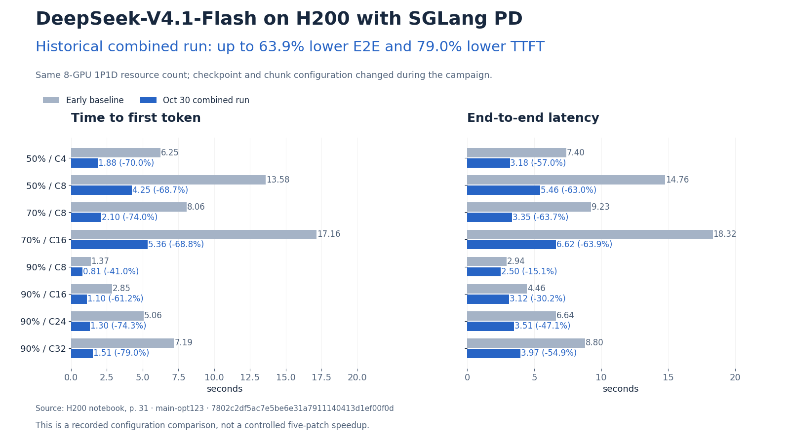

*Figure 0. Historical combined TTFT and E2E results from the author's H200 experiment notebook, §2.8, October 30. Both configurations use the same reported cache-hit label and concurrency in each row. The early baseline and combined configuration use the same eight-GPU resource count, with checkpoint and chunk changes during the campaign.*

## Background: Find the Bottleneck in the PD Pipeline

The [DeepSeek-V4.1 day-0 post](/blog/2026-09-10-deepseek-v41/) describes the model's shared compressed KV, shared Indexer candidates, and sliding-window attention. Here we focus on the H200 serving path and the engineering work needed to make those features useful under Prefill/Decode disaggregation.

The deployment separates prompt processing from token generation. The Prefill worker uses TP4 / CP4 / EP4; the Decode worker uses TP4 / DP4 / EP4. TP shards tensor computation, CP partitions the prompt computation, EP distributes experts, and DP supplies independent attention replicas on the Decode side. These parallel dimensions share the four GPUs assigned to each worker.

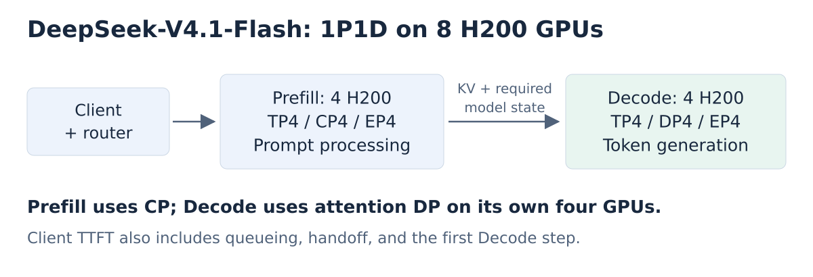

*Figure 1. The measured 1P1D topology. The handoff includes the KV and model state required to continue generation. Client-visible TTFT includes queueing and handoff costs as well as Prefill computation.*

The notebook first identified a supply problem on the P side. Requests accumulated in the Prefill queue even at modest concurrency, while the Decode worker's available cache capacity did not explain the queueing. We therefore concentrated on reducing Prefill service time before considering a different P/D ratio.

The evaluated H200 configuration uses the Torch BF16 Prefill Indexer scoring path. Its bottlenecks differ from the Blackwell path that uses DeepGEMM for the relevant Indexer operations. A representative early profile attributed **209.47 ms, or 39.06% of the reported per-forward breakdown, to the Indexer**. MoE computation and NCCL each accounted for approximately another 18%.

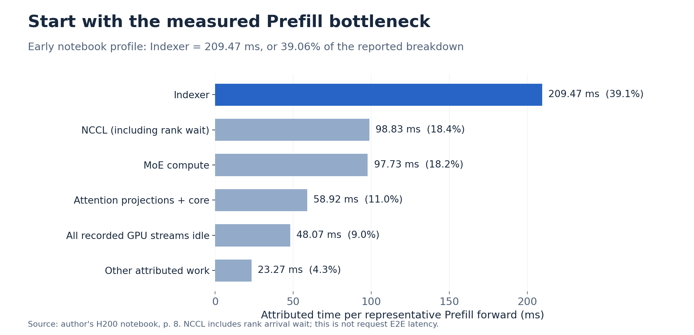

*Figure 2. Redrawn from the H200 notebook, §2.3–2.4. This is a representative Prefill profile, separate from request E2E latency. NCCL attribution includes waiting for other ranks. The Attention category combines the reported projection and core-attention categories; the smaller remaining compute categories are grouped together.*

### Measurement Setup

We developed the optimizations in this article on top of our earlier [PR #40323](https://github.com/sgl-project/sglang/pull/40323).

The PRs describe a workload with nominal **65,536-token inputs and 512-token outputs**, using reported cache-hit labels of **50%, 70%, and 90%**. The corresponding concurrency levels are 4 and 8; 8 and 16; and 8, 16, 24, and 32, respectively. The labels are retained as reported; they do not specify the exact number of cached tokens in every request.

PRs #45794, #47406, #46003, and #45807 report means of three runs, with 512 requests and 10 warmup requests per run. #47247 provides a serving-results screenshot and additional trace samples, but its description does not specify the same repetition protocol. The initial Indexer experiments explicitly disable Prefill BCG. The bounded-replay compatibility path discussed below also uses eager CP Prefill.

In the benchmark screenshots, TTFT and E2E latency are in milliseconds; TPOT is in milliseconds per output token. We calculate reductions from the displayed absolute values as `(baseline − optimized) / baseline`. These calculated reductions can differ slightly from the percentages printed in the original screenshots.

The following sections examine the five initial optimizations and a subsequent investigation of larger Prefill chunks and Decode graph metadata. Each experiment uses its reported baseline; the figures do not represent successive optimizations applied to a single configuration. Later experiments changed checkpoints and chunk sizes, and complete revision records for the benchmarks are not available for every table. The chunk-size comparison in Section 6 comes from §2.5 of the H200 experiment notebook.

## 1. Align the BF16 Prefill Indexer Score Width

[PR #45794](https://github.com/sgl-project/sglang/pull/45794) addresses a surprising observation: nearby Indexer score widths could have very different GEMM costs. The notebook's cross-rank trace showed much faster execution at a 64-aligned width than at neighboring unaligned widths. Almost identical dimensions and similar strides still resulted in different kernel behavior.

The scoring operation takes query rows across heads and compares them with the request's visible compressed keys. Its large intermediate has shape `[query_rows, heads, visible_keys]`. Padding the physical key extent can improve the GEMM shape even though it adds a small amount of arithmetic.

For CUDA BF16 keys with at least 1,024 visible positions, the patch pads the dequantized key tensor to `ceil(visible_keys / 64) × 64`. It does this once per request and reuses that tensor across query chunks. Scores are sliced back to the logical extent before causal masking and top-k selection. The chunk-size calculation uses the padded width, keeping the existing intermediate-memory budget intact.

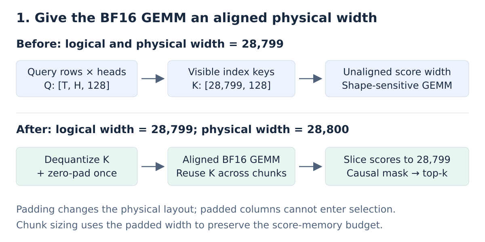

*Figure 3. Physical padding improves the GEMM shape while selection still operates on the original logical positions. Padded columns never become eligible candidates.*

The PR's scoring microbenchmark includes the epilogue and the padding cost:

| Query rows | Logical score width | Baseline | Aligned | Reduction |
| ---: | ---: | ---: | ---: | ---: |
| 582 | 28,799 | 4.113 ms | 2.462 ms | 40.1% |
| 292 | 57,343 | 4.088 ms | 2.472 ms | 39.5% |
| 582 | 28,800 | 2.443 ms | 2.445 ms | Approximately unchanged |

The patch also reconstructs rank-local request-row mappings when CP supplies no explicit `req_rows`. Both the baseline and optimized runs include that mapping fix, isolating the score-width change in this experiment.

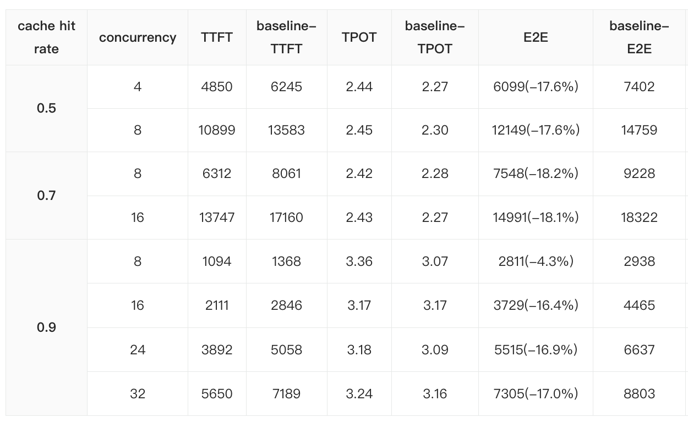

*Figure 4. Original [PR #45794 performance screenshot](https://github.com/sgl-project/sglang/pull/45794). Optimized values appear before their baseline columns; all latency values are milliseconds, and TPOT is milliseconds per token.*

Across the eight displayed cases, TTFT falls by **19.8%–25.8%** and E2E latency by **4.3%–18.2%**. At the 70% cache-hit label and concurrency 16, TTFT changes from **17,160 to 13,747 ms**, while E2E changes from **18,322 to 14,991 ms**. The smaller E2E gain in the 90%/concurrency-8 case illustrates why a scoring-kernel improvement should be checked against the entire request path.

## 2. Enable Bounded Replay with CP and DSpark

[PR #47406](https://github.com/sgl-project/sglang/pull/47406) enables an existing model-level optimization for a previously unsupported combination of execution modes.

DeepSeek-V4.1's final compressed-KV source is layer 20. Later layers reuse that compressed history and maintain their own sliding-window state. Decoder-side bounded replay processes the full prompt chunk through layers 0–20, then executes layers 21–39 on at most the last 128 tokens per request. The option is enabled on the **Prefill worker**, despite its decoder-side name: it reduces the work performed by late model layers during Prefill.

With CP and DSpark auxiliary-state capture, the model returns compact tail outputs. The eager CP runner previously gathered them with the original full-chunk layout. For a single 16,384-token chunk at CP4, that layout expects 4,096 local rows; a 128-token tail supplies only 32 rows per rank. The output tensor and the gather metadata therefore describe different token sets.

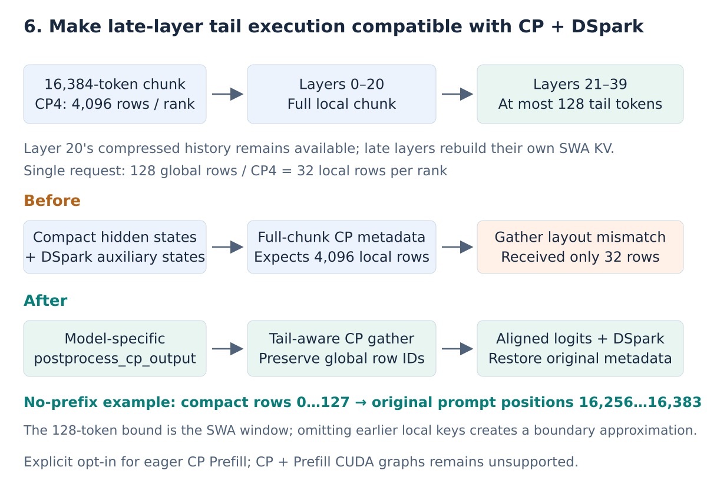

*Figure 5. The compatibility fix preserves compact hidden states, DSpark auxiliary states, and their original global token indices. The illustrated 32-row local tail is a single-request example; mixed requests require their own tail metadata.*

The patch adds a model-specific `postprocess_cp_output` hook. DeepSeek's hook gathers hidden and auxiliary states using tail-specific CP metadata, aligns logits and DSpark consumers with the original global token indices, and restores the original batch metadata in a `finally` block. The ordinary forward path and the eager CP path share this output postprocessing.

This allows bounded replay to be explicitly enabled for eager CP Prefill. The default CP policy is unchanged, and the combination of CP, bounded replay, and Prefill CUDA graphs remains unsupported.

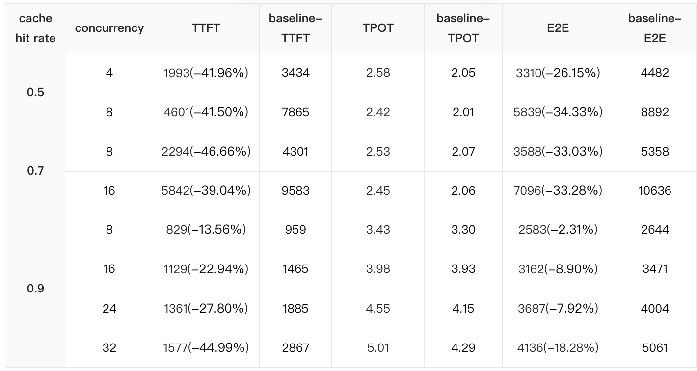

*Figure 6. Original [PR #47406 performance screenshot](https://github.com/sgl-project/sglang/pull/47406). This comparison has a later baseline than the first Indexer experiment.*

The reported TTFT reduction ranges from **13.6% to 46.7%**. At the 70% label and concurrency 8, TTFT drops from **4,301 to 2,294 ms** and E2E from **5,358 to 3,588 ms**. The largest E2E reduction is **34.3%**, at the 50% label and concurrency 8.

The table also records TPOT increasing from **2.07 to 2.53 ms/token** in the 70%/concurrency-8 case. Prefill gains therefore do not imply faster token generation. The available measurements do not isolate the cause of this TPOT change.

Bounded replay changes the late-layer computation and can change hidden states at the reconstructed window boundary. Its effect on output quality requires separate evaluation. The PR reports four-rank validation of token mappings and metadata restoration, nine full-model functional requests, and a 32-question GSM8K smoke test. That small quality probe does not establish broad long-context accuracy parity.

## 3. Use Reduce-Scatter for Contiguous CP MoE Outputs

Once the largest Indexer costs were reduced, the notebook's next profiling pass shifted attention toward MoE and collectives. [PR #47247](https://github.com/sgl-project/sglang/pull/47247) examines the ownership of the MoE output rows.

On the supported contiguous CP path, the original implementation first all-reduced the full expert output. Every rank received all reduced rows, then selected its CP shard and made it contiguous. When TP=CP=4 and both span the same GPU group, each rank ultimately needs only one quarter of those rows.

Reduce-scatter expresses that requirement directly: reduce the full input contributions and return only the rows owned by the receiving rank. The optimization removes full-result replication and the subsequent local output slicing/copying step.

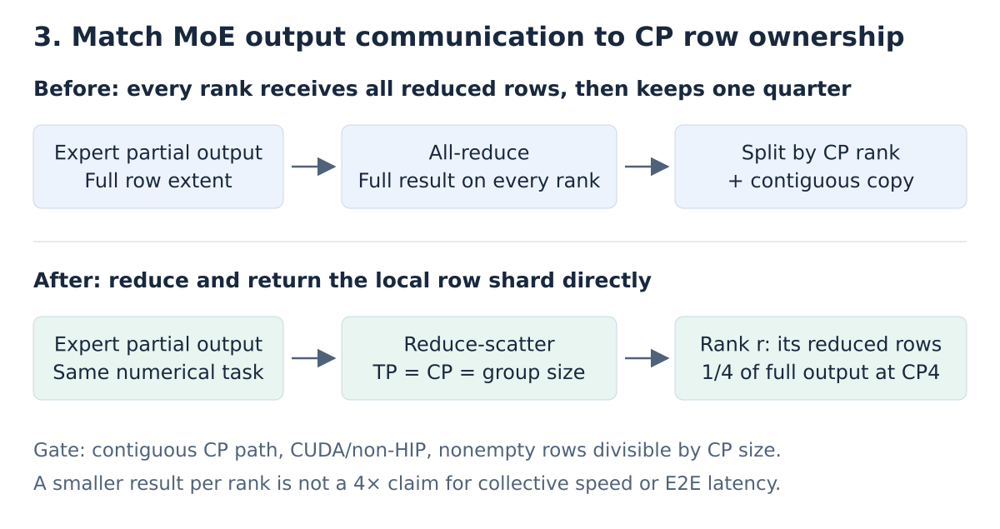

*Figure 7. The change targets contiguous CP output transport with no MoE all-to-all backend. The interleaved CP path already uses a separate reduce-scatter implementation.*

The gate requires CUDA/non-HIP tensors, matching TP/CP/group sizes, and a nonzero row count divisible by CP size. Other configurations retain the original fallback. The quarter-sized output at CP4 describes ownership, not a fourfold collective speedup.

In matched profiled steps with a BF16 input of shape `[16240, 5120]` and 40 MoE output collectives per rank, the total duration of the communication kernels decreased by **15.4%–25.7%**, depending on the rank. Across nearby sampled steps, the mean per-rank reduction was **19.4%–21.7%**. The mean GPU time per forward pass, measured using the slowest rank for each step, decreased from **606.244 to 595.320 ms**, a reduction of approximately **1.8%**.

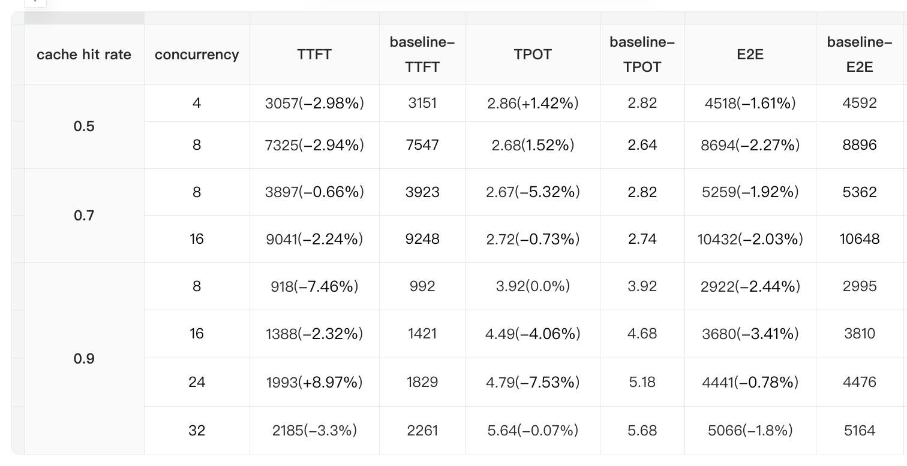

*Figure 8. Original [PR #47247 performance screenshot](https://github.com/sgl-project/sglang/pull/47247). Percentages discussed here are recalculated from the displayed absolute values.*

The serving table shows **0.8%–3.4% lower E2E latency**. At the 90% label and concurrency 24, TPOT improves from **5.18 to 4.79 ms/token**, but TTFT increases from **1,829 to 1,993 ms**. E2E therefore improves by only **0.8%**, from **4,476 to 4,441 ms**.

The notebook records substantial run-to-run variation and identifies expert imbalance as a hypothesis for further investigation. A shorter local communication segment does not guarantee a proportional reduction in the slowest rank's execution time or request queueing delay. The PR also reports a changed BF16 reduction order and GSM8K scores of 1,274/1,319 versus baseline runs at 1,275–1,279/1,319; model-level accuracy parity remains unresolved.

## 4. Score Only Candidate Positions in Indexer Consumers

[PR #46003](https://github.com/sgl-project/sglang/pull/46003) removes work outside the consumer's selection domain.

DeepSeek-V4.1 shares candidate blocks across Indexer source layers. A publisher produces candidate block IDs; later consumers select their final top-k only within those published blocks. The original Torch consumer still scored every visible key before gathering candidate scores. Positions that could never be selected consumed GEMM work and intermediate memory bandwidth.

The patch moves the restriction before scoring. A Triton kernel uses the block IDs to load the corresponding keys directly, producing a compact per-head score tensor of width `C` rather than the full visible width `L`. ReLU, head weighting, and head reduction retain the reference operations. Causal and invalid-candidate masking operate on compact scores before top-k.

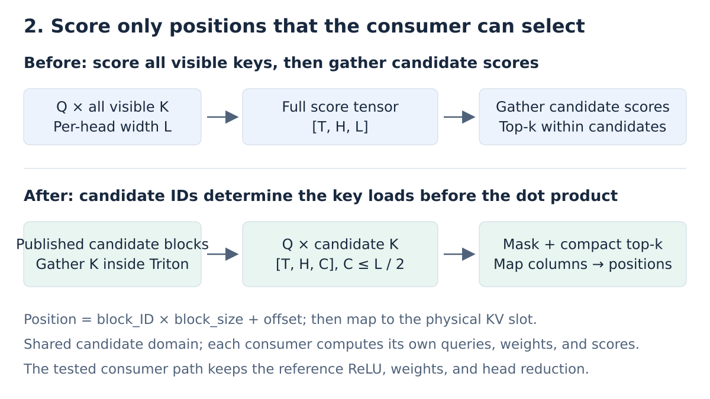

*Figure 9. Candidate filtering moves ahead of the dot product. The publisher, candidate budget, and consumer selection domain remain unchanged.*

Selected compact columns must then be translated back correctly. Each pick identifies a candidate block and an offset within that block; `block_id × block_size + offset` reconstructs the request-local key position, which is then mapped to the physical KV slot. An index in the compact score array is not itself a KV-cache address.

The optimized path requires CUDA BF16 operands, a head dimension of 128, at most 64 heads, and **a candidate width no greater than half the visible key length**. Wider candidate sets use the original path. This avoids paying the indirect-load cost when candidate restriction removes too little scoring work.

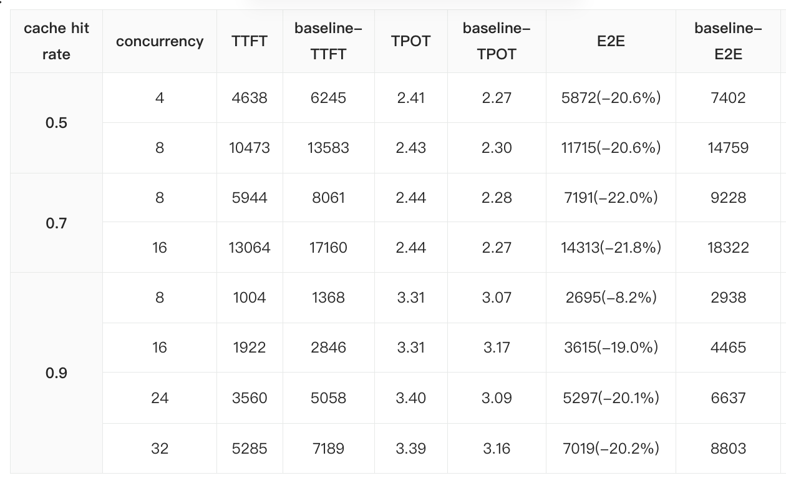

*Figure 10. Original [PR #46003 performance screenshot](https://github.com/sgl-project/sglang/pull/46003). It reports the configuration associated with candidate-only scoring; it should not be interpreted as the next cumulative step after Figures 6 and 8.*

The displayed TTFT reductions are **22.9%–32.5%**, with **8.3%–22.1% lower E2E latency**. At the 70% label and concurrency 8, TTFT changes from **8,061 to 5,944 ms** and E2E from **9,228 to 7,191 ms**. At the 90% label and concurrency 16, TTFT changes from **2,846 to 1,922 ms**, a **32.5%** reduction.

The local validation reported exact score/top-k agreement for tested model-style FP4 inputs and matching Indexer/KV-slot writeback in the integration cases. The attached 1,319-question GSM8K result is **96.74%**, with zero request errors. Those checks support the tested path; they are separate from a complete long-context quality evaluation.

## 5. Fuse the BF16 Indexer Score Epilogue

[PR #45807](https://github.com/sgl-project/sglang/pull/45807) keeps the existing score GEMM and reduces the work that follows it.

The original sequence materializes the large BF16 per-head scores, applies ReLU, multiplies by head weights, reduces across heads, and converts the result to FP32. Separate elementwise operations repeatedly read and write `[query_rows, heads, context]` tensors. The notebook attributed approximately **104.8 ms per representative forward** to the multiplication, clamp/ReLU, and reduction operations, making this a substantial target after inspecting the GEMM itself.

The patch replaces that epilogue with one Triton kernel for the supported 32-head CUDA BF16 path. The GEMM's per-head output still exists; the later full-sized intermediates disappear.

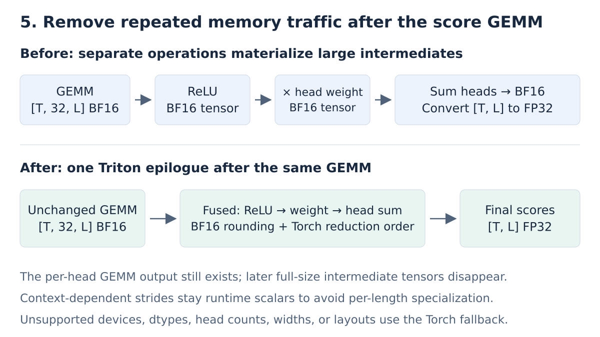

*Figure 11. Fusion removes intermediate memory traffic and launches after GEMM. It preserves the numerical effects of the reference operations.*

Numerical behavior matters because top-k consumes these scores. The kernel preserves BF16 rounding after multiplication and reduction and uses four interleaved accumulators to reproduce the tested Torch/CUDA 32-head accumulation order. Keeping the same mathematical formula while changing these rounding points can change selection near a score boundary.

Context-dependent row and head strides remain runtime arguments, avoiding a separate kernel specialization for each context-dependent stride. The implementation uses the Torch fallback for unsupported devices, dtypes, head counts, widths, and layouts. In particular, width-one and head-contiguous reduction layouts require their own fallback because the reference reduction order differs.

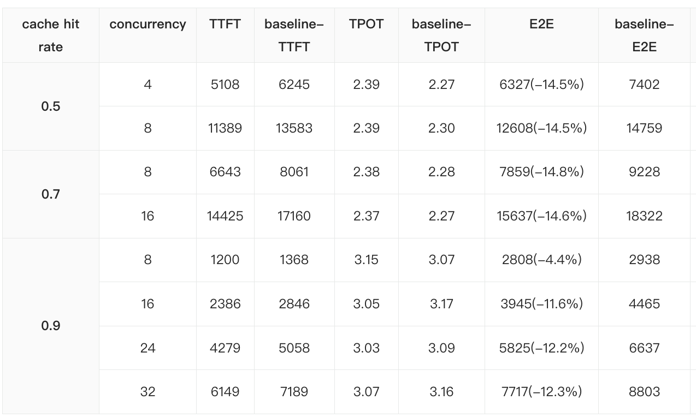

*Figure 12. Original [PR #45807 performance screenshot](https://github.com/sgl-project/sglang/pull/45807). The fused epilogue comparison retains the existing GEMM.*

Across the displayed cases, TTFT falls by **12.3%–18.2%** and E2E by **4.4%–14.8%**. At the 70% label and concurrency 8, E2E changes from **9,228 to 7,859 ms**. At the 90% label and concurrency 16, TPOT also decreases from **3.17 to 3.05 ms/token**, but TPOT does not improve in every case.

The PR reports exact agreement in its local scoring, rounding-boundary, and integration checks, and GSM8K at **96.59%**, compared with baseline runs at **96.74% and 96.36%**. The current patch includes dedicated CPU fallback and CUDA parity tests. Local exactness checks apply to the tested numerical path, rather than establishing bitwise identity of complete generated responses.

## 6. Larger Prefill Chunks and Decode Graph Metadata

Section 2.5 of the notebook, “Larger Prefill Chunks,” examines another source of Prefill overhead. With an 8,192-token chunk, a long uncached suffix requires several Prefill forward passes and scheduling rounds. Increasing the chunk to 16,384 tokens lets each forward pass process more of that suffix and reduces the number of rounds. This targets scheduling and chunk boundaries alongside the kernel work optimized above.

The same investigation exposed a Decode-side CUDA graph metadata problem: reading CUDA sequence lengths back to the host with `.tolist()` during capture could fail and force the metadata path to run eagerly. This work was tracked in [PR #46777](https://github.com/sgl-project/sglang/pull/46777).

The merged PR prevents the draft metadata glue graph from running when a backend requires host sequence lengths and removes an unused `seq_lens.sum().item()` read during Decode graph capture. Its description notes that the original host-read fixes landed separately in #46891 and #46897. Under the current DSpark configuration, the host-length guard is defensive because `needs_cpu_seq_lens` is already false. The table below reports the notebook's chunk-size experiment; it does not isolate the performance impact of the guard.

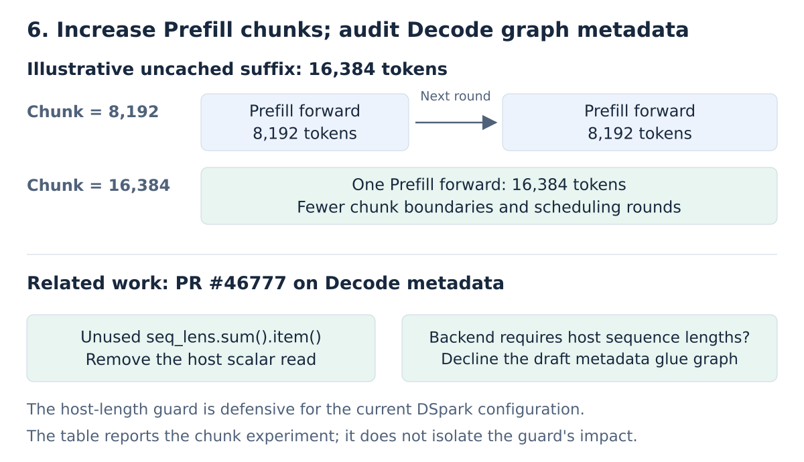

*Figure 13. An illustrative 16,384-token uncached suffix requires two 8,192-token chunks or one 16,384-token chunk. The Decode metadata work tracked in [PR #46777](https://github.com/sgl-project/sglang/pull/46777) addresses graph-capture constraints separately from the choice of Prefill chunk size.*

### Data Summary: 8,192 → 16,384 Prefill Tokens

The following table reproduces the eight selected cases from §2.5, measured after the earlier checkpoint was restored. Each arrow shows the reported baseline followed by the result with 16,384-token chunks. TTFT and E2E are in milliseconds; TPOT is in milliseconds per output token. We calculate the change in E2E latency as `(16K result / baseline − 1) × 100%`, so a negative value means lower latency.

| Cache-hit label | Concurrency | TTFT, baseline → 16K (ms) | TPOT, baseline → 16K (ms/token) | E2E, baseline → 16K (ms) | E2E change |
| --- | ---: | ---: | ---: | ---: | ---: |
| 50% | 4 | 3,693 → 3,434 | 2.59 → 2.05 | 5,017 → 4,482 | −10.7% |
| 50% | 8 | 8,697 → 7,865 | 2.54 → 2.01 | 9,997 → 8,892 | −11.1% |
| 70% | 8 | 4,718 → 4,301 | 2.59 → 2.07 | 6,042 → 5,358 | −11.3% |
| 70% | 16 | 10,706 → 9,583 | 2.62 → 2.06 | 12,044 → 10,636 | −11.7% |
| 90% | 8 | 962 → 959 | 3.32 → 3.30 | 2,660 → 2,644 | −0.6% |
| 90% | 16 | 1,527 → 1,465 | 3.66 → 3.93 | 3,396 → 3,471 | +2.2% |
| 90% | 24 | 2,744 → 1,885 | 3.49 → 4.15 | 4,529 → 4,004 | −11.6% |
| 90% | 32 | 4,065 → 2,867 | 3.81 → 4.29 | 6,011 → 5,061 | −15.8% |

TTFT falls in every displayed case, with the largest reduction of **31.3%** at the 90% label and concurrency 24. E2E improves in **seven of eight cases**, with the largest reduction of **15.8%** at the 90% label and concurrency 32. At the 50% and 70% labels, TPOT also decreases by approximately **20.1%–21.4%**.

At the 90% label and concurrency 16, however, TTFT improves by **4.1%** while TPOT increases by **7.4%**. The generation-side increase outweighs the input-side gain, and E2E rises from **3,396 to 3,471 ms**, a **2.2% regression**. TPOT also rises at concurrency 24 and 32, although their larger TTFT reductions still produce lower E2E latency.

Controlling for the checkpoint was important here. Earlier trials in the notebook showed lower speculative acceptance lengths after a checkpoint update. Restoring the earlier checkpoint helped distinguish that change from the effects of larger chunks and the Decode metadata modifications. The selected table summarizes the experiment using the earlier checkpoint; it does not isolate each runtime patch's contribution.

## Performance Results: Separate PR Comparisons from the Combined Run

The first five changes act at different levels: tensor shape, late-layer token extent, collective output ownership, candidate scoring domain, and memory traffic. Their benefits overlap and their reported baselines differ. The chunk-size experiment above is reported separately because it also involves configuration and graph-metadata work.

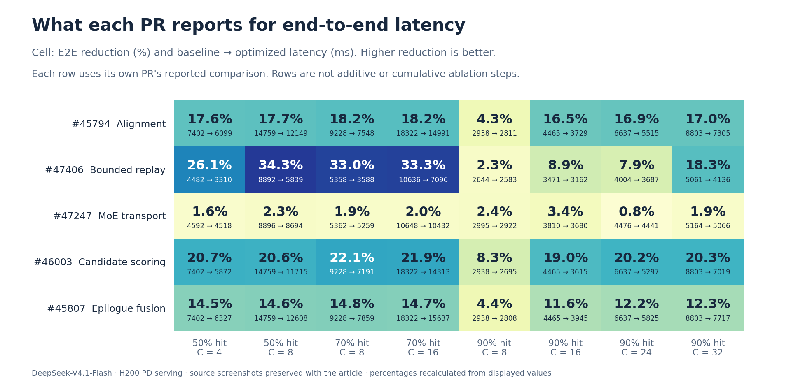

*Figure 14. Redrawn from the five initial PR screenshots in the same order as Sections 1–5. Each cell shows the reduction and baseline → optimized E2E latency in milliseconds. Each row retains its source comparison. The row percentages cannot be added or multiplied to infer a combined result.*

The following table compares the historical combined configuration with the early baseline:

| Cache-hit label / concurrency | TTFT, baseline → combined (ms) | TPOT, baseline → combined (ms/token) | E2E, baseline → combined (ms) | E2E reduction |
| --- | ---: | ---: | ---: | ---: |
| 50% / 4 | 6,245 → 1,876 | 2.27 → 2.56 | 7,402 → 3,182 | 57.0% |
| 50% / 8 | 13,583 → 4,249 | 2.30 → 2.36 | 14,759 → 5,457 | 63.0% |
| 70% / 8 | 8,061 → 2,097 | 2.28 → 2.46 | 9,228 → 3,352 | 63.7% |
| 70% / 16 | 17,160 → 5,359 | 2.27 → 2.47 | 18,322 → 6,623 | 63.9% |
| 90% / 8 | 1,368 → 807 | 3.07 → 3.30 | 2,938 → 2,495 | 15.1% |
| 90% / 16 | 2,846 → 1,104 | 3.17 → 3.94 | 4,465 → 3,115 | 30.2% |
| 90% / 24 | 5,058 → 1,302 | 3.09 → 4.32 | 6,637 → 3,511 | 47.1% |
| 90% / 32 | 7,189 → 1,512 | 3.16 → 4.80 | 8,803 → 3,967 | 54.9% |

The highest E2E reduction is **63.9%** at the 70% label and concurrency 16, with a **baseline/combined latency ratio of 2.77** for that recorded case. The largest TTFT reduction is **79.0%** at the 90% label and concurrency 32. These maxima occur in different cases. They do not establish a throughput increase or a joint tail-latency SLA.

## Appendix: Evidence and PR Links

At the time of writing, the foundational [PR #40323](https://github.com/sgl-project/sglang/pull/40323), #45794, and [#46777](https://github.com/sgl-project/sglang/pull/46777) are merged; #47406, #47247, #46003, and #45807 are open. The inspected PR head revisions are:

- [#45794: 9a8995ba0064ace674b9186404194268273ec575](https://github.com/BJWang-ant/sglang/commit/9a8995ba0064ace674b9186404194268273ec575)
- [#47406: f274754cb12fdefba511c05137257410df00dea5](https://github.com/BJWang-ant/sglang/commit/f274754cb12fdefba511c05137257410df00dea5)
- [#47247: f065f3d1747afacdca9982208e3d2e952dd08f09](https://github.com/BJWang-ant/sglang/commit/f065f3d1747afacdca9982208e3d2e952dd08f09)
- [#46003: 772a4a1c754c9c85edfec8aabef9b9edee460545](https://github.com/BJWang-ant/sglang/commit/772a4a1c754c9c85edfec8aabef9b9edee460545)
- [#45807: 619d461d452445dbeb171d4f6f9a9e788513e40e](https://github.com/BJWang-ant/sglang/commit/619d461d452445dbeb171d4f6f9a9e788513e40e)
- [#46777: 70e5eccaf1e70045654074d175bcc7680051267a](https://github.com/BJWang-ant/sglang/commit/70e5eccaf1e70045654074d175bcc7680051267a)

These revisions identify the code inspected for this article. They do not indicate that every attached benchmark was rerun at the current PR head. In particular, #45807's description still requests renewed performance and accuracy validation after rebasing. The combined commit is transcribed from the notebook and could not be resolved in the public fork when checked. The notebook also lacks a complete manifest of baseline revisions, weight fingerprints, launch commands, and repeated-run artifacts for an independently reproducible campaign comparison.

The article's vector diagrams and redrawn performance figures can be regenerated with `python3 scripts/gen-deepseek-v41-h200-pd-figures.py` in this website repository, using Matplotlib and NumPy. The original PR screenshots are preserved alongside them. No GPU benchmark or model-quality evaluation was rerun while preparing this article.

