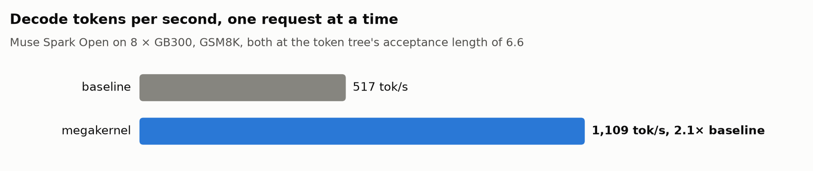
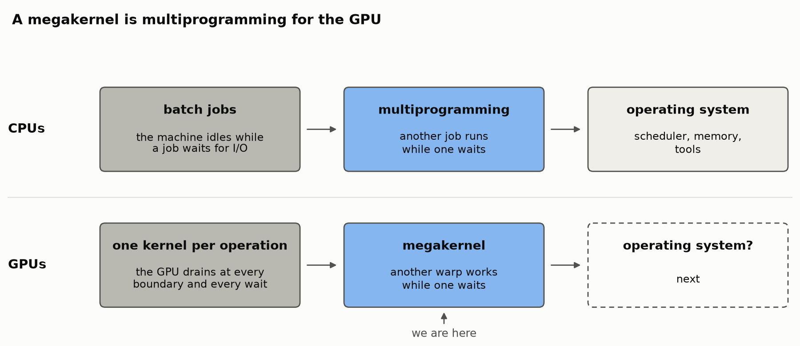
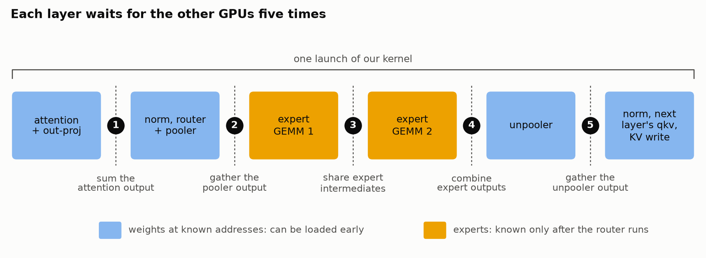
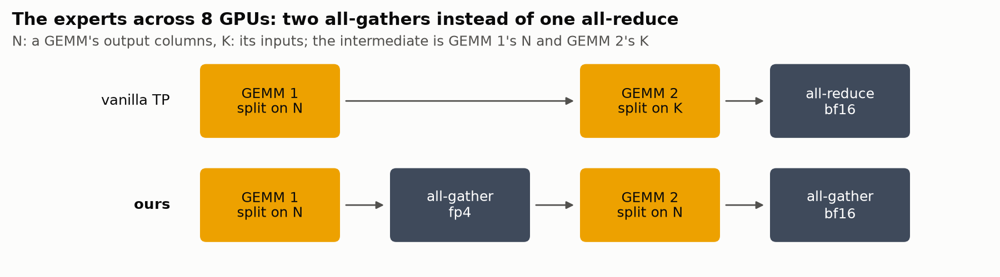
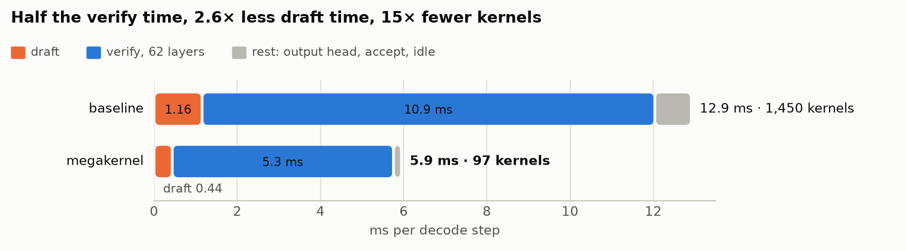
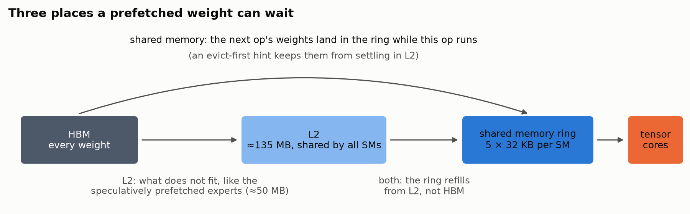
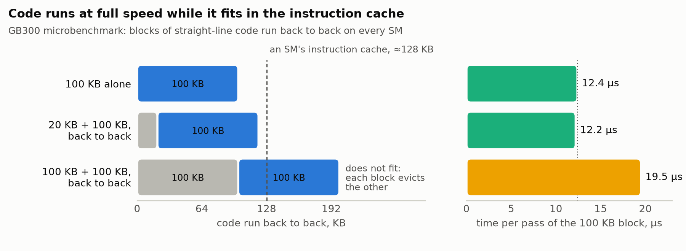
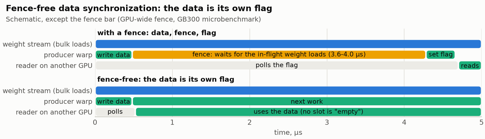
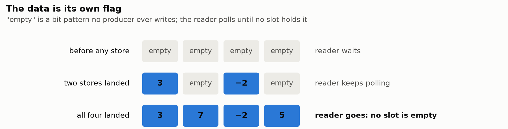
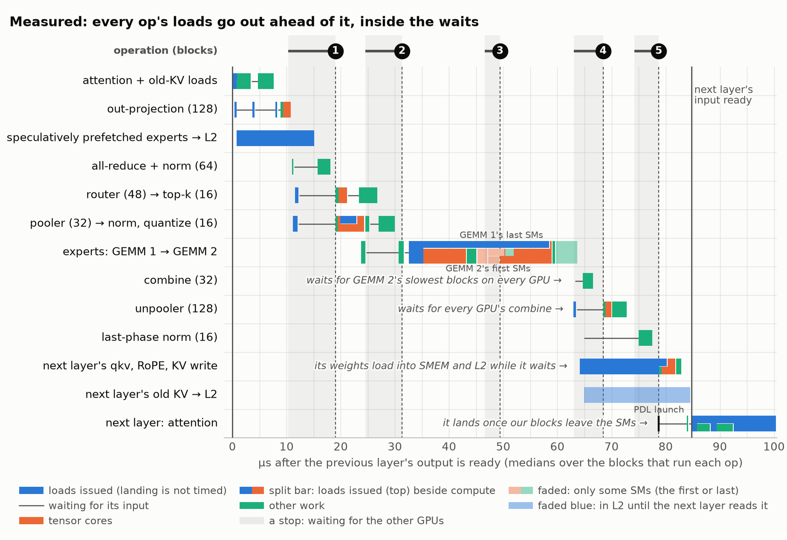

In this post, we explain why SGLang (and ML infra in general) is moving towards larger GPU kernels, called **megakernels**, and what makes one different from a normal kernel. We built one for [Muse Spark Open](https://www.lmsys.org/blog/2026-10-15-meta-muse-spark-open), from scratch in CUDA C++ and PTX, and it takes decoding **517 → 1,109 tok/s** on Blackwell GPUs.

The goal is to keep every part of the GPU busy. Even with speculative decoding, our baseline serves only 517 tok/s. Our megakernel achieves 1,109 tok/s by running each layer (attention + MoE) as one kernel, with extreme latency hiding so every memory load overlaps other work.



*Muse Spark Open on eight GB300s. GSM8K*


**Contents**

- [First, what is a megakernel?](#first-what-is-a-megakernel)
- [The model](#the-model)
    - [A new tensor parallelism](#a-new-tensor-parallelism)
- [Megakernel](#megakernel)
    - [One launch per layer](#one-launch-per-layer)
    - [Twelve warps, different roles](#twelve-warps-different-roles)
    - [Performance](#performance)
- [Speculative decoding](#speculative-decoding)
- [Megakernel internals](#megakernel-internals)
    - [1. Prefetch weights in all caches](#1-prefetch-weights-in-all-caches)
    - [2. Instruction cache - The curse of big kernels!](#2-instruction-cache---the-curse-of-big-kernels)
    - [3. Many ways to synchronize threads](#3-many-ways-to-synchronize-threads)
    - [4. Faster drafting](#4-faster-drafting)
- [Profiling](#profiling)
    - [Perfect overlap](#perfect-overlap)
- [What's upcoming](#whats-upcoming)
    - [Larger batches](#larger-batches)
    - [Toward an operating system for the GPU](#toward-an-operating-system-for-the-gpu)

## First, what is a megakernel?

**A normal GPU kernel does one thing.** It runs one operation, a matrix multiplication or an attention pass, as a grid of identical thread blocks running on different cores (SMs). A serving engine runs a model as a chain of such kernels: SGLang launches about 1,450 of them for each decoding step of Muse Spark Open. If not optimized correctly, the GPU drains and refills between two consecutive kernels. In this time, many SMs can stay idle. And when we look inside an SM, many threads/warps may be idle as well. In order to achieve full memory bandwidth, we will have to *fully* utilize all parts of our GPU as well. This demands that we design our hardware-native algorithms for finer-grained overlap than traditional ML frameworks typically allow.

**CPUs had this problem in the 1960s.** Early machines ran *batch jobs*: one job owned the machine, and while it waited for a tape or a disk, the processor sat idle. *Multiprogramming* fixed that by keeping several jobs in memory at once and running another one whenever the current one waited for I/O. Operating systems grew from there to natively support multiprogramming - making it faster and more accessible.



*Figure 1. Evolution of CPU programming, and where GPU is*

**A megakernel is multithreading/multiprogramming for the GPU.** A megakernel solves this with one single kernel that stays resident on every SM and runs many different jobs at once: some warps can run ahead working on next operations before the previous operation has fully finished. The GPU has many engines that can work at the same time, among them the tensor cores, the bulk-copy engine (TMA), the load units and NVLink, and a megakernel's job is to keep them all busy. It already has the first pieces of an operating system:

| operating system | megakernel |
|:---|:---|
| a process | one kernel, holding all GPU resources until it's done |
| threads | warps, each handed a job for each phase; no preemption |
| waiting for I/O | busy-waiting for data to be written |
| DMA | TMA bulk copies, tracked by mbarrier |
| messages between processes | plain stores into another GPU's memory over NVLink |
| a profiler | the kernel records its own timestamps |

## The model

Muse Spark Open is a traditional MoE model where every token is routed to 8 of 256 experts. Experts are stored in 4-bit NVFP4 (some layers are bf16). It has 62 decoder layers: 46 use sliding-window attention over the last 2,048 tokens and 16 use global attention. Additionally, we have pooler and unpooler blocks. *Pooler* is a projection that shrinks each token's vector before the experts, and the *unpooler* restores it afterwards. We split the model over eight GPUs with tensor parallelism (TP8), so each GPU holds a slice of every layer.



*Figure 2. One decoder layer on eight GPUs, and what one launch of our kernel covers: from this layer's attention to the next layer's qkv projection and KV write. At each numbered stop, every GPU waits for data from all the others.*

Each stop lasts until the slowest GPU arrives. Even when we perfectly distribute work, GPUs can lag from each other by up to 4 µs.

### A new tensor parallelism



There is an extra communication step here between the MoE GEMMs, that's not found in vanilla TP implementations. EP is a standard way of running inference, but number of experts activated on GPUs can differ vastly due to imbalance. The weights of both MoE GEMMs are sharded on the N dimension, leading to an all-gather after each GEMM. This is an extra step of communication, compared to vanilla TP which shards both GEMMs on intermediate-dim, leading to one all-reduce

Despite an extra communication step, this design has less communication volume than vanilla TP, and scales better to larger batch sizes. It can also be implemented bitwise same as EP to match training numerics.

## Megakernel

### One launch per layer

The code is at [facebookresearch/sgl-muse-mega](https://github.com/facebookresearch/sgl-muse-mega). Each launch of our kernel runs from one layer's attention through the next layer's qkv projection and KV write, the bracket in Figure 2. It is also the best place to start: most of what attention reads, the KV history, was written in earlier steps and depends on nothing, so a new launch can start loading it the moment it lands, before the previous layer's output is ready.

Naturally, the first and last layers have slightly different ops. One kernel puts one thread block of twelve warps on each of 144 SMs (they launch in clusters of four, and utilize distributed shared memory for lower latency reduction where applicable). Inside a kernel, each warp does its own synchronization for the data its waiting on, and keeps working. Later, we also explain why we stopped at one kernel per layer and didn't go for the full model megakernel.

### Twelve warps, different roles

| warps | attention | dense GEMMs | expert GEMM | all-reduce, all-gathers |
|:---|:---|:---|:---|:---|
| 0 | KV load | weight load | weight load | next op weight load |
| 1 | KV load | activation load | tensor cores | |
| 2 | tensor cores | tensor cores | scale factors | |
| 3 | instruction-cache warm | | send | |
| 4-7 | attention, merge | epilogue, send | SwiGLU | receive, sum / norm |
| 8-11 | attention, merge | | SwiGLU | receive, sum / norm |

*Attention as in the global layers' tensor-core path; in the sliding-window layers, warps 4-11 load their own KV. Dense GEMMs are the out-projection, pooler, router, unpooler and next layer's qkv.*

### Performance



*Medians of 20 steps of one GSM8K request at TP8.*

## Speculative decoding

Muse Spark Open uses DFlash V2 as the draft. In each step the draft guesses the next 15 tokens in one pass, and the big model checks all of them in one pass over 16 tokens. We also verify a tree of tokens generated from draft model, instead of a linear chain which is slightly better.

Xiaomi [crossed 1,000 tokens per second](https://mimo.mi.com/docs/en-US/news/latest/1000tps) with [MiMo-V2.5-Pro](https://huggingface.co/XiaomiMiMo/MiMo-V2.5-Pro) by verifying 8 tokens per step and accepting 6.3 of them on average. We verify 16 and accept 6.6. Sixteen tokens cost more to verify, since they activate more experts, but we found it more practical to reach this acceptance length with 16 tokens than with 8.

| | tokens verified per step | acceptance length |
|:---|---:|---:|
| MiMo-V2.5-Pro (Xiaomi) | 8 | 6.3 |
| Muse Spark Open (ours) | 16 | 6.6 |

## Megakernel internals

Our code spans 8000 lines of CUDA + PTX for the big model. We go over some critical ideas we found during development.

### 1. Prefetch weights in all caches

Weights never depend on the previous layer. Warp 0 is free to read weights of next operation while the current operation still finishes. This is key to ensuring we get high memory bandwidth usage - always having in flight memory loads. We have some choices where to put these weights: Shared memory, L2 cache or both!



#### Shared memory

Once warp 0 finishes loading current operation weights, it can sit idle for the time rest of the warps consume those weights. During this time, we can start loading next operation weights - for example, a quarter of *o_proj* weights get loaded into shared memory while attention is still running!

#### Into L2, for what does not fit

Another option is to load those weights in L2 cache instead. The two differ a lot in size: the ring holds 5 × 32 KB of weights per SM, about 23 MB across the GPU, while GB300's L2 holds about 135 MB. But anything in L2 still needs a second, much shorter trip into shared memory, and L2 is shared with everything else in flight. They also stack. Near the end of a layer, the ring already holds the first of the next layer's qkv weights, but the qkv projection cannot start until the layer's final norm produces its input. So just before warp 1 waits for the norm, it asks L2 for the rest of the qkv weights, and when the norm lands, the ring refills from L2 instead of HBM. The weight streams themselves load with an evict-first cache hint, so they pass through L2 without pushing out what has to stay.

#### Speculative expert prefetching

Not all experts are loaded, so it is not possible to prefetch them before the router runs. Experts are most of the bytes we load, so loading more experts can be costly. But consecutive steps tend to route alike, as work on expert offloading has observed. So while attention runs, warp 3 looks up which experts this layer used on the previous step and pulls this GPU's slices of the 14 most-used ones into L2, about 50 MB per GPU. The moment the router's tables land, each block also prefetches its first expert tile into L2 beside reading the table, and the experts already in L2 go first in the expert GEMM's list of tiles, so the blocks that get a second tile reach it sooner. A wrong guess costs some bandwidth, but the GPU is idle anyway and this saves around 0.2 ms out of 5.3 ms of step time.

### 2. Instruction cache - The curse of big kernels!

Bigger kernels are not always better. There is an interesting overhead as the kernels get bigger.
We did a simple experiment, stitch code of two kernels back to back without any extra synchronization and see if we resulting perf is indeed sum of the two.

It is not. We wrote two 100 KB blocks of straight-line code. Run on its own, over and over, each block takes 12.4 µs; stitched back to back, each took 19.5 µs, 14 µs more than the sum for every pair.

Our first suspect was **register spills**. `ptxas` is often unable to optimally reuse registers in different parts of code, leading to register spills and slowdowns. There is no easy way around this - but manually rewriting parts of code and hope compiler likes one version over other. But in this case, we found no register spills - the root cause was something entirely else - Instruction Cache!



*Figure 3. Per-pass medians on GB300, every SM running the same blocks. While the two blocks fit in the instruction cache together, the 100 KB block runs at its solo speed.*

#### Size matters
We found that shrinking one block to 20 KB, and the 100 KB block runs at its solo speed again. An SM caches only about 128 KB of instructions, so two 100 KB blocks keep evicting each other, and every pass fetches its code again.

Our kernels are far bigger than that cache: 215-314 KB of machine code each, because each one holds every phase of a layer. A GPU fetches instructions through the same L2 cache as data, and a launch brings only the first 32-64 KB of a kernel's code close to the SMs. Everything past the window is fetched line by line on first use: cheaply if it is still in L2, slowly if it has to come from memory. And L2 keeps only part of our code between launches. Left alone, a sliding-window kernel lost about a tenth of its code from L2 between one run and the next; the global-attention kernel, which runs only about every fourth layer, lost more than half. The main culprit was our own expert prefetch, the one stream that has to stay in L2. With nothing protecting the code, the prefetch was a net loss: switching it off made steps faster.

#### First, run less code

In a small kernel, unrolling a loop is free; in ours, every unrolled copy is more code past the window. So loops that carry no per-element register state stay rolled. A rolled loop issues the same copies and waits in the same order, so the output is bit-identical, and the code shrinks by ~50KB if we unroll some loops.

#### Then, read our own code as data, every launch

At the start of every launch, one warp in a few blocks reads one word from every 128-byte line of the kernel's code, which pulls the whole kernel into L2. A cache hint asks L2 to keep each line ahead of the data around it:

```cpp
// simplified version of code warming logic
for (unsigned line = lane; line < code.bytes / 128; line += 32)
    sink ^= load_evict_last(code.base + line * 128);   // one word per 128-byte line
```

The readers are one warp scattered in a handful of SMs. Each reads all of the code; splitting it among them is slower because [GB300's two dies](https://cudaforfun.substack.com/i/210641900/the-l2-is-actually-two-caches) each keep their own copy in L2. We warm every launch, not once per step, because the code does not survive even one step in L2.

#### Dry-run the code that has to be fast

For some latency bound cases, L2 is still too far away from the SM. Some short stretches of code sit right on the critical path: a few warps wait for data and then have to finish fast. These warps run their loop twice: first as a *dry pass* while the data is still landing, with the same instructions and loads but none of the waits or outputs, then for real, from the SM's instruction cache. GEMM 1's epilogue, the combine of the expert outputs and the norm at the end of each layer all start this way. We would rather prefetch exactly those instructions, but we have little control over how `ptxas` lays out the machine code, or which parts of the source end up next to each other. A dry pass touches exactly the lines the real pass will run.

```cpp
// simplified: the norm at the end of a layer, on the warps that wait for its row
#pragma unroll 1                        // one copy of the code, run twice: unrolled, the dry pass would warm a copy
for (int pass = 0; pass < 2; ++pass) {  //   the real pass never runs
    const bool dry = pass == 0;
    if (!dry) wait_until_ready(row);    // the dry pass runs while the row is still landing
    float4 x = load(row, lane);         // the same loads and math on both passes
    float4 y = rms_norm(x, weight);
    if (!dry) { store(out, y); publish(out_ready); }  // only the real pass writes and signals
}
```

In a handful of cases, this saves us 0.5-1 µs per such operation.

### 3. Many ways to synchronize threads

A megakernel spends much of its life waiting for data that another thread, on the same or another GPU, is still producing. Let's look at different ways of synchronizing data dependencies across threads:


#### Inside a SM: mbarriers

An mbarrier is a hardware counter in shared memory. A TMA copy reports its bytes to it as they land, a warp waiting on it is suspended by the hardware instead of spinning, and the four blocks of a cluster can signal each other's mbarriers through distributed shared memory. Our shared memory loads and the hand-offs inside a SM all run on mbarriers.

#### Everywhere else: busy waiting

For data written by threads on other SMs on the same GPU, or by another GPU over NVLink, there is nothing in hardware to wait on: no interrupt, no wait-on-an-address. A warp has to poll, loading a flag again and again until it changes, and every poll costs something. In our microbenchmarks, one GPU-scope acquire poll takes 141-145 ns, a one-way flag between two GPUs in the same node takes about 1.9 µs, and while its SM streams weights, a poll's loads queue behind the bulk copies for 1.0-2.6 µs. A spinning warp also takes issue slots and memory requests from the warps doing useful work. Busy waiting is not ideal, but it is all the hardware gives us.

#### Memory Fences

The textbook hand-off between GPUs is: write the data, issue a [memory fence](https://en.cppreference.com/cpp/atomic/memory_order), then set a flag; the reader polls the flag, then reads the data. On GB300, every system-scope release we tried (`fence.release.sys`, `fence.acq_rel.sys` or a `st.release.sys` flag) compiles to the same heavyweight barrier, `MEMBAR.ALL.SYS`. Even the narrower GPU-wide fence took 0.4 µs on an idle SM but 3.6-4.0 µs while the SM had bulk (TMA) loads in flight, because it waits for those loads to land. That is our situation all the time: the expert GEMMs send their results to the other GPUs tile by tile while the same SM is still loading that GEMM's weights, and each of those fences took about 3.6 µs, on both expert exchanges (stops 3 and 4), in every layer.



#### Fence-free: make the data its own flag

Fill the receiving buffer with a value that means "empty" and that no producer ever writes. The producer stores its data straight into the reader's buffer, with no fence and no flag, and the reader polls until no slot is empty. This is the trick behind the Lamport-style all-reduce of TensorRT-LLM and FlashInfer, and we use it for every cross-GPU handoff inside a layer. In the bf16 gathers, "empty" is all bits set (`FFFF`), a NaN that rounding never produces:



Each kind of data picks its own "empty": the all-reduce, for example, uses +0 and writes a real +0 as −0, which has different bits but the same value.

Reusing a buffer still needs a fence, but only one per layer, off the critical path. The expert exchanges' buffers have two copies that alternate from layer to layer: the idle copy is reset to "empty" while the other is in use. The remaining handoffs' slots are reset by their reader right after use.

### 4. Faster drafting
The draft model got **2.6× faster**, from 1.16 ms per step to mere 440 us, by fusing aggressively. SGLang runs the draft as 175 kernels. Using a similar megakernel stack, we run each of the draft's five layers as one launch, like the verify layers: its attention, projections, MLP and allreduces. With this, we have 8 launches instead of 175. Moreover, we put both draft and verify model in the same CUDA graph, eliminating any host overhead and running everything on GPUs!

## Profiling

To Nsight Systems or the PyTorch profiler, our kernel is one long bar per layer, so it times itself. At the start and end of every job, lane 0 of the warp reads the GPU's nanosecond clock and stores it in a slot of its own: one plain store, no atomics, no synchronization.

```cpp
// storing timestamps of different events in stamp array
__device__ __forceinline__ uint64_t now() {
    uint64_t t;
    asm volatile("mov.u64 %0, %%globaltimer;" : "=l"(t) :: "memory");
    return t;
}
#define STAMP(event) if (lane_id() == 0) stamps[blockIdx.x * 256 + (event)] = now()

STAMP(kGemmBegin);
expert_gemm(...);
STAMP(kGemmEnd);
```

**Stamping costs 2.8%.** The stamps add about 2.5 µs per layer launch, 2.8% of a step, and leave the outputs bit-identical; a build flag compiles them out.

### Perfect overlap

Figure 4 shows our megakernel, one row per op. Everything starts as soon as some thread can run it



*Figure 4. Our sliding-window layer, op by op, in our benchmark at a 4,096-token context. Each bar is the median over the blocks that run that op (their count in brackets when not all 144 do), the 45 sliding-window layers with NVFP4 experts, 19 replays of one verify pass and two GPUs, with the synthetic routing set to the 49 experts per layer we measured on GSM8K. Blue marks when loads are issued, not when they land. Faded bars mark an op on only some blocks: GEMM 1 out to its slowest tenth, GEMM 2 from its earliest tenth; faded blue, the next layer's old KV waiting in L2 until its attention reads it.*

- **Loads go out early.** Attention starts loading old KV rows before the layer's input arrives. Beside it, the likely experts stream into L2 from 0.7 to 15 µs, through about half of stop 1, and the router and the pooler issue their weights about 7 µs before stop 1's data arrives. Around stop 4, the unpooler's weights, the first of the next layer's qkv weights and its old KV rows go out.
- **GEMM 2 starts before GEMM 1 ends.** Blocks that finish GEMM 1 early issue their first GEMM 2 weight tile at about 45 µs, before stop 3's data arrives, so the expert weights stream in one block from GEMM 1 into GEMM 2. The earliest tenth of the blocks start GEMM 2 at 47 µs, while the slowest tenth still run GEMM 1's tensor cores until 50 µs.
- **Gaps after GEMM 2 and the combine.** Blocks finish GEMM 2 anywhere between 55 and 64 µs (10th to 90th percentile), and the combine waits for GEMM 2's outputs from every GPU, so it starts at 65; the unpooler then waits for every GPU's combine. From GEMM 2 to the end of the layer, the timestamps show a block with no work for about 12.5 µs on average, almost half of all its idle time. That chain is where we are looking next.
- **The next layer's attention cannot start sooner.** PDL launches the next layer at 79 µs, about 4 µs before our first block exits, but its blocks land only once ours leave their SMs, at 84 µs, so launching it earlier would start nothing sooner. Instead, we prefetch its old KV rows into L2 at 65 µs, where they wait for its attention.


## What's upcoming

### Larger batches

Today, megakernel supports only batch size one with speculative decoding. We will extend the megakernel to larger batches next. Larger batches make the problem easier: with more tokens in flight, some of the previous op's outputs are ready while the rest are still arriving, so warps can start on those right away instead of waiting at every stop. At one request every wait is exposed; with more, there is almost always ready work.

### Toward an operating system for the GPU

Our megakernel is still a crude operating system: like IBM's OS/360 MFT, "multiprogramming with a fixed number of tasks", it hands every warp a fixed job for each phase, chosen at compile time. The general form is a virtual machine on the GPU: code for each op written per warp, every handoff tracked by counters, and a scheduler that gives any ready piece of work to whichever warp is free. [Flapping Airplanes](https://alphasignal.ai/news/flapping-airplanes-raises-1b-to-collapse-entire-ai-training-into-one-gpu-kernel) describes such a machine: a virtual machine "that takes control of the GPU and schedules different workloads across it", with whole training runs inside one kernel. Much of what that needs is already in our kernel: per-warp code for every op, counters for the handoffs inside a GPU, and data that is its own flag across GPUs. The step left is to decide at run time, not compile time, which warp runs what.

However, at extreme low-latency settings (one request), no single overlap strategy works everywhere. Whether a weight goes into shared memory, into L2 or both, how far ahead it goes and with which cache hint: we decided each op on its own, by trying several versions and keeping what measured fastest. A general scheduler has to leave room for those per-op choices, and coding agents already excel at exploring this search space.
