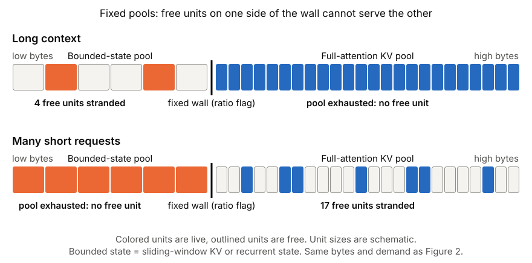
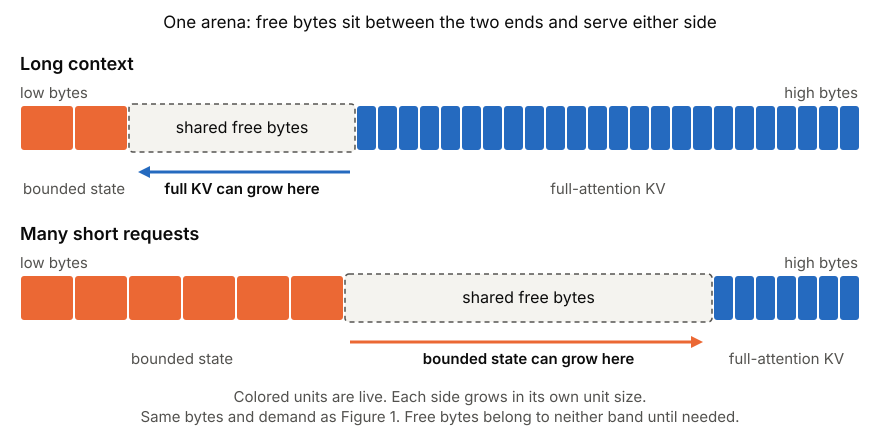
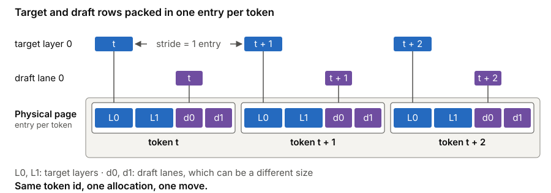
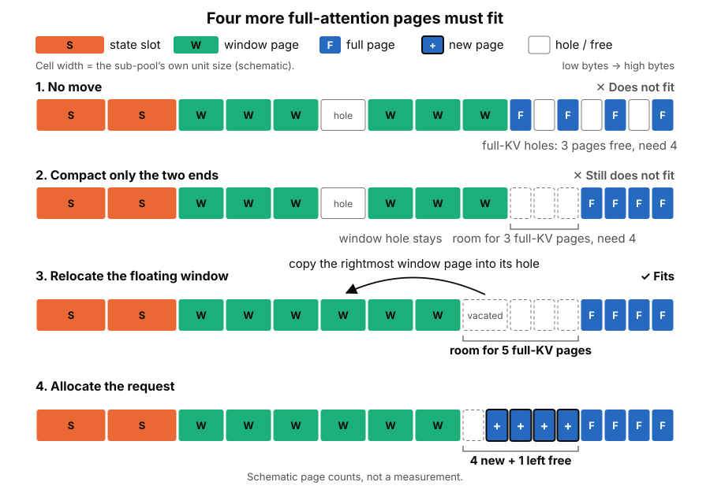
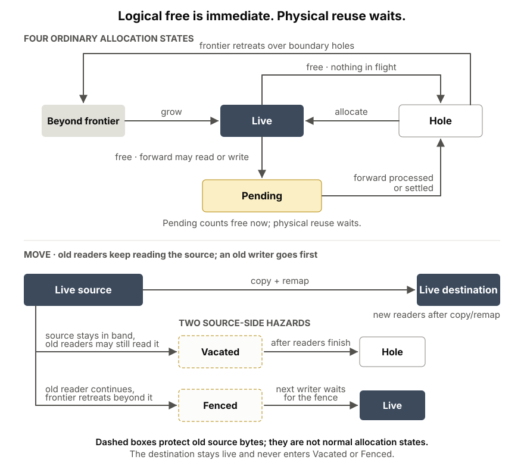

**TL;DR.**

- **One less knob.** Hybrid models make you decide at startup how much memory each kind of state gets (full-attention KV, sliding-window KV, recurrent state), before you know the traffic. With `--enable-unified-memory` they share one arena and capacity follows demand, so there is no split to tune.
- **Any page size, zero fragmentation.** Memory is handed out in whole pages, so a page freed by one request can be reused in full by the next, and nothing is lost to fragmentation. Each kind of state keeps its own page or slot size, and you can choose any `--page-size`. If free bytes end up where the wrong kind of state cannot use them, compaction moves them over.
- **A new KV layout: one entry per token.** Each token's rows for every layer sit together in one entry, so allocation, free and whole-page moves act on all layers at once. Rows of different shapes and dtypes can share an entry, so a speculative draft's KV, even in a different dtype from the target's, is fused into the target's entry and allocated, freed and moved with it.
- **One memory system, end to end.** We built the whole stack around the arena: one allocator for every kind of state, one demand model that answers every capacity question, from request admission to decode-node preallocation in prefill–decode disaggregation, and a page lifecycle that keeps old bytes safe while pages move under the overlap scheduler.
- **It works with the main serving features:** the overlap scheduler, Radix cache, HiCache, prefill–decode (PD) disaggregation, speculative decoding, pipeline parallelism, decode context parallelism and data-parallel attention.

## Hybrid models and the memory split

Attention layers need their past to compute the next token, but not every layer remembers it the same way:

| State | What is retained | What drives its memory demand |
|---|---|---|
| Full-attention KV | The whole context | Sequence length, across every full-attention layer |
| Sliding-window KV | A bounded suffix of the context | Sequence length up to the window, across the window layers |
| Recurrent state | A fixed-size state per running request | Concurrency, not context length |

GPT-OSS and Muse Spark interleave full and sliding-window attention. Qwen3.5 interleaves full attention with linear-attention layers. Kimi K3 pairs linear attention with MLA.

Their demands do not scale together. A long-context workload grows full-attention KV; many short concurrent requests need more window KV and state slots even though each request's history is small. The pressure can shift within one request, too: its state slots are taken when it starts, while its full-attention KV keeps growing.

SGLang's default design gives each kind of state its own pool, a *sub-pool*, and fixes their sizes at startup through `--swa-full-tokens-ratio` and `--mamba-full-memory-ratio`. The right ratio depends on traffic you do not know yet. A long-context workload can exhaust the full-attention pool while much of the pool for the bounded states (window KV and recurrent state) sits idle, and many short requests do the reverse. The free bytes exist, but the other pool is not allowed to use them. Choosing the ratio well means profiling your workload, and when the traffic changes, memory is stranded behind the earlier guess.

In this post a *unit* is a sub-pool's allocation unit: a page of KV, or a slot of recurrent state. Each sub-pool has its own unit size, set by its layers.



*Figure 1. Each pool hands out units wherever its free list points, so live data may be scattered through it. Two workloads strand free units in opposite pools. “Bounded” can be sliding-window KV or recurrent state; orange units are drawn wider because each sub-pool has its own unit size.*

Unified memory replaces the partition with one arena. Full KV takes the high end and grows down; bounded state takes the low end and grows up. Lazy compaction moves live data toward those two ends, so the free bytes form one region in the middle that belongs to no sub-pool until one of them needs it, and each side takes bytes from it in its own unit size. The ratio flags remain only as boot-sizing targets, not walls at run time. Nothing is lost to fragmentation: memory is handed out in whole pages, so a page freed by one request can be reused in full by the next, and compaction only moves free bytes to the sub-pool that needs them.



*Figure 2. The same bytes and demand, now in one arena. Live data is compacted toward the two ends, leaving one free region that either side can grow into.*

## A new KV layout: one entry per token

Separate pools keep one buffer per layer. Unified memory instead packs every layer's rows for one token (or one state slot) into a single *entry*, and a page is a run of entries. An allocation, eviction or whole-page move therefore acts on all layers at once, and a layer's view strides over the entries.

Because the arena is a byte region, entry size is each sub-pool's own: a state slot holds every state layer's conv and temporal state, a KV entry holds every layer's K and V. Token sub-pools allocate in pages of whatever `--page-size` you choose and the state sub-pool in single slots, so no kind of state is forced onto another's page size.

Every group of rows in an entry carries its own shape and dtype: a state entry keeps conv and temporal state in their own dtypes, and a fused draft's rows keep theirs next to the target's K and V. This is what lets a compatible speculative-decoding draft place its KV in additional lanes inside the target's entries. The draft's rows can differ from the target's in size and in dtype, which is why rows are packed per token instead of one same-sized pool per layer. Target and draft share a token id, and one allocation, free or whole-page move carries both.



*Figure 3. Target rows and draft lanes can differ in size, so each token's rows are packed into one entry. Per-layer views (here layer 0 and draft lane 0) stride over those entries, and one token id covers both.*

## One arena, different allocation geometries

Putting two tensors in one device buffer is easy. Making their capacities fungible is harder. A full-attention page and a recurrent-state slot can differ greatly in size, and neither should have to round its demand up to the other's allocation unit.

An arena is therefore a byte region, not a uniform array of identical pages: pages and slots share the same bytes without sharing a geometry.

A sub-pool occupies a contiguous *band* of the arena. The two end bands grow inward: bounded state grows up from the low end, and full KV grows down from the high end. When another sub-pool sits between them, it is a *floating* band that can move to open a useful gap. Live bands never overlap one another's storage. Growing, shrinking, compacting and relocating these bands changes who can use the free bytes, not where a request's data is addressed.

### Composing all three state types

The same composition works when a model has all three kinds of state, as Inkling does: full attention, sliding-window attention and a per-request convolution state. The planner creates a full-KV sub-pool, a window sub-pool and a state sub-pool, each with its own lifetime and allocation unit.

Their bands own disjoint bytes. The allocator grows and rearranges them with the same demand and layout rules used for two kinds; there is no special full + Mamba + SWA allocator. This is an example of composition, not a third memory model.

### Request-scoped state

An arena-backed state entry can carry more than the usual recurrent tensors. For example, the per-request ring buffers that linear-attention ReplaySSM (GDN and KDA) keeps for replaying recurrent state, in both speculative and ordinary decode, are additional payloads in the state entry. They share its allocation and movement model rather than requiring a separate pool.

That is the larger direction of the design: model and request state can be declared and managed by one memory system instead of one allocator per feature.

## Admission: can the whole request fit?

Sharing bytes does not reduce a request's footprint to a number of full-attention tokens. Consider a 32K-token request to a model that also has a 4K-token sliding window. With 64-token pages, its steady-state footprint is 512 full-KV pages and 64 window pages. A recurrent-state model would instead include a state slot for the running request. A window may temporarily retain rows beyond its steady-state bound until retirement or a later recurrent checkpoint, so the allocator prices the joint demand it must actually support, not an idealized final footprint.

The same demand calculation serves the memory clip that bounds how much a request may generate, prefill admission and continued commitment across chunks, and PD decode preallocation. It includes page rounding and an expected decode allowance, using a conservative bound where the exact peak is unknown.

Even the right total demand is not enough: the arena must have a layout that can supply it. Each band has *holes* (free pages inside it) and a *frontier* (the outer edge up to which it has handed out pages). A host-side snapshot of these drives a search over three levels of rearrangement:

1. **No move:** reuse holes and extend a band in place.
2. **Compact the ends:** pack the two end bands to release their holes.
3. **Relayout:** also relocate floating bands between the compacted ends.

Figure 4 makes this distinction concrete. The state band is the low end, full KV is the high end, and the window floats between them. The full-KV band has three one-page holes but no free space at its frontier, so three holes cannot serve a four-page demand. Compacting the full-KV end turns those holes into a three-page gap beside the window, still one page short; the window's own hole stays, because compacting the ends does not touch a floating band. Relayout moves the floating band's inner edge: it copies pages from that edge into the band's own holes, so the edge retreats and the freed bytes join the gap. Here one window page, drawn two full pages wide, moves into the window's hole, leaving room for five full-KV pages; four serve the demand and one stays free. The ladder uses only as much movement as the demand needs.



*Figure 4. Three reusable holes cannot serve a four-page demand, and compacting the ends leaves the full-KV band one page short. Copying the floating window's rightmost page into its hole frees room for five pages beside the full-KV band: four allocated and one left.*

This example also separates **feasibility** from **realization**. Feasibility asks whether some layout can serve the demand. It considers every page movable: a pending page can settle and a transfer can eventually finish. Realization first tries the current layout, then finds a concrete plan that keeps fixed pages in place and avoids active network transfers where possible. A positive feasibility answer is a promise that the allocator can realize the demand, not a decision to block on every unfinished reader or transfer.

The same rule extends beyond one device. With pipeline parallelism, the stages exchange their arena geometry when the pipeline loop starts. Each then simulates every stage from the same logical request counts and admits only a demand that fits all of them, without a capacity exchange per decision.

## Keeping pages safe during in-flight work

Moving bytes would be simple if no device work were still using them. Request tables hold virtual ids rather than physical page numbers; a sub-pool maps each virtual id to its current physical page. A move copies the bytes and redirects that mapping. The next iteration translates the virtual ids into physical pages, so request rows do not need to be rewritten.

The difficult part is time. SGLang's overlap scheduler prepares step N+1 on a schedule stream while step N's forward is still running. There are three cases to keep safe:

1. **Free with an old reader.** A request finishes, but an already-launched forward still reads its KV. The free is logical and immediate: the page counts toward capacity at once. Its physical bytes cannot be overwritten until that forward is processed or settled (the stream waits for its event).
2. **Move with an old reader.** The move need not wait. The allocator copies and remaps the page; new forwards resolve the virtual id to the destination after the copy, while an already-launched reader can keep reading the old source. Only reuse or overwrite of that source must wait for its old readers.
3. **Move with an old writer.** The writer must be ordered before the copy. Otherwise the destination could contain stale data, and the old writer could corrupt the source's next owner. An opportunistic move avoids such a source; a needed move waits first.

The rule is: **logical free is immediate; physical reuse waits.** A freed page under an unprocessed forward becomes pending whether that forward may still read it, write it, or both. It becomes an ordinary hole only after the forward is processed or its event is waited on. There is no separate read-only fast path for an ordinary free.

| State or protection | What it means | When the bytes can be reused or written |
|---|---|---|
| Beyond frontier | Bytes outside every band | A band grows over them |
| Hole | A reusable free page inside a band | Immediately available to a new writer |
| Live | Holds a request's data | Freed or moved |
| Pending | Logically freed while a forward may still read or write it | The forward is processed or settled |
| Vacated (source protection) | A moved source whose old readers may still read it | Its old readers finish |
| Fenced (source protection) | Old bytes beyond a retreating frontier, with an outstanding read | The next writer first waits for the fence |

That is four states plus two protections. A move leaves its destination live through the remap, and new readers consume it only after the copy is ordered before them. The old source remains protected against premature reuse. Vacated and Fenced are source-side protections, not states of the destination.



*Figure 5. A logical free counts toward capacity immediately; physical reuse waits for unfinished work. Moving a page creates a live destination and protects the old source bytes.*

The memory system orders movement and reuse against unfinished work, using logical progress to keep distributed ranks consistent. Focused tests and a seeded stress harness exercise these rules with modeled and real CUDA work.

## What it works with today

Turn it on with one flag; `--mem-fraction-static` and `--max-total-tokens` size the arena as a whole, and `--max-running-requests` still bounds concurrency:

```bash
# NVIDIA CUDA; choose --tp for your GPU count and model.
python3 -m sglang.launch_server \
  --model-path MODEL_PATH \
  --tp 2 \
  --enable-unified-memory
```

`MODEL_PATH` is a Hugging Face repo id or local path of a supported hybrid model. The [usage guide](https://docs.sglang.io/docs/advanced_features/unified_memory) has the current model and backend matrix, and the [design guide](https://docs.sglang.io/docs/advanced_features/unified_memory_design) covers implementation and debugging tools.

Unified memory changes storage and admission, not the rest of the serving stack:

| Feature | How it works with unified memory |
|---|---|
| Overlap scheduler | Supported, and the default; freed pages stay pending until the forwards that may still touch them are processed |
| Radix cache | One prefix-tree slot per sub-pool; cache eviction feeds the joint admission decision |
| HiCache | Host pools mirror each sub-pool, and host copies take part in page ordering |
| PD disaggregation | Mooncake transfers carry whole sub-pool entries, and each in-flight transfer is recorded against the pages it touches |
| Speculative decoding | `--speculative-algorithm` EAGLE, EAGLE3, DFLASH and DSPARK with a linear draft chain; compatible fused drafts use target-entry lanes |
| Pipeline parallelism (PP) | Each stage owns an arena and simulates every stage's capacity from shared logical counts |
| Decode context parallelism (DCP) | MLA models without sliding-window layers, with the backend restrictions in the usage guide |
| Data-parallel attention | Each attention-DP rank has its own arena |

Restrictions: PD requires Mooncake and cannot be combined with PP, speculative decoding or DCP, and HiCache cannot be combined with EAGLE or EAGLE3. The [usage guide](https://docs.sglang.io/docs/advanced_features/unified_memory) lists the full matrix.

## Results

Unified memory is compared with SGLang's separate pools at their default ratios, on one H200 per server with SGLang at `daa171846f`, on Qwen3.5-4B and GPT-OSS-20B, as averages of two runs.

- **No regression at defaults.** On Qwen3.5-4B with 1,024 input and 256 output tokens at concurrency 64, unified memory sustained 5,830 output tokens/s against 5,880 with separate pools, and both scored 0.875 on GSM8K (200 questions).
- **A wrong ratio is expensive.** On GPT-OSS-20B (512 input and 1,536 output tokens, 1,024 concurrent requests), setting `--swa-full-tokens-ratio` to 0.1 lost 12% of throughput against the default (7,910 against 9,030 tokens/s). On Qwen3.5-4B, `--mamba-full-memory-ratio 0.3` capped running requests at 24, where the default allows 51, and lost 14% of throughput.
- **Without a ratio, unified memory fits more requests.** On the same GPT-OSS-20B workload, unified memory ran about 1,000 requests at once where separate pools at the default ratio ran 618, with 14% higher throughput and a time to first token of 6 s instead of 43 s. On Qwen3.5-4B with 16K input and 4,096 output tokens at concurrency 64, it ran 32 requests against 22 and was 26% faster.
- **Fewer retractions, without throttling.** On Qwen3.5-4B with 512 input and 16,384 output tokens at concurrency 51, unified memory retracted about 233 requests per 1,000 completed, against 294 for the default pools. The `--mamba-full-memory-ratio 0.3` pools retracted none, only because they capped running requests at 24, and were 20% slower (3,620 against 4,530 tokens/s).

## Limitations and what comes next

**Unified memory is still an experimental feature.** A longer-term goal is to make it the default memory system, after the remaining model, backend and lifecycle gaps are closed.

It currently targets hybrid models. Full-attention-only models, MLA with sliding-window layers and DeepSeek-V4 are not supported, and other model and backend restrictions, including MPS and MLX, are listed in the usage guide.

- **Priority preemption:** currently disabled under unified memory. Higher-priority requests are admitted first but wait rather than retracting running requests.
- **Window rows with recurrent checkpoints:** admission assumes checkpoints advance. If no tracking or replacement state slot is free, a request can hold more window rows than it was priced for.
- **Startup refusals:** besides the combinations listed above, two-batch overlap, LMCache, int8 Mamba checkpoints and FP4 KV are refused at startup; the usage guide has the full list.
- **Request slots:** `--max-running-requests` still reserves a fixed number of request slots. We want that to follow demand as well, so related request-row state can join the same capacity model.
