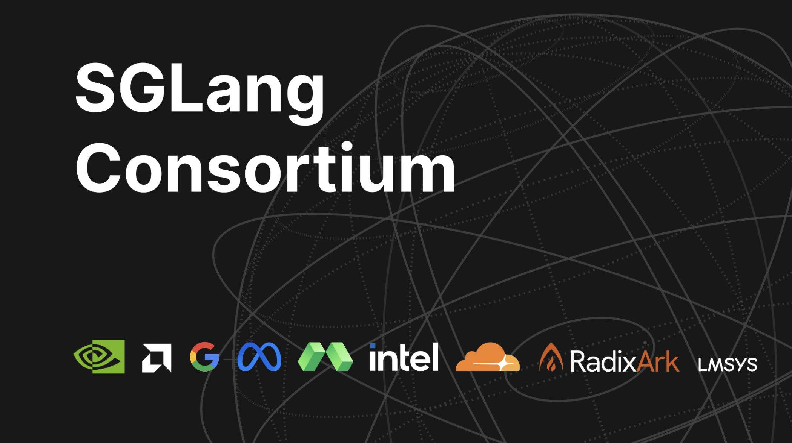

*Hardware, model and infrastructure leaders join SGLang’s maintainers to advance efficient inference for growing AI ecosystem*

**SAN FRANCISCO, November 12, 2026** — [LMSYS Org](https://www.lmsys.org/), the nonprofit behind the open-source AI engine SGLang, today launched the SGLang Consortium with founding members NVIDIA, AMD, Intel, Google, Meta, Cloudflare, Modal and RadixArk, who will work with SGLang’s maintainers to help shape the project’s roadmap and advance open-source AI inference. The consortium was announced in the opening keynote of the inaugural SGLang Summit in San Francisco.

## A shared forum for open AI inference

Inference is expected to account for roughly two-thirds of all AI compute in 2026, up from about half in 2025, according to [Deloitte](https://www.deloitte.com/global/en/insights/industry/technology/technology-media-and-telecom-predictions/2026/compute-power-ai.html). The inference engine determines how fast and cost-effectively that compute runs on each company’s hardware. SGLang, the full-stack inference engine for frontier AI and part of the PyTorch ecosystem, runs on hundreds of thousands of GPUs and powers some of the largest production inference deployments in the world, for companies including Meta, Microsoft, Google, Amazon, Thinking Machines Lab, Cloudflare, Reflection and Modal.

The consortium gives its members a standing forum to discuss emerging inference trends with SGLang’s maintainers and turn shared priorities into joint engineering work, focused on frontier model support, reasoning and multimodal workloads, distributed inference and hardware optimization. Each founding member will designate a technical representative and join two roadmap meetings a year, contributing through engineering expertise, deployment feedback, testing resources or joint development. Working groups may collaborate between meetings, with public updates on roadmap direction and progress. SGLang’s maintainers keep responsibility for technical decisions and code acceptance, and the project stays open to the entire community.

“The teams running SGLang at the largest scale see what inference needs next before anyone else does,” said Ying Sheng, co-author of the original SGLang paper and co-founder and CEO of RadixArk, on behalf of the SGLang team. “With the challenges in building new data centers, software approaches to improve AI efficiency will be incredibly important. These lessons will benefit every SGLang user and advance the AI ecosystem.”

“NVIDIA is proud to be a founding member of the SGLang Consortium and to work with the community to advance open inference software,” said Ian Buck, vice president of hyperscale and high-performance computing at NVIDIA. “Better software helps developers get more performance from NVIDIA compute. Open models enable them to build new applications and businesses. And lower inference costs make AI more accessible to organizations everywhere.”

## Launched at the first SGLang Summit

The consortium was announced in the opening keynote of the inaugural SGLang Summit, the first conference dedicated to SGLang and its open-source community, held November 12–13 at the Fort Mason Center for Arts & Culture in San Francisco. More than 100 speakers from across AI hardware, models, infrastructure and applications are taking part. Sessions cover SGLang’s ecosystem across reinforcement learning, multimodal models and hardware platforms.

Summit details are in LMSYS Org’s [October 28 announcement](https://www.businesswire.com/news/home/20261028934474/en/Next-Gen-AI-Hardware-Infrastructure-Frontier-Models-and-Applications-on-Center-Stage-at-SGLang-Summit).
