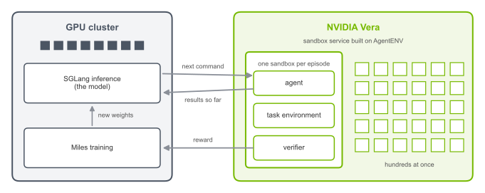
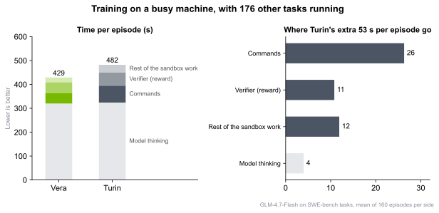
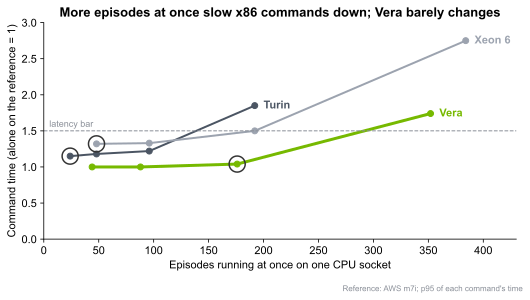
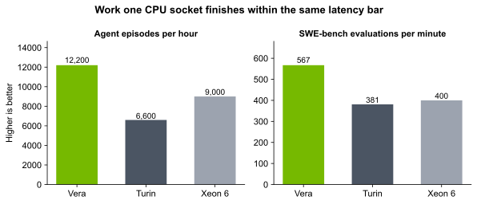
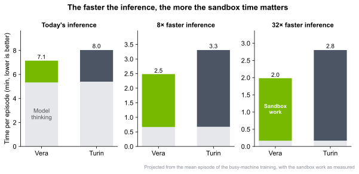
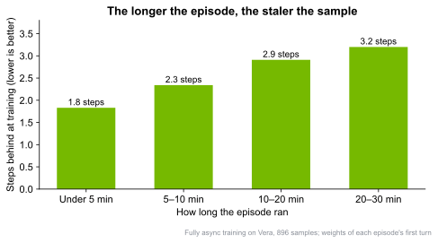

In agentic RL, the model does more than write text: it runs commands in a sandbox, compiles code and runs tests, and decides its next step from the results. A training run can keep hundreds of sandboxes or more open at once, and the CPUs that run them can affect the speed and scale of training.

RadixArk partnered with NVIDIA to run [Miles](https://miles.radixark.com/), our open-source RL post-training framework for LLMs and VLMs, with every sandbox on NVIDIA Vera CPUs. To our knowledge, this is the first public result of end-to-end agentic RL training with its sandboxes on Vera CPU servers. We also compared Vera systematically with the current-generation AMD EPYC Turin and Intel Xeon 6<a href="#note-1">1</a>. The conclusion is clear: **Vera runs sandboxes fast even at full load, and its advantage grows as training gets larger and inference gets faster.**

## End-to-end training with every sandbox on Vera

We built the sandbox service on the open-source [AgentENV](https://github.com/kvcache-ai/AgentENV): each sandbox is a lightweight Firecracker virtual machine, more isolated than a container, and it starts from a snapshot in under 0.1 seconds. During training, inference (served by [SGLang](https://www.sglang.io/)) and training stay on our GPU cluster. Each episode, one attempt by the model at one task, gets a fresh sandbox on Vera. Inside it, an agent coordinates the attempt over dozens of turns. It first sends the task to the model, which decides what to do next and returns a command. The agent runs that command in the sandbox, then sends the output back to the model so it can choose its next action. This loop continues until the attempt is complete. A verifier then runs the task's tests in the same sandbox to score the result, and the reward goes back to training. Because RL learns by comparing many attempts at each task, a training run keeps hundreds of these sandboxes open at once.

Miles works with many agent frameworks and sandbox backends, so moving every sandbox to a different CPU architecture took no change to the training code; all the work was on the environment side. Terminal-Bench and SWE-bench publish only x86 images, so we rebuilt the environments of 530 of their tasks for arm64 and checked each one against its reference solution<a href="#note-2">2</a>.

With Miles, we trained GLM-4.7-Flash on Terminal-Bench and SWE-bench tasks, in both synchronous and fully asynchronous modes: 68 training steps and more than 2,400 episodes, all in sandboxes on Vera. In synchronous training, the GPUs take turns generating episodes and training on them; in fully asynchronous training, generation and training run at the same time on separate GPUs, so dozens of episodes, each with its own sandbox, are always in flight.

The training was also effective: the model improved as it trained. On a task that asks it to build a gRPC service, for example, its pass rate rose from 40% in the first half of training to 82% in the second, as it learned to get the service running<a href="#note-3">3</a>.

## Episodes finish sooner in real RL training

To see what the CPU changes in a real training run, we trained with the sandboxes once on Vera and once on Turin. A production sandbox cluster usually serves several training jobs at once, so we first made the machines busy: each CPU socket kept running 176 other tasks, exactly filling the 176 threads of one Vera socket<a href="#note-4">4</a>, and we trained on top of that. Training used SWE-bench tasks in which the agent runs the tests over and over. With the same model, tasks, GPUs and settings, we trained 5 steps and 160 episodes on each<a href="#note-5">5</a>.

With the sandboxes on Turin, each episode took 12% longer on average, and each of the four tasks took 9%–15% longer. **The model's thinking time was the same on both, so nearly all of the difference came from the work in the sandbox.** Per episode, Turin took 53 seconds longer:

- The agent's commands took 26 seconds longer, 60% more than on Vera; the same test commands, run on both, took 54%–56% longer<a href="#note-6">6</a>.
- The verifier, which reruns the tests to compute the reward, took 11 seconds longer, 24% more than on Vera.
- The rest of the work in the sandbox took 12 seconds longer: the agent itself, which also runs inside the sandbox, and starting the sandbox.
- Waiting for the model took only 4 seconds longer.

## Vera stays fast at full load

Why is the work in the sandbox faster on Vera? Even with only one sandbox running, Vera performs on par with or better than today's x86 processors: depending on the benchmark, the typical command takes 8%–19% longer on Turin and 29%–50% longer on Xeon 6<a href="#note-7">7</a>. The real gap opens at full load. As more episodes run at once, every x86 core slows down, while Vera is barely affected. With 176 episodes running at once on one Vera socket (one per hardware thread), its commands are still faster than on Turin with only 24 episodes, or on Xeon 6 with only 48 (see the circled points). The reason is that with every core busy, each Vera core slows down by only 5%–22% on the Python and compilation work that dominates these agents' commands, while each Turin core slows down by 40%–70%.

To see how much load each CPU can carry, we set a latency bar: 95% of commands must take no more than 1.5 times as long as when they run alone on a reference machine<a href="#note-8">8</a>. This is the dashed line in the first chart of this section. Within this bar, one Vera socket carries 1.3–1.5 times the load of Xeon 6 and 1.4–2.1 times that of Turin<a href="#note-9">9</a>. For RL training that keeps many sandboxes open at once, this means the same number of CPUs supports a larger training run<a href="#note-10">10</a>.

## What this means for RL training

In the training comparison above, SGLang served the model on 8 NVIDIA H200 GPUs, and an average episode spent about 5.3 minutes waiting for the model, plus 1.8 minutes in the sandbox with Vera or 2.6 with Turin. Faster inference would shrink only the model's part. The chart below shrinks the model's part and keeps the sandbox work as measured: with, say, 8 times faster inference, episodes with their sandboxes on Turin would take 33% longer than on Vera, and with 32 times faster inference, 41% longer<a href="#note-11">11</a>. Eight times faster inference is something the latest GPUs and serving techniques may already deliver, and it could become common within months; 32 times could come within two years<a href="#note-12">12</a>. And as training runs grow and pack more episodes onto each CPU, they move toward the full-load case above.

If longer episodes only meant fewer of them finished per hour, running more at once on more servers would make up for it. But in RL, it also matters that each episode finishes sooner, and that pays off in three ways<a href="#note-13">13</a>:

- **Fresher samples**: in fully asynchronous training, the longer an episode runs, the further the weights have moved on by the time the episode is used for training, and the more the training has to correct for it. The chart below shows this in our training on Vera, where episode length varies from task to task: episodes that ran for more than 20 minutes started with weights more than 3 steps behind; those that finished within 5 minutes were less than 2 steps behind. Running more episodes at once also speeds training up, but makes the samples staler; shorter episodes speed it up without that cost: with episodes 11% shorter on Vera, training could run up to 12% faster at the same staleness<a href="#note-14">14</a>.
- **Less GPU memory sitting idle**: while an episode waits for a command's result, its KV cache keeps holding GPU memory. In the training comparison above, with the sandboxes on Turin, this idle KV cache was nearly 50% larger than on Vera: 17.9% of all KV cache in use, against 12.1% on Vera.
- **Less waiting for the slowest episode**: GRPO scores each episode against the rest of its group, so a group goes to training only when its slowest episode finishes, even in fully asynchronous training. In our training, finished episodes sat waiting for 38%–52% of the time their group held its slots. Faster commands shorten that tail and free the whole group's slots earlier.

So in agentic RL, a faster CPU server does more than save the seconds spent running commands: it makes the whole training run more efficient.

## Conclusion

With Miles, we ran agentic RL training end to end with every sandbox on NVIDIA Vera, both synchronously and fully asynchronously, without needing to modify the training code. Vera matches or beats x86 with only one sandbox running, and its lead grows as the load gets heavier: within the same latency bar, one socket carries 1.3–2.1 times the load of current x86. So on the tasks we tested, with the sandbox machines kept busy, episodes ran 12% faster with the sandboxes on Vera than on a current x86 CPU. And the faster the inference, the more this matters: we project that the gap grows to 33% once inference is 8 times faster than in our runs. In RL, shorter episodes also mean fresher samples to learn from and better use of the GPUs, with less memory sitting idle and less waiting for the slowest episode in each group.

**Ultimately, faster sandboxes mean faster time to quality. By running their sandboxes on NVIDIA Vera, teams using RadixArk Miles complete more episodes in the same time and get more on-policy data, so they can train agentic models to the same quality in less time, on the same GPUs. The gain will only grow in the future as inference with SGLang gets faster.**

Give it a try: [https://miles.radixark.com](https://miles.radixark.com/)

---

1 Every machine ran the same sandbox service (the same AgentENV code, Firecracker and guest kernel), and we compared one CPU socket with one socket. One Vera socket has 88 cores and 176 threads. Turin is an AWS m8a.metal-24xl, with 96 cores and no simultaneous multithreading. Xeon 6 is an AWS m8i.metal-48xl, with 96 cores and 192 threads per socket. The x86 machines used AWS's default settings, and Vera used boot parameters tuned by NVIDIA.

2 The images for both architectures were built on the same day from the same sources, and we recorded which tasks pass on which architecture, and why. On the sandbox-service side, we added support for Vera's 64K memory pages and built Firecracker for arm64.

3 We compared 40 episodes of this task from the first half of training with 40 from the second half. Early on, most failures came from the verifier being unable to reach the gRPC service; later, this rarely happened, so the model really did learn to get the service running. We checked the commands of every solved episode, and none touched the grading files.

4 The background tasks are SWE-bench evaluations (apply the reference patch, then run the tests), each replaced as soon as it finishes, 176 at a time on both machines. At those same 176 at a time, Vera finished 1,057 evaluations per minute and Turin 638, so Vera was also carrying two thirds more background work. With only 96 in the background (Turin's thread count), running commands took 44% longer on Turin, against 60% with 176: the busier the machine, the larger the gap.

5 The model is GLM-4.7-Flash, on the same GPU machine with 8 H200s; GRPO on the same 4 SWE-bench Verified tasks at every step, 8 episodes per task, and up to 100 turns per episode. The two sides reach the GPU machine over different network paths, so we matched them by how long each turn waits for the model (inference is identical, so any extra time is network): 3.31 seconds on Vera and 3.32 seconds on Turin. We compare the mean episode time rather than the step time: each step waits for its slowest few episodes, which varies a lot, and 5 steps cannot resolve a difference of a few percent. Episode times are compared task by task; the 90% confidence interval of Turin ÷ Vera is 1.04–1.22.

6 136 commands ran on both sides and took at least 0.3 seconds each: by the per-command median, Turin took 56% longer; weighted by time, 54% longer.

7 The ranges are the per-command medians on Terminal-Bench 2.0, Terminal-Bench 4.0 and SWE-bench Verified. The comparison replays real agent trajectories and the SWE-bench reference solutions. We had agents solve Terminal-Bench and SWE-bench tasks and recorded every command and the thinking time between commands; each machine then replayed the same commands, and we checked that every command's result and the final reward matched. This compares the machines, not one lucky run of the model. With AWS's default settings, Xeon 6 has a deep sleep state (C6) enabled, which makes commands that read files several times slower; all Xeon 6 numbers here are with C6 turned off.

8 The reference machine is an AWS m7i (the previous-generation Xeon). Every machine's latency is divided by the time the same command takes alone on the reference, so the numbers compare directly. Every test was repeated several times.

9 Without a latency bar, Vera's peak throughput is 39%–46% higher than Turin's. The gap is larger with the bar, because near full load the x86 commands already slow down past it.

10 Memory is not the bottleneck either: one Vera socket holds 4,096 idle sandboxes. Under 90 minutes of continuous load, nothing failed and latency did not drift.

11 The projection assumes that only the model's thinking time shrinks as inference gets faster, and that the work in the sandbox (running commands, the verifier and so on) stays as measured. In practice, faster inference sends commands more densely and keeps the machine busier, which only slows Turin down further, so this estimate is conservative.

12 Decoding is mostly limited by memory bandwidth, which per GPU went from 4.8 TB/s on H200 to 8 TB/s on Blackwell and is announced at about 20 TB/s for Rubin, NVIDIA's 2026 generation. FP4 weights take half the bytes of FP8. Speculative decoding sped up decoding 1.8 times with DeepSeek-V3's multi-token prediction ([report](https://arxiv.org/abs/2412.19437)), and NVIDIA reported 4 times faster per-user decoding on Blackwell for Llama 4 Maverick after adding EAGLE-3 and other optimizations ([blog](https://developer.nvidia.com/blog/blackwell-breaks-the-1000-tps-user-barrier-with-metas-llama-4-maverick)). Multiplied together, these give roughly 6–13 times on Blackwell and 15–35 times on Rubin at best. RL rollouts may spend such gains on running more episodes at once rather than on making each one faster, so these are upper bounds.

13 The KV cache number is each turn's context length times the time spent waiting for commands, from the loaded training run above. The other two come from the Terminal-Bench training on Vera. Staleness uses the weights of the first turn of each of 896 trained samples, from fully asynchronous training with 64 samples in flight; the share of time spent waiting was measured with 8 episodes per group, once in synchronous and once in fully asynchronous training.

14 An estimate, not a measurement. At a fixed batch size, how far a sample falls behind grows with the number of episodes in flight (in our runs, about 2.75 steps with 64 in flight and 1–1.75 with 32, at 32 samples per step), and training speed is that number divided by the time per episode. So at the same staleness, training speed scales with 1 ÷ episode time, and 482 ÷ 429 seconds gives 12%. It assumes the GPUs keep up, and uses the episode times of the synchronous comparison above.
