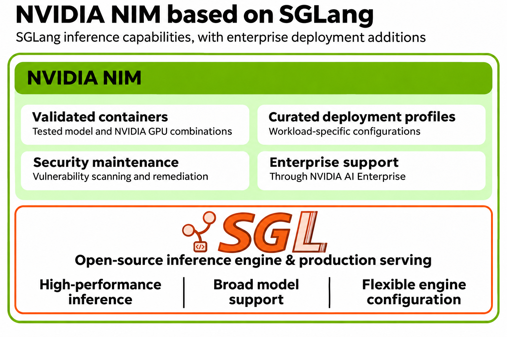
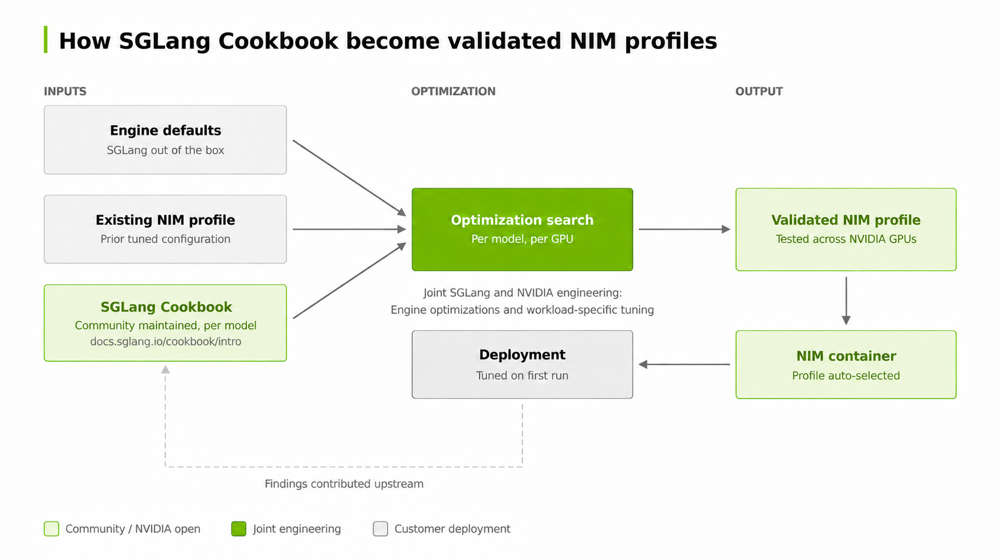

SGLang now powers [NVIDIA NIM Certified](https://docs.nvidia.com/nim/large-language-models/latest/about-nim-llm/nim-offerings.html#nim-certified) microservices. The open-source inference engine brings together high performance, broad model support, and a developer community that continues to push inference forward. It is already proven in large-scale production deployments.

With [NVIDIA NIM Certified](https://docs.nvidia.com/nim/large-language-models/latest/about-nim-llm/nim-offerings.html#nim-certified) microservices now built on SGLang, NVIDIA makes it easier for enterprises to adopt SGLang's serving innovations, with validated containers, optimized configurations for supported models and GPUs, and enterprise support through NVIDIA AI Enterprise. *Ref: [SGLang documentation](https://docs.sglang.io/), [Certified NIM catalog](https://catalog.ngc.nvidia.com/orgs/nim/nvidia/collections/certified-nim/-)*

The collaboration brings complementary engineering strengths to a shared goal: helping developers get more from their AI infrastructure. SGLang advances the inference engine and gives developers extensive control over how models run. The NVIDIA NIM team builds on that foundation, turning those capabilities into deployments that enterprise teams can confidently configure, operate, and maintain.

SGLang's breadth is an important starting point. Its support for diverse models and hardware platforms gives developers flexibility as their applications evolve. NIM adds a focused validation effort around a curated selection of popular models and the NVIDIA hardware customers deploy on. Across the broader NIM program, validation covers more than 30 NVIDIA hardware SKUs and more than 37 popular models, helping users identify a dependable deployment path.

That validation connects compatibility to practical deployment decisions. Developers need to know which configurations have been tested for their model, which hardware they require, and what performance to expect. NIM documents verified configurations and optimized profiles, giving teams a concrete starting point for deployment. *Ref: [NIM support matrix](https://docs.nvidia.com/nim/large-language-models/latest/reference/support-matrix.html)*

Performance is another central part of the collaboration. SGLang provides a high-performance foundation through capabilities such as Unified Radix Cache and Breakable CUDA Graph. NIM builds on that foundation by tuning selected models and configurations for user workloads. The objective is to improve throughput, measured in tokens per second per GPU, for the configurations users actually deploy. *Ref: [SGLang documentation](https://docs.sglang.io/), [NIM performance validation](https://docs.nvidia.com/nim/large-language-models/latest/about-nim-llm/enterprise-grade.html)*

Achieving that objective requires attention to the workload. An interactive assistant has different latency requirements from a batch generation service, while applications processing long documents place different demands on the system than applications generating long responses. NIM's workload-specific tuning and packaged profiles help translate engine capabilities into useful deployment choices. For supported model-specific offerings, users can start with curated settings and hardware-aware profile selection. *Ref: [NIM model profiles](https://docs.nvidia.com/nim/large-language-models/latest/deployment/model-profiles-and-selection.html)*

The same approach applies to the developer experience. SGLang's flexibility gives engineers room to explore model behavior, serving features, and runtime configurations. NIM developers use that flexibility to assemble an experience that runs with the supplied settings on supported configurations. Teams with specialized requirements retain access to engine settings. Users gain a simpler starting point and room to customize as their needs become more sophisticated. *Ref: [NIM configuration documentation](https://docs.nvidia.com/nim/large-language-models/latest/reference/advanced-configuration.html)*

SGLang also brings an established foundation for production serving. NIM adds enterprise security maintenance on top, including vulnerability scanning and remediation, alongside validated releases and support through NVIDIA AI Enterprise. This ongoing maintenance helps enterprise teams manage the software throughout its deployment lifecycle. Enterprise support is optional and available with an active [NVIDIA AI Enterprise subscription](https://docs.nvidia.com/ai-enterprise/planning-resource/licensing-guide/latest/licensing.html). *Ref: [NIM enterprise capabilities](https://docs.nvidia.com/nim/large-language-models/latest/about-nim-llm/enterprise-grade.html), [NIM support offerings](https://docs.nvidia.com/nim/large-language-models/latest/about-nim-llm/nim-offerings.html)*

Looking ahead, closer collaboration can strengthen both projects. Enterprise validation can surface issues across a wider range of hardware and workloads. Performance investigations can identify opportunities for shared optimizations. User experience can help guide improvements to configuration, observability, and deployment workflows. Contributing those findings and improvements upstream would extend their value to the broader SGLang community.

Certified NIM provides a foundation for that continuing collaboration: expanding validated model coverage, making new SGLang capabilities easier to adopt, and bringing lessons from enterprise deployments back into open-source development.
