More than 2,000 developers, researchers, and industry leaders gathered at Fort Mason in San Francisco on November 12–13 for the first SGLang Summit. The event brought together the people building SGLang and Miles, the teams running them in production, and the hardware partners helping them reach new platforms. Across the main stage, technical sessions, hands-on workshops, and expo floor, the community shared what is working today and what needs to come next.

<figure class="summit-figure summit-figure--hero" style="margin: 2rem 0;">
  <a href="/images/blog/sglang-summit-2026/summit-opening-hall.webp" target="_blank" rel="noopener noreferrer" aria-label="The SGLang community at Fort Mason. — view larger (opens in a new tab)" style="display: block; border-radius: 6px; overflow: hidden; color: inherit;">
    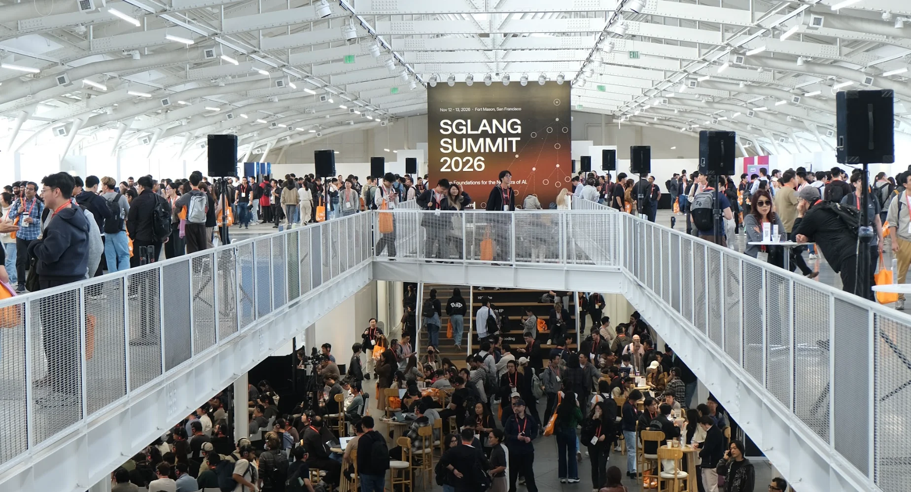
  </a>
  <figcaption style="margin-top: 0.6rem; color: #595959; font-size: 0.875rem; line-height: 1.5;">The SGLang community at Fort Mason.</figcaption>
</figure>

The summit marked several milestones: the launch of the SGLang Consortium with nine founding members, the announcement of SGLang v1.0, and the release of Miles v0.2. Just as valuable were the engineering lessons and conversations around those announcements, from serving frontier models and scaling reinforcement learning to building infrastructure for increasingly capable agents. Here are the highlights from two days of building and learning together.

  <strong style="flex-basis: 100%; color: #555; font-size: 0.75rem; letter-spacing: 0.08em; text-transform: uppercase;">In this recap</strong>
  <a href="#announcements">Announcements</a>
  <a href="#themes-from-the-talks">Talks</a>
  <a href="#breakout-sessions-building-the-engine-for-the-agentic-era">Breakout sessions</a>
  <a href="#hands-on-workshops-put-sglang-and-miles-to-work">Workshops</a>
  <a href="#moments-with-the-sglang-community">Community</a>

## Announcements

### Nine founding members join the SGLang Consortium

NVIDIA, AMD, Intel, Google, Meta, Thinking Machines Lab, Cloudflare, Modal, and RadixArk joined as founding members of the SGLang Consortium, announced at the opening presentation.

<figure class="summit-figure summit-figure--consortium" style="margin: 2rem 0;">
  
  <figcaption style="margin-top: 0.6rem; color: #595959; font-size: 0.875rem; line-height: 1.5;">The SGLang Consortium brings together nine founding members.</figcaption>
</figure>

The consortium creates a standing forum for members to work with SGLang’s maintainers on engineering priorities, contributing experience from production deployments, testing resources, and joint development. Its focus includes frontier model support, reasoning and multimodal workloads, distributed inference, and hardware optimization.

The [consortium announcement](https://www.lmsys.org/blog/2026-11-12-sglang-consortium) was accompanied by a recorded video message from Dr. Lisa Su, chair and CEO of AMD.

“At AMD, we are big believers in open,” said Dr. Lisa Su. “We are excited to extend our work with the SGLang community through the SGLang Consortium. We look forward to contributing more directly to the framework and helping developers get the most from their AMD platforms.”

<figure class="summit-figure summit-figure--lisa-su" style="margin: 2rem 0;">
  
  <figcaption style="margin-top: 0.6rem; color: #595959; font-size: 0.875rem; line-height: 1.5;">Dr. Lisa Su’s video message followed the fireside chat with Vamsi Boppana and Lianmin Zheng.</figcaption>
</figure>

Members will appoint technical representatives and participate in regular roadmap discussions. SGLang’s maintainers retain responsibility for technical decisions and code acceptance, and the project remains open to the wider community.

### SGLang v1.0 sets the next milestone for production inference

The SGLang v1.0 announcement puts efficiency and production scalability at the center of the project’s next release. The work focuses on strengthening existing functionality, surfacing configuration problems clearly, and establishing compatibility expectations for what’s next for SGLang.

The opening presentation connected that work to the demands of newer models and agents. Hybrid model architectures require different types of state to be managed together, while long-running agents accumulate histories that can exceed GPU memory. Unified memory management and hierarchical caching help address those constraints by supporting reuse across different types of state and storage.

1.0 also signals SGLang’s shift to AI-driven development, with agents now producing most of the project’s merged PRs. Next, the SGLang team will work on AI tools that write code, review PRs, build tests, manage compatibility and even propose roadmaps. The community is building toward an ecosystem that keeps improving itself.

<figure class="summit-figure" style="margin: 2rem 0;">
  <a href="/images/blog/sglang-summit-2026/sglang-v1-release.webp" target="_blank" rel="noopener noreferrer" aria-label="Ying Sheng announces SGLang v1.0. — view larger (opens in a new tab)" style="display: block; border-radius: 6px; overflow: hidden; color: inherit;">
    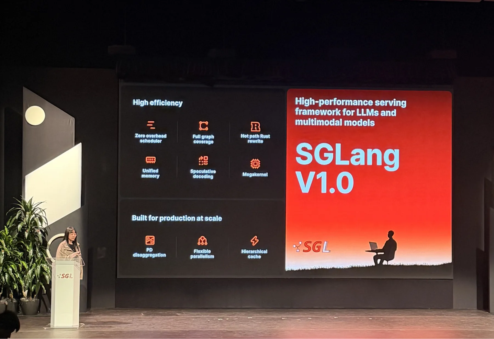
  </a>
  <figcaption style="margin-top: 0.6rem; color: #595959; font-size: 0.875rem; line-height: 1.5;">Ying Sheng announces SGLang v1.0.</figcaption>
</figure>

Release progress and migration guidance are documented in the [SGLang 1.0 release tracker](https://github.com/sgl-project/sglang/issues/50045).

### Miles v0.2 expands reinforcement learning across hardware and workloads

Miles v0.2 takes production RL post-training with SGLang to more hardware and more workloads. It runs on NVIDIA GPUs, AMD GPUs and Google TPUs, with AWS Trainium landing soon, and trains with Megatron-LM, FSDP or TorchTitan.

Beyond text, Miles now handles RL for image, video and audio, and Miles-Diffusion extends it to diffusion models. With Multi-LoRA, it’s practical to customize one base model for many tasks at once.

The code and implementation details are available in the [Miles v0.2 release notes](https://github.com/radixark/miles/releases/tag/v0.2.0).

<figure class="summit-figure" style="margin: 2rem 0;">
  <a href="/images/blog/sglang-summit-2026/miles-v02-release.webp" target="_blank" rel="noopener noreferrer" aria-label="Banghua Zhu presents Miles v0.2. — view larger (opens in a new tab)" style="display: block; border-radius: 6px; overflow: hidden; color: inherit;">
    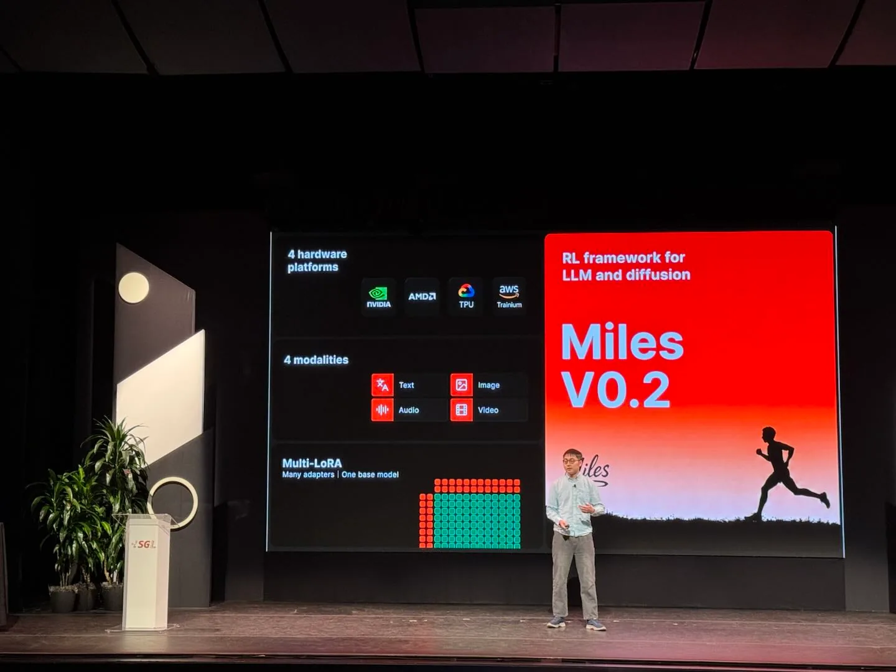
  </a>
  <figcaption style="margin-top: 0.6rem; color: #595959; font-size: 0.875rem; line-height: 1.5;">Banghua Zhu presents Miles v0.2.</figcaption>
</figure>

### SGLang powers NVIDIA NIM Certified microservices

NVIDIA and the SGLang team announced that SGLang now powers NVIDIA NIM Certified microservices. NIM packages the inference engine with validated containers, optimized configurations for supported models and NVIDIA GPUs, and ongoing security maintenance, giving enterprise teams a tested starting point for deployment. Optional enterprise support is available through an active NVIDIA AI Enterprise subscription.

Read the [NVIDIA NIM announcement](https://www.lmsys.org/blog/2026-11-13-sglang-nvidia-nim).

### Intel collaboration and AWS Trainium preview extend hardware support

Intel and RadixArk [announced a collaboration](https://www.intel.com/content/www/us/en/newsroom/news/artificial-intelligence/radixark-open-ai-inference.html) to optimize SGLang for Intel platforms, including CPUs, GPUs, and accelerators. The work emphasizes contributing optimizations directly to the open-source framework, giving developers additional deployment options through SGLang.

The collaboration brings hardware-specific engineering into the shared software stack, with the aim of making production inference more efficient and cost-effective on Intel infrastructure.

Separately, SGLang-Neuron v0.1.0 became open source and available in public preview. Co-developed by the SGLang team at RadixArk and Amazon Annapurna Labs, the PyTorch-native plugin brings SGLang’s serving stack to AWS Trainium for supported language and diffusion models.

The preview includes an asynchronous runtime, optimized kernels, and caching capabilities. Developers can get started through the AWS Deep Learning Container for SGLang-Neuron and the [public release announcement](https://www.lmsys.org/blog/2026-11-12-sglang-neuron-v0.1.0).

<figure class="summit-figure" style="min-width: 0; margin: 0;">
  
  <figcaption style="margin-top: 0.6rem; color: #595959; font-size: 0.875rem; line-height: 1.5;">Intel and RadixArk announce their collaboration on open AI inference.</figcaption>
</figure>
<figure class="summit-figure" style="min-width: 0; margin: 0;">
  
  <figcaption style="margin-top: 0.6rem; color: #595959; font-size: 0.875rem; line-height: 1.5;">SGLang-Neuron v0.1.0 brings SGLang’s serving stack to AWS Trainium.</figcaption>
</figure>

### A call for security partners

As AI accelerates software development, security review needs to keep pace. The keynote highlighted vulnerabilities reported by Cloudflare and NEAR AI, the fixes they prompted, and ongoing work to strengthen isolation between requests and protect administrative access.

<figure class="summit-figure" style="margin: 2rem 0;">
  <a href="/images/blog/sglang-summit-2026/security-partners-keynote.webp" target="_blank" rel="noopener noreferrer" aria-label="Ying Sheng calls for security partners. — view larger (opens in a new tab)" style="display: block; border-radius: 6px; overflow: hidden; color: inherit;">
    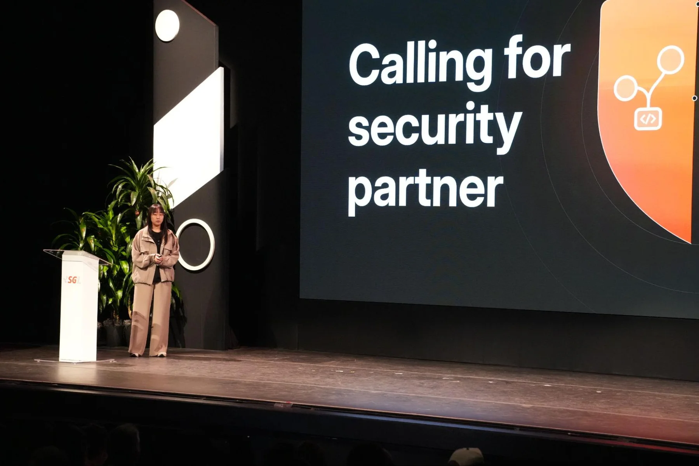
  </a>
  <figcaption style="margin-top: 0.6rem; color: #595959; font-size: 0.875rem; line-height: 1.5;">Ying Sheng calls for security partners.</figcaption>
</figure>

## Themes from the talks

### Hardware partners advance SGLang across platforms

Hardware partners shared how they are adapting SGLang to different architectures and agentic workloads.

Ujval Kapasi, NVIDIA’s VP of AI & HPC Frameworks and Libraries, highlighted work on Vera Rubin, Dynamo integration for cache-aware routing and distributed serving, and faster replica startup through Dynamo Snapshot and Model Express. He also discussed Vera CPUs for agent sandboxes and RL workloads.

<figure class="summit-figure" style="min-width: 0; margin: 0; flex: 1 1 320px;">
  <a href="/images/blog/sglang-summit-2026/nvidia-dynamo-talk.webp" target="_blank" rel="noopener noreferrer" aria-label="NVIDIA’s Ujval Kapasi on Vera Rubin and inference infrastructure. — view larger (opens in a new tab)" style="display: block; border-radius: 6px; overflow: hidden; color: inherit;">
    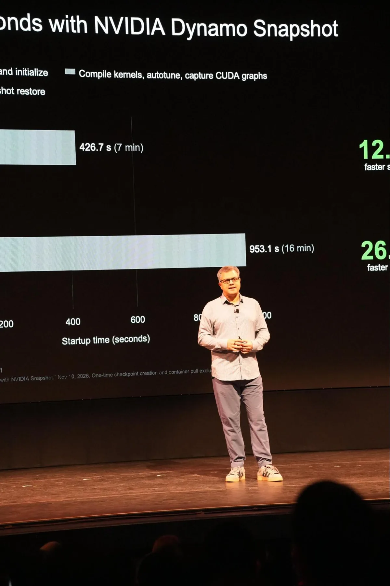
  </a>
  <figcaption style="margin-top: 0.6rem; color: #595959; font-size: 0.875rem; line-height: 1.5;">NVIDIA’s Ujval Kapasi on Vera Rubin and inference infrastructure.</figcaption>
</figure>
<figure class="summit-figure summit-figure--result" style="min-width: 0; margin: 0; flex: 1 1 320px;">
  <a href="/images/blog/sglang-summit-2026/kimi-vera-rubin-performance.webp" target="_blank" rel="noopener noreferrer" aria-label="Kimi K3.1 Pro on Vera Rubin with NVIDIA Dynamo and SGLang: up to 6× total token throughput per GPU versus GB300 NVL72 on AgentX, at matched interactivity. — view larger (opens in a new tab)" style="display: block; border-radius: 6px; overflow: hidden; color: inherit;">
    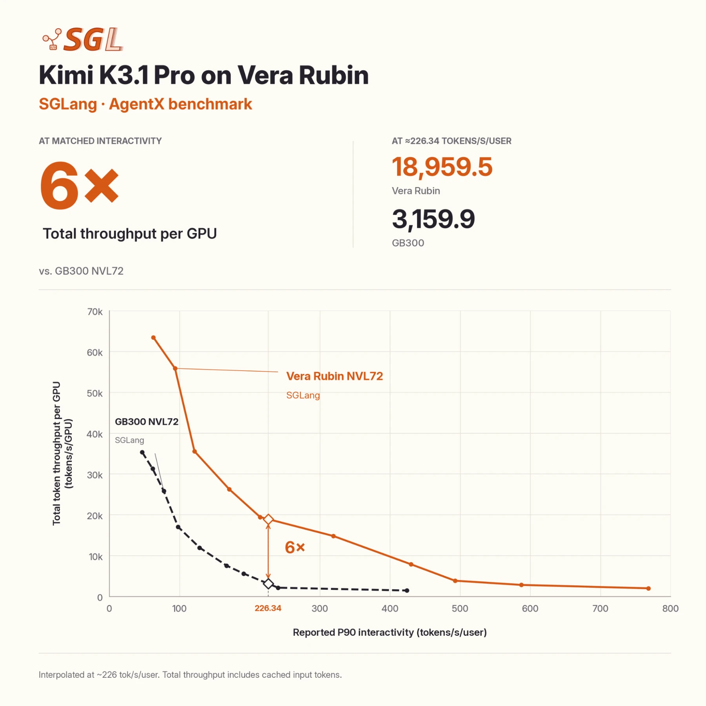
  </a>
  <figcaption style="margin-top: 0.6rem; color: #595959; font-size: 0.875rem; line-height: 1.5;">Kimi K3.1 Pro on Vera Rubin with NVIDIA Dynamo and SGLang: up to 6× total token throughput per GPU versus GB300 NVL72 on AgentX, at matched interactivity.</figcaption>
</figure>

Luis Ceze, NVIDIA’s VP of AI Systems Software and Compilers, explored how agents can accelerate kernel optimization, with compiler feedback and independent correctness checks guiding development, and FlashInfer bringing improved kernels into SGLang.

<figure class="summit-figure summit-figure--speaker" style="margin: 2rem 0;">
  
  <figcaption style="margin-top: 0.6rem; color: #595959; font-size: 0.875rem; line-height: 1.5;">NVIDIA’s Luis Ceze on agents, compilers, and kernel optimization.</figcaption>
</figure>

Colin Brace, VP of Technology at AWS’s Annapurna Labs, presented native SGLang on Trainium, developed with RadixArk using PyTorch and optimized Neuron kernels, including day-zero support for Kimi K3.1 Pro. Nancy Zheng, Cerebras’ VP of Engineering for Inference, showed how pairing GPU prefill with wafer-scale decode addresses the different compute and memory demands of inference, combining efficient input processing with fast token generation.

<figure class="summit-figure" style="min-width: 0; margin: 0;">
  <a href="/images/blog/sglang-summit-2026/aws-infrastructure-presentation.webp" target="_blank" rel="noopener noreferrer" aria-label="AWS’s Colin Brace on native SGLang on Trainium. — view larger (opens in a new tab)" style="display: block; border-radius: 6px; overflow: hidden; color: inherit;">
    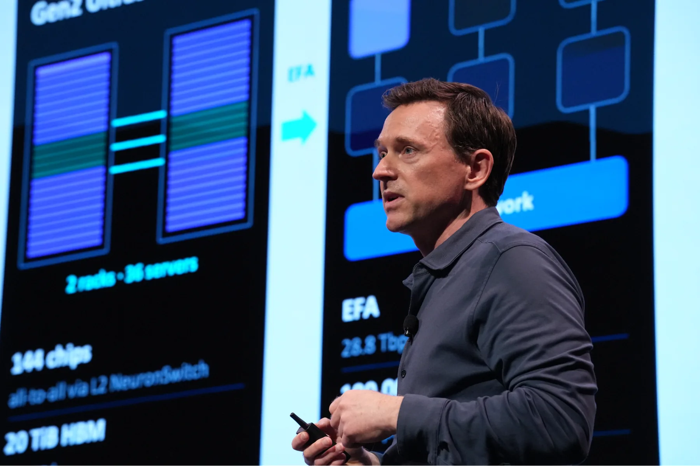
  </a>
  <figcaption style="margin-top: 0.6rem; color: #595959; font-size: 0.875rem; line-height: 1.5;">AWS’s Colin Brace on native SGLang on Trainium.</figcaption>
</figure>
<figure class="summit-figure" style="min-width: 0; margin: 0;">
  
  <figcaption style="margin-top: 0.6rem; color: #595959; font-size: 0.875rem; line-height: 1.5;">Cerebras’ Nancy Zheng on GPU prefill and wafer-scale decode.</figcaption>
</figure>

AMD’s SVP of AI, Vamsi Boppana, highlighted Muse Spark Open optimizations and day-zero Kimi K3.1 Pro support on AMD GPUs, alongside collaboration on MI455 and Miles. The fireside chat with Bill Jia, Google’s VP of Engineering for Core ML/AI, explored TorchTPU’s work with SGLang and Miles, workload-specific TPU design, and AI-generated kernels.

<figure class="summit-figure" style="min-width: 0; margin: 0;">
  <a href="/images/blog/sglang-summit-2026/main-stage-fireside-chat.webp" target="_blank" rel="noopener noreferrer" aria-label="AMD’s Vamsi Boppana in conversation with Lianmin Zheng. — view larger (opens in a new tab)" style="display: block; border-radius: 6px; overflow: hidden; color: inherit;">
    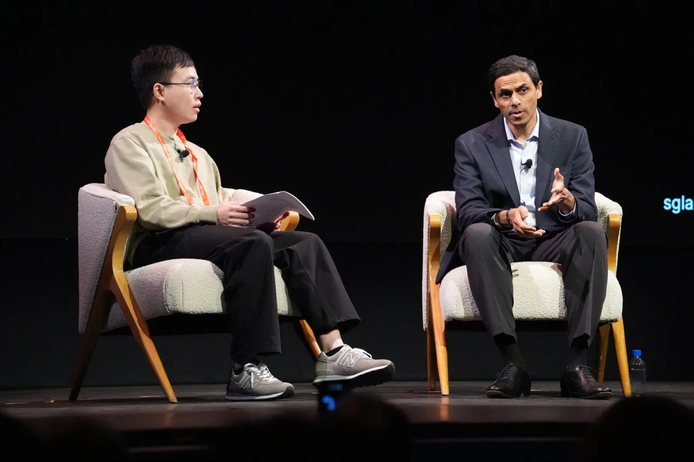
  </a>
  <figcaption style="margin-top: 0.6rem; color: #595959; font-size: 0.875rem; line-height: 1.5;">AMD’s Vamsi Boppana in conversation with Lianmin Zheng.</figcaption>
</figure>
<figure class="summit-figure" style="min-width: 0; margin: 0;">
  <a href="/images/blog/sglang-summit-2026/fireside-speaker-on-stage.webp" target="_blank" rel="noopener noreferrer" aria-label="Google’s Bill Jia on TPUs and open AI infrastructure. — view larger (opens in a new tab)" style="display: block; border-radius: 6px; overflow: hidden; color: inherit;">
    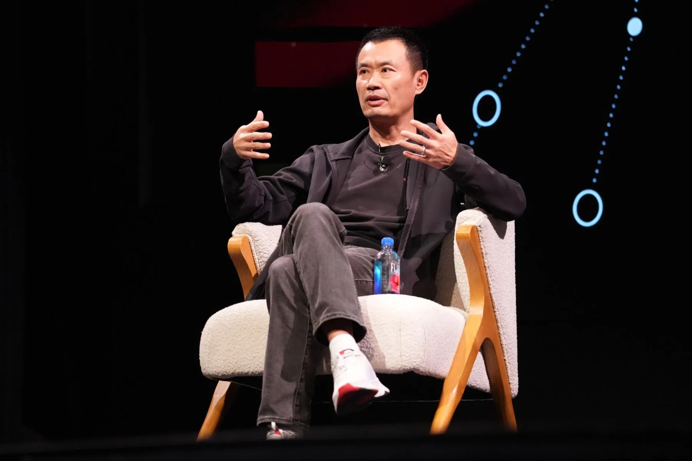
  </a>
  <figcaption style="margin-top: 0.6rem; color: #595959; font-size: 0.875rem; line-height: 1.5;">Google’s Bill Jia on TPUs and open AI infrastructure.</figcaption>
</figure>

Together, these sessions highlighted how open software and joint engineering give developers more flexibility in how they train and serve models.

### Production lessons take center stage

Over the past year, SGLang has grown from a handful of early adopters to 332 organizations across the AI ecosystem. That growth took sustained engineering work: helping teams bring up new workloads, debugging production issues together, supporting more hardware, and earning trust one deployment at a time. Every team that gave SGLang a chance, shared feedback, or contributed a fix helped make this progress possible.

<figure class="summit-figure" style="margin: 2rem 0;">
  
  <figcaption style="margin-top: 0.6rem; color: #595959; font-size: 0.875rem; line-height: 1.5;">Lianmin Zheng shares SGLang’s growth to 332 organizations.</figcaption>
</figure>

At Meta, SGLang powers production inference for products serving billions of users. On the main stage, Meta’s Lianmin Zheng showed how the SGLang runtime supports Muse App, Muse Code, Model API, the Meta family of apps, and image and video workloads, with an infrastructure spanning NVIDIA GPUs, AMD GPUs, Google TPUs, and Meta MTIA.

Meta also reported more than 2× GPU savings after migrating from its prior inference solutions, validated at large scale across multiple hardware platforms. The team highlighted three reasons for choosing SGLang: a strong community with fast feedback and shared engineering, an efficient engine core built around scheduling, caching, and kernels, and the flexibility to extend it for production integration.

Together, these results show what SGLang can deliver under the demands of large-scale production: measurable infrastructure savings across diverse applications and hardware.

<figure class="summit-figure" style="min-width: 0; margin: 0;">
  
  <figcaption style="margin-top: 0.6rem; color: #595959; font-size: 0.875rem; line-height: 1.5;">SGLang supports inference across Meta’s products and hardware platforms.</figcaption>
</figure>
<figure class="summit-figure" style="min-width: 0; margin: 0;">
  
  <figcaption style="margin-top: 0.6rem; color: #595959; font-size: 0.875rem; line-height: 1.5;">Meta’s production experience: community, engine efficiency, and flexibility.</figcaption>
</figure>

Across the two days, teams from Modal, Cloudflare, Crusoe, Fireworks, Baseten, DigitalOcean, LinkedIn, and others added perspectives from their own production environments. Their sessions brought practical engineering questions into focus: how to serve demanding workloads, integrate inference into complete applications, and maintain performance under real operating conditions.

The production discussion extended from inference to training and post-training, connecting SGLang’s serving capabilities with the reinforcement learning workflows being developed around Miles. Sessions on Meta’s work with TorchTitan and Miles explored the training infrastructure behind these workflows.

At the same time, humans& CEO Eric Zelikman discussed the training and infrastructure needed to build AI that collaborates with people over time. Speakers from humans&, Applied Compute, and Mercor explored advances in post-training, from scaling reinforcement learning infrastructure to training agents for real-world work.

<figure class="summit-figure" style="min-width: 0; margin: 0;">
  
  <figcaption style="margin-top: 0.6rem; color: #595959; font-size: 0.875rem; line-height: 1.5;">The AI Compute Panel brings together perspectives from production deployments.</figcaption>
</figure>
<figure class="summit-figure" style="min-width: 0; margin: 0;">
  
  <figcaption style="margin-top: 0.6rem; color: #595959; font-size: 0.875rem; line-height: 1.5;">humans&amp; CEO Eric Zelikman on training AI that collaborates with people.</figcaption>
</figure>

These examples help shape the engineering agenda for SGLang and Miles. Production experience brings concrete requirements back to the projects: improvements must hold up across complete applications, diverse hardware, changing workloads, and full training runs. Thank you to every team that shared both its results and the engineering lessons behind them.

### AI leaders discuss what comes next

Main stage sessions featured fireside conversations with Intel CEO Lip-Bu Tan, OpenAI’s Lilian Weng, Thinking Machines Lab CTO Soumith Chintala, and Periodic Labs co-founder and co-CEO Liam Fedus, along with Perplexity co-founder and CEO Aravind Srinivas’s presentation, “Building the Next Computer.”

Intel CEO Lip-Bu Tan spoke about the need for new chip architectures to reduce AI’s power demands. He compared the energy required by large computing systems with the human brain, which he noted uses about 20 watts. Over the next 10 to 15 years, he hopes to help develop architectures beyond CPUs and GPUs, raising neuromorphic computing as one possibility for delivering more performance with far less power.

Lilian Weng described how coding agents are changing the way researchers work. Ideas that once had to wait because of limited time or resources can now be tested more quickly. She likened the researcher’s role to that of a team lead: directing agents as they handle implementation, with more time to explore higher-level questions.

<figure class="summit-figure" style="min-width: 0; margin: 0;">
  
  <figcaption style="margin-top: 0.6rem; color: #595959; font-size: 0.875rem; line-height: 1.5;">Intel’s Lip-Bu Tan discusses the future of AI hardware.</figcaption>
</figure>
<figure class="summit-figure" style="min-width: 0; margin: 0;">
  
  <figcaption style="margin-top: 0.6rem; color: #595959; font-size: 0.875rem; line-height: 1.5;">Lilian Weng discusses how coding agents are changing research.</figcaption>
</figure>

Thinking Machines Lab CTO Soumith Chintala discussed how frontier model capabilities could evolve, including the possibility of surpassing human abilities. He reflected on the difficulty of predicting what that future will look like and whether previous technological revolutions offer a useful guide.

Periodic Labs co-founder and co-CEO Liam Fedus discussed how open-source infrastructure can help accelerate scientific discovery. His fireside conversation explored the opportunity for emerging AI labs to turn advances in model capabilities into scientific progress, and the shared tools and infrastructure that can support that work.

Aravind Srinivas outlined a vision of agents carrying out sustained work across local and cloud environments. His presentation connected that vision to concrete requirements: grounding work in search, preserving recoverable state, and enforcing boundaries around execution. It also described local agents retaining control while selectively seeking help from the cloud.

<figure class="summit-figure" style="min-width: 0; margin: 0;">
  
  <figcaption style="margin-top: 0.6rem; color: #595959; font-size: 0.875rem; line-height: 1.5;">Thinking Machines Lab’s Soumith Chintala on frontier model capabilities.</figcaption>
</figure>
<figure class="summit-figure" style="min-width: 0; margin: 0;">
  
  <figcaption style="margin-top: 0.6rem; color: #595959; font-size: 0.875rem; line-height: 1.5;">Periodic Labs’ Liam Fedus on AI and scientific discovery.</figcaption>
</figure>
<figure class="summit-figure" style="min-width: 0; margin: 0;">
  
  <figcaption style="margin-top: 0.6rem; color: #595959; font-size: 0.875rem; line-height: 1.5;">Perplexity’s Aravind Srinivas presents “Building the Next Computer.”</figcaption>
</figure>

## Breakout sessions: building the engine for the agentic era

AI is moving from answering questions to getting things done, and SGLang is becoming the engine behind that shift. Across six breakout rooms and more than 90 technical talks, the results spoke for themselves. On speed, an optimized SGLang deployment served a leading open model at about 1,800 tokens per second to a single user, 1.8× faster than the stock recipe with reasoning accuracy unchanged. On reliability, one production team reported running SGLang for 500 days through eight major upgrades with no performance regressions observed. For agents, which must re-read a growing history at every step, SGLang’s HiCache reuses stored context instead of recomputing it, cutting median time-to-first-token by 60% in a multi-turn benchmark. And for reinforcement learning, the SGLang-powered Miles framework cut the weight-update pause for a trillion-parameter model across 32 nodes from 53 seconds to about 7.

Even more exciting, AI is starting to help improve SGLang itself. GPU megakernels written by AI agents made decoding up to 2× faster, with outputs verified against the original kernels. Two engineers working with AI agents ported SGLang to another AI accelerator in under a week, reaching within 1% of production performance. When AI starts helping build the engine that runs AI, progress only speeds up. A faster, more open SGLang that runs everywhere is on its way, and this is only the beginning.

<figure class="summit-figure" style="min-width: 0; margin: 0;">
  <a href="/images/blog/sglang-summit-2026/breakout-room-audience.webp" target="_blank" rel="noopener noreferrer" aria-label="Technical sessions bring the community together around the inference stack. — view larger (opens in a new tab)" style="display: block; border-radius: 6px; overflow: hidden; color: inherit;">
    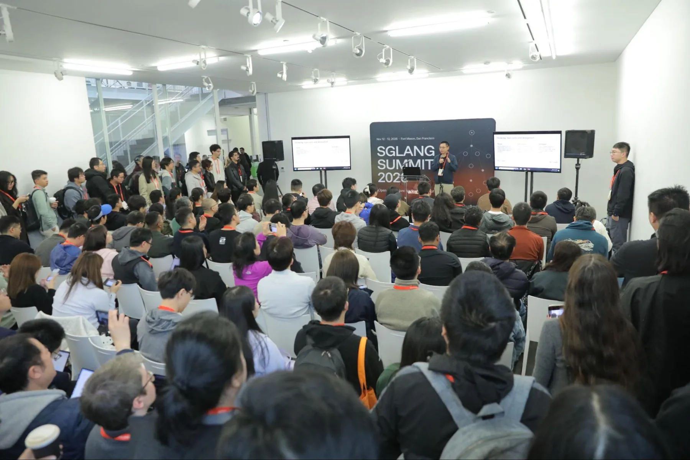
  </a>
  <figcaption style="margin-top: 0.6rem; color: #595959; font-size: 0.875rem; line-height: 1.5;">Technical sessions bring the community together around the inference stack.</figcaption>
</figure>
<figure class="summit-figure" style="min-width: 0; margin: 0;">
  
  <figcaption style="margin-top: 0.6rem; color: #595959; font-size: 0.875rem; line-height: 1.5;">Attendees compare ideas across breakout rooms.</figcaption>
</figure>
<figure class="summit-figure" style="min-width: 0; margin: 0;">
  
  <figcaption style="margin-top: 0.6rem; color: #595959; font-size: 0.875rem; line-height: 1.5;">Engineers share implementation details and lessons from their work.</figcaption>
</figure>
<figure class="summit-figure" style="min-width: 0; margin: 0;">
  
  <figcaption style="margin-top: 0.6rem; color: #595959; font-size: 0.875rem; line-height: 1.5;">Breakout talks connect new techniques with practical deployments.</figcaption>
</figure>

## Hands-on workshops put SGLang and Miles to work

Alongside the main stage, six partner-led workshops gave attendees a chance to run the stack themselves. NVIDIA took people from an introduction to Miles straight into a working RL loop, with each attendee running real training on two H100s in a Jupyter notebook. AMD showed where the time goes in agentic RL on Instinct MI355X and how a series of optimizations lifted throughput 3.5×, before attendees launched multi-turn RL training themselves.

On the inference side, the Local AI Coding Lab, hosted by the SGLang and NVIDIA teams, had participants use a fully local coding agent, powered by Qwen3.8-27B on a single RTX PRO 6000 Blackwell, to debug and repair optimizations in Mini-SGLang. Nebius walked through inference optimization across the stack, from Vera Rubin hardware features and model compression to GB300 serving and agent-written CUDA kernels. Crusoe had attendees deploy SGLang on Managed Kubernetes and tune it under load. Modal supplied the “why,” deriving from first principles how today’s models and serving systems are designed.

<figure class="summit-figure" style="min-width: 0; margin: 0;">
  
  <figcaption style="margin-top: 0.6rem; color: #595959; font-size: 0.875rem; line-height: 1.5;">Working through the stack together in a hands-on workshop.</figcaption>
</figure>
<figure class="summit-figure" style="min-width: 0; margin: 0;">
  
  <figcaption style="margin-top: 0.6rem; color: #595959; font-size: 0.875rem; line-height: 1.5;">Workshop discussions connect the concepts to running code.</figcaption>
</figure>
<figure class="summit-figure" style="min-width: 0; margin: 0;">
  <a href="/images/blog/sglang-summit-2026/workshop-audience.webp" target="_blank" rel="noopener noreferrer" aria-label="Attendees put inference and training techniques into practice. — view larger (opens in a new tab)" style="display: block; border-radius: 6px; overflow: hidden; color: inherit;">
    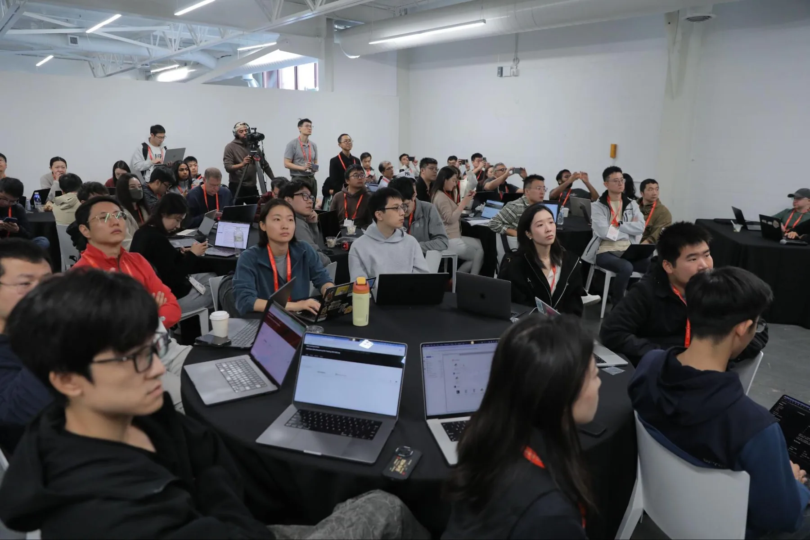
  </a>
  <figcaption style="margin-top: 0.6rem; color: #595959; font-size: 0.875rem; line-height: 1.5;">Attendees put inference and training techniques into practice.</figcaption>
</figure>

## Moments with the SGLang community

SGLang grows through collaboration across the stack. That breadth was reflected throughout the summit program, from AI hardware and inference infrastructure to training, agents, real-time AI, science, and robotics.

Bringing these communities together creates room for conversations across teams and disciplines: sharing production challenges, comparing approaches, and finding opportunities to work together.

### Expo booths

Those conversations continued across the expo floor. Sponsor booths brought teams and attendees together around demos, technical questions, and the practical challenges of building AI systems. For people who knew one another through code, issues, or online discussions, the summit was also a chance to finally meet face to face.

<figure class="summit-figure" style="min-width: 0; margin: 0;">
  
  <figcaption style="margin-top: 0.6rem; color: #595959; font-size: 0.875rem; line-height: 1.5;">Conversations continue across the expo floor.</figcaption>
</figure>
<figure class="summit-figure" style="min-width: 0; margin: 0;">
  
  <figcaption style="margin-top: 0.6rem; color: #595959; font-size: 0.875rem; line-height: 1.5;">Google Cloud</figcaption>
</figure>
<figure class="summit-figure" style="min-width: 0; margin: 0;">
  
  <figcaption style="margin-top: 0.6rem; color: #595959; font-size: 0.875rem; line-height: 1.5;">Meta and PyTorch</figcaption>
</figure>
<figure class="summit-figure" style="min-width: 0; margin: 0;">
  
  <figcaption style="margin-top: 0.6rem; color: #595959; font-size: 0.875rem; line-height: 1.5;">Intel</figcaption>
</figure>
<figure class="summit-figure" style="min-width: 0; margin: 0;">
  
  <figcaption style="margin-top: 0.6rem; color: #595959; font-size: 0.875rem; line-height: 1.5;">LanceDB</figcaption>
</figure>
<figure class="summit-figure" style="min-width: 0; margin: 0;">
  
  <figcaption style="margin-top: 0.6rem; color: #595959; font-size: 0.875rem; line-height: 1.5;">Snowflake</figcaption>
</figure>
<figure class="summit-figure" style="min-width: 0; margin: 0;">
  
  <figcaption style="margin-top: 0.6rem; color: #595959; font-size: 0.875rem; line-height: 1.5;">Demos and discussions</figcaption>
</figure>
<figure class="summit-figure" style="min-width: 0; margin: 0;">
  
  <figcaption style="margin-top: 0.6rem; color: #595959; font-size: 0.875rem; line-height: 1.5;">Meeting the teams behind the tools</figcaption>
</figure>
<figure class="summit-figure" style="min-width: 0; margin: 0;">
  <a href="/images/blog/sglang-summit-2026/crusoe-booth.webp" target="_blank" rel="noopener noreferrer" aria-label="Crusoe — view larger (opens in a new tab)" style="display: block; border-radius: 6px; overflow: hidden; color: inherit;">
    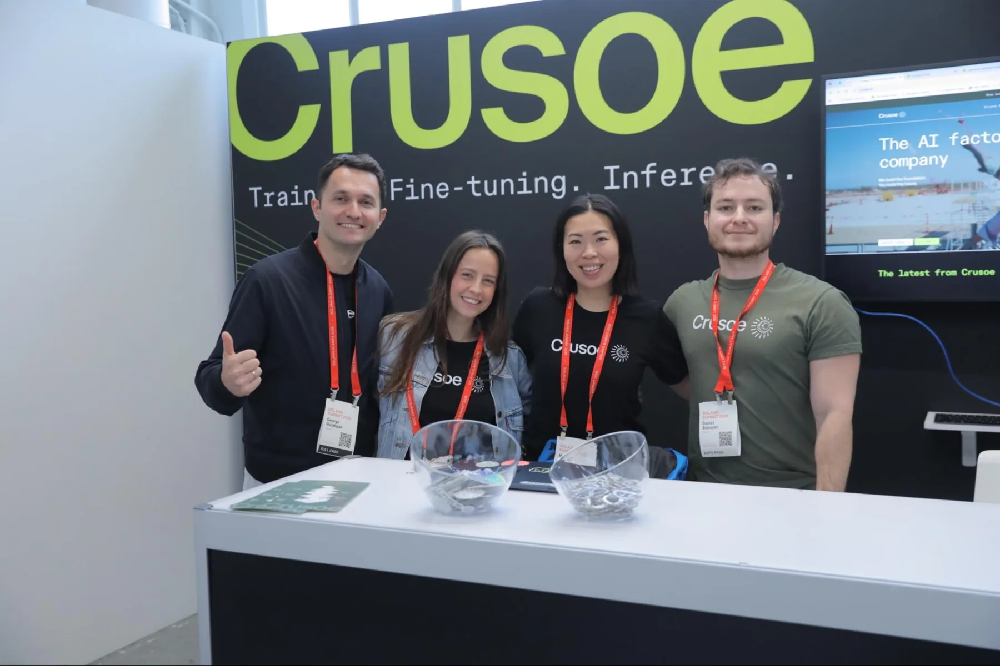
  </a>
  <figcaption style="margin-top: 0.6rem; color: #595959; font-size: 0.875rem; line-height: 1.5;">Crusoe</figcaption>
</figure>
<figure class="summit-figure" style="min-width: 0; margin: 0;">
  
  <figcaption style="margin-top: 0.6rem; color: #595959; font-size: 0.875rem; line-height: 1.5;">ai&amp;</figcaption>
</figure>
<figure class="summit-figure" style="min-width: 0; margin: 0;">
  <a href="/images/blog/sglang-summit-2026/baseten-booth.webp" target="_blank" rel="noopener noreferrer" aria-label="Baseten — view larger (opens in a new tab)" style="display: block; border-radius: 6px; overflow: hidden; color: inherit;">
    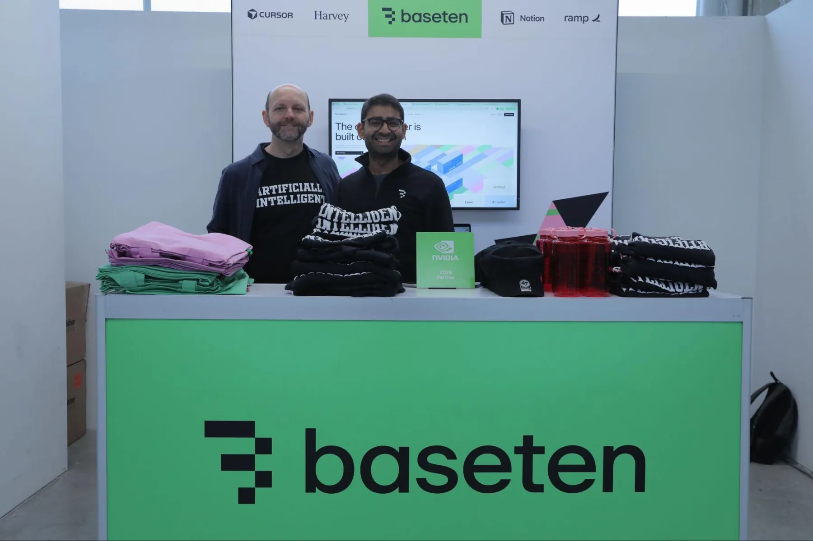
  </a>
  <figcaption style="margin-top: 0.6rem; color: #595959; font-size: 0.875rem; line-height: 1.5;">Baseten</figcaption>
</figure>
<figure class="summit-figure" style="min-width: 0; margin: 0;">
  
  <figcaption style="margin-top: 0.6rem; color: #595959; font-size: 0.875rem; line-height: 1.5;">Novita</figcaption>
</figure>

<figure class="summit-figure" style="min-width: 0; margin: 0; flex: 1.333334 1 133.3333px;">
  
  <figcaption style="margin-top: 0.6rem; color: #595959; font-size: 0.875rem; line-height: 1.5;">Liquid</figcaption>
</figure>
<figure class="summit-figure" style="min-width: 0; margin: 0; flex: 1.333334 1 133.3333px;">
  <a href="/images/blog/sglang-summit-2026/arcee-booth.webp" target="_blank" rel="noopener noreferrer" aria-label="Arcee — view larger (opens in a new tab)" style="display: block; border-radius: 6px; overflow: hidden; color: inherit;">
    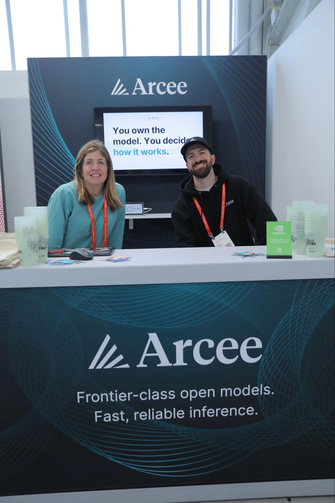
  </a>
  <figcaption style="margin-top: 0.6rem; color: #595959; font-size: 0.875rem; line-height: 1.5;">Arcee</figcaption>
</figure>
<figure class="summit-figure" style="min-width: 0; margin: 0; flex: 1.333334 1 133.3333px;">
  <a href="/images/blog/sglang-summit-2026/netpreme-booth.webp" target="_blank" rel="noopener noreferrer" aria-label="Netpreme — view larger (opens in a new tab)" style="display: block; border-radius: 6px; overflow: hidden; color: inherit;">
    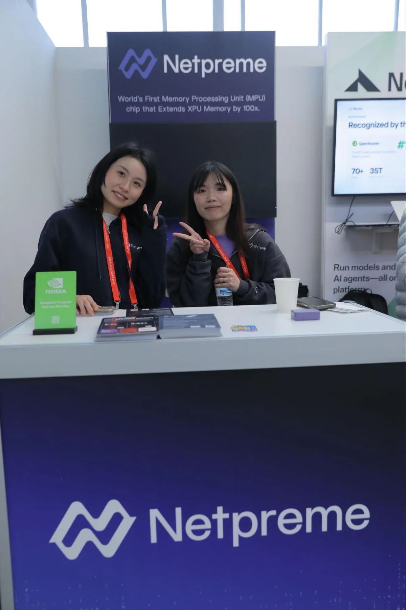
  </a>
  <figcaption style="margin-top: 0.6rem; color: #595959; font-size: 0.875rem; line-height: 1.5;">Netpreme</figcaption>
</figure>
<figure class="summit-figure" style="min-width: 0; margin: 0; flex: 1.501112 1 150.1111px;">
  
  <figcaption style="margin-top: 0.6rem; color: #595959; font-size: 0.875rem; line-height: 1.5;">Exploring the expo together</figcaption>
</figure>
<figure class="summit-figure" style="min-width: 0; margin: 0; flex: 1.501112 1 150.1111px;">
  
  <figcaption style="margin-top: 0.6rem; color: #595959; font-size: 0.875rem; line-height: 1.5;">A busy afternoon on the expo floor</figcaption>
</figure>

Seeing so many teams represented in one place made the breadth of the SGLang ecosystem tangible. Across hardware, cloud infrastructure, models, and applications, people brought different perspectives on shared challenges and a chance to learn directly from one another.

Thank you to every exhibitor and workshop host who brought their work into the room, walked attendees through a demo, and took the time to answer questions. Those exchanges are an important part of how this ecosystem moves forward.

### GPU expo

The GPU Expo brought the hardware side of the ecosystem into focus, giving attendees a closer look at the GPUs behind AI training and inference. Alongside the summit’s technical sessions, it offered another way to explore the infrastructure that supports the models and applications being built with SGLang.

<figure class="summit-figure" style="min-width: 0; margin: 0; flex: 1 1 200px;">
  <a href="/images/blog/sglang-summit-2026/server-rack-display.webp" target="_blank" rel="noopener noreferrer" aria-label="A closer look at the systems behind AI training and inference. — view larger (opens in a new tab)" style="display: block; border-radius: 6px; overflow: hidden; color: inherit;">
    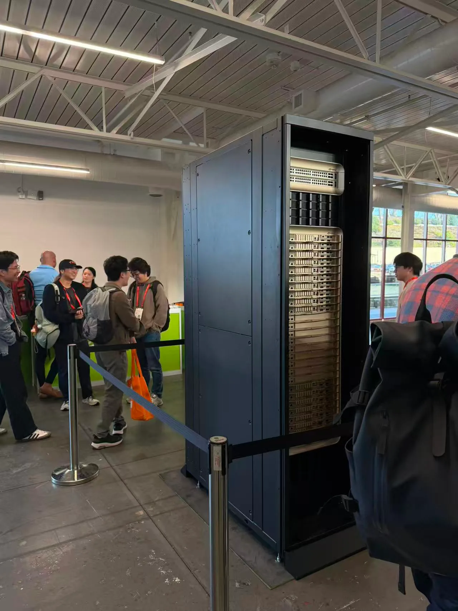
  </a>
  <figcaption style="margin-top: 0.6rem; color: #595959; font-size: 0.875rem; line-height: 1.5;">A closer look at the systems behind AI training and inference.</figcaption>
</figure>
<figure class="summit-figure" style="min-width: 0; margin: 0; flex: 2 1 400px;">
  
  <figcaption style="margin-top: 0.6rem; color: #595959; font-size: 0.875rem; line-height: 1.5;">The GPU Expo puts the hardware within reach.</figcaption>
</figure>

### Beyond the booths

The summit also made room for people to relax, meet someone new, and enjoy the day together. Between sessions, attendees could grab a drink from Kyoto Matcha or Hedge Coffee, enjoy tanghulu, and continue conversations over breakfast and lunch.

Sponsors and community partners organized 25 community events around the summit, with around 3,000 attendees in total.

<figure class="summit-figure" style="min-width: 0; margin: 0;">
  <a href="/images/blog/sglang-summit-2026/community-snack-table.webp" target="_blank" rel="noopener noreferrer" aria-label="Tanghulu between sessions — view larger (opens in a new tab)" style="display: block; border-radius: 6px; overflow: hidden; color: inherit;">
    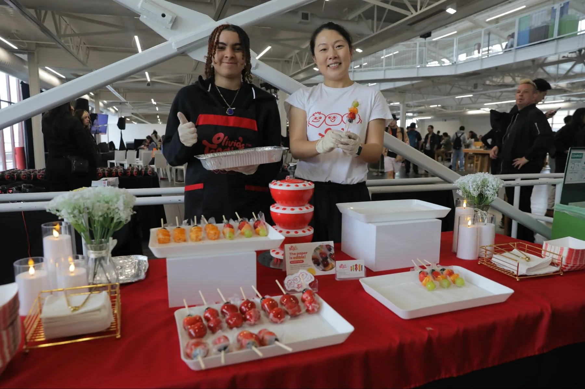
  </a>
  <figcaption style="margin-top: 0.6rem; color: #595959; font-size: 0.875rem; line-height: 1.5;">Tanghulu between sessions</figcaption>
</figure>
<figure class="summit-figure" style="min-width: 0; margin: 0;">
  
  <figcaption style="margin-top: 0.6rem; color: #595959; font-size: 0.875rem; line-height: 1.5;">Wearable DeepSeek, powered by SGLang</figcaption>
</figure>

<figure class="summit-figure" style="min-width: 0; margin: 0; flex: 0.750556 1 112.5833px;">
  
  <figcaption style="margin-top: 0.6rem; color: #595959; font-size: 0.875rem; line-height: 1.5;">Coffee and conversation at Hedge Coffee.</figcaption>
</figure>
<figure class="summit-figure" style="min-width: 0; margin: 0; flex: 1.333333 1 200.0000px;">
  <a href="/images/blog/sglang-summit-2026/breakout-session-overview.webp" target="_blank" rel="noopener noreferrer" aria-label="Attendees gather for a session at Fort Mason. — view larger (opens in a new tab)" style="display: block; border-radius: 6px; overflow: hidden; color: inherit;">
    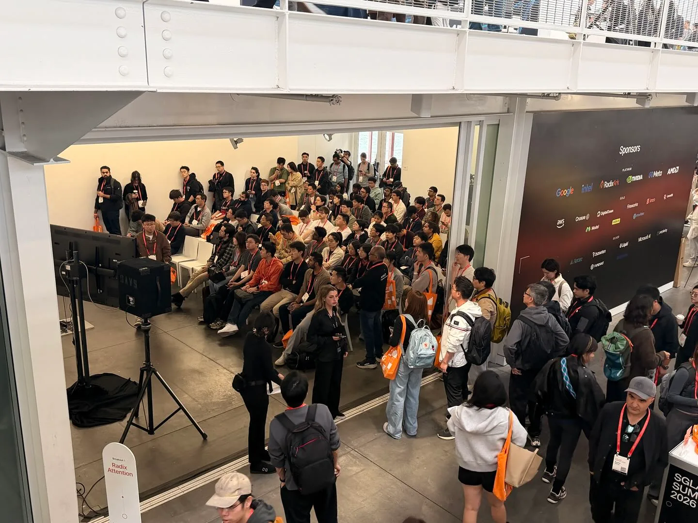
  </a>
  <figcaption style="margin-top: 0.6rem; color: #595959; font-size: 0.875rem; line-height: 1.5;">Attendees gather for a session at Fort Mason.</figcaption>
</figure>
<figure class="summit-figure" style="min-width: 0; margin: 0; flex: 1.332346 1 199.8520px;">
  
  <figcaption style="margin-top: 0.6rem; color: #595959; font-size: 0.875rem; line-height: 1.5;">A full house at Fort Mason.</figcaption>
</figure>

Conversations over coffee, photos with new friends, and shared snacks were part of the summit, too. Thank you to everyone who helped make the summit a welcoming place to spend two days with the SGLang community.

## Thank you

We are grateful to the sponsors and community partners who helped make this gathering possible. Their support brought space, resources, and expertise to an event built around sharing and collaboration.

Thank you to our Platinum sponsors: Google, Intel, RadixArk, NVIDIA, Meta, and AMD; our Gold sponsors: AWS, Crusoe, DigitalOcean, Fireworks AI, Inco AI, LanceDB, Modal, Nebius, and Snowflake; and all our Silver, Star, Spark, and Community partners.

<figure class="summit-figure summit-figure--sponsors" style="margin: 2rem 0;">
  
  <figcaption style="margin-top: 0.6rem; color: #595959; font-size: 0.875rem; line-height: 1.5;">Thank you to the sponsors and community partners of SGLang Summit 2026.</figcaption>
</figure>

Most of all, thank you to everyone who joined us. To the speakers sharing their experience, the contributors improving the software, the teams building with SGLang, and the volunteers helping the event come together: each of you brought something to these two days.

The summit brought a broad ecosystem into one place. The work continues across teams, organizations, and time zones, and we’re excited to keep building it together.

Thank you for being part of SGLang.

<figure class="summit-figure summit-figure--closing" style="margin: 2rem 0;">
  <a href="/images/blog/sglang-summit-2026/summit-staircase-original.webp" target="_blank" rel="noopener noreferrer" aria-label="SGLang Summit 2026 at Fort Mason. — view larger (opens in a new tab)" style="display: block; border-radius: 6px; overflow: hidden; color: inherit;">
    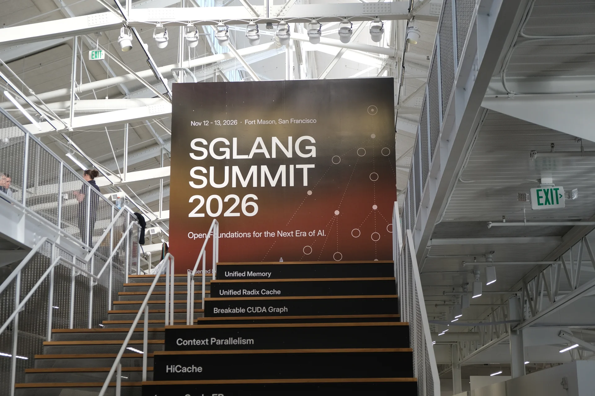
  </a>
  <figcaption style="margin-top: 0.6rem; color: #595959; font-size: 0.875rem; line-height: 1.5;">SGLang Summit 2026 at Fort Mason.</figcaption>
</figure>

Visit <a href="https://sglang.io/summit">sglang.io/summit</a> for talk recordings and presentation slides, which will be available soon.

