More than 2,000 developers, researchers, and industry leaders gathered at Fort Mason in San Francisco on November 12–13 for the first SGLang Summit. The event brought together the people building SGLang and Miles, the teams running them in production, and the hardware partners helping them reach new platforms. Across the main stage, technical sessions, hands-on workshops, and expo floor, the community shared what is working today and what needs to come next.

<figure class="summit-figure summit-figure--hero">
  <a href="/images/blog/sglang-summit-2026/summit-exhibition-hall.webp" target="_blank" rel="noopener noreferrer" aria-label="Two days of talks, workshops, and conversations at Fort Mason in San Francisco. — view larger (opens in a new tab)">
    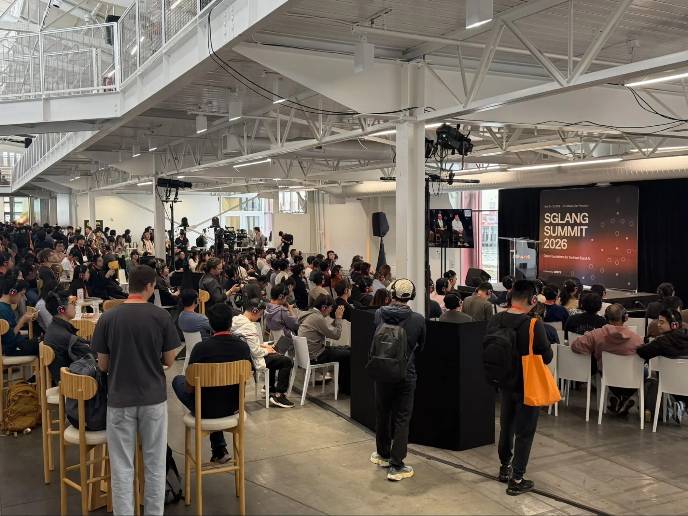
  </a>
  <figcaption>Two days of talks, workshops, and conversations at Fort Mason in San Francisco.</figcaption>
</figure>

The summit marked several milestones: the launch of the SGLang Consortium with nine founding members, the announcement of SGLang v1.0, and the release of Miles v0.2. Just as valuable were the engineering lessons and conversations around those announcements, from serving frontier models and scaling reinforcement learning to building infrastructure for increasingly capable agents. Here are the highlights from two days of building and learning together.

<nav class="summit-nav" aria-label="In this recap">
  <strong>In this recap</strong>
  <a href="#announcements">Announcements</a>
  <a href="#themes-from-the-talks">Talks</a>
  <a href="#breakout-sessions-building-the-engine-for-the-agentic-era">Breakout sessions</a>
  <a href="#hands-on-workshops-put-sglang-and-miles-to-work">Workshops</a>
  <a href="#moments-with-the-sglang-community">Community</a>
</nav>

## Announcements

### Nine founding members join the SGLang Consortium

NVIDIA, AMD, Intel, Google, Meta, Thinking Machines Lab, Cloudflare, Modal, and RadixArk joined as founding members of the SGLang Consortium, announced at the opening presentation.

The consortium creates a standing forum for members to work with SGLang’s maintainers on engineering priorities, contributing experience from production deployments, testing resources, and joint development. Its focus includes frontier model support, reasoning and multimodal workloads, distributed inference, and hardware optimization.

The [consortium announcement](https://www.lmsys.org/blog/2026-11-12-sglang-consortium) was accompanied by a recorded video message from Dr. Lisa Su, chair and CEO of AMD.

“At AMD, we are big believers in open,” said Dr. Lisa Su. “We are excited to extend our work with the SGLang community through the SGLang Consortium. We look forward to contributing more directly to the framework and helping developers get the most from their AMD platforms.”

Members will appoint technical representatives and participate in regular roadmap discussions. SGLang’s maintainers retain responsibility for technical decisions and code acceptance, and the project remains open to the wider community.

<figure class="summit-figure">
  <a href="/images/blog/sglang-summit-2026/sglang-consortium.webp" target="_blank" rel="noopener noreferrer" aria-label="The SGLang Consortium brings together nine founding members. — view larger (opens in a new tab)">
    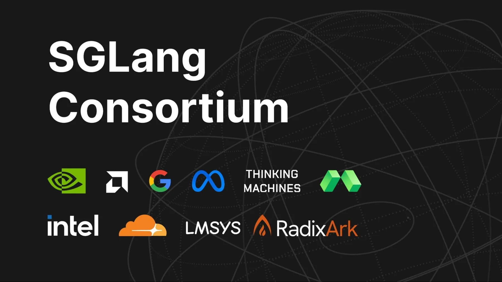
  </a>
  <figcaption>The SGLang Consortium brings together nine founding members.</figcaption>
</figure>
<figure class="summit-figure">
  <a href="/images/blog/sglang-summit-2026/keynote-video-message.webp" target="_blank" rel="noopener noreferrer" aria-label="Dr. Lisa Su’s video message followed the fireside chat with Vamsi Boppana and Lianmin Zheng. — view larger (opens in a new tab)">
    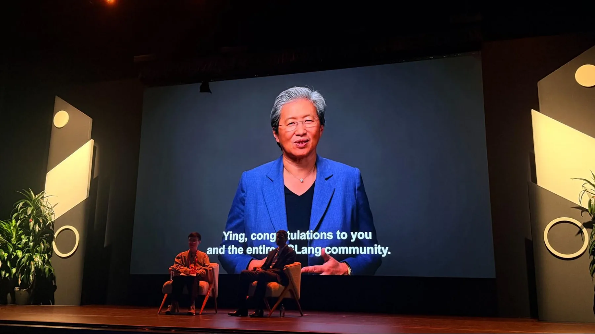
  </a>
  <figcaption>Dr. Lisa Su’s video message followed the fireside chat with Vamsi Boppana and Lianmin Zheng.</figcaption>
</figure>

As an example of what deeper collaboration can deliver, the opening presentation also featured joint optimization work by SGLang and NVIDIA on Kimi K3.1 Pro. AgentX results using NVIDIA Dynamo and SGLang on Vera Rubin showed up to 6× the total token throughput per GPU of the GB300 baseline. The gains followed just a few weeks of close collaboration between the two teams.

<figure class="summit-figure summit-figure--graphic">
  
  <figcaption>Joint SGLang and NVIDIA optimization results for Kimi K3.1 Pro, presented at the opening keynote.</figcaption>
</figure>

### SGLang v1.0 sets the next milestone for production inference

The SGLang v1.0 announcement puts reliability and compatibility at the center of the project’s next release. The work focuses on strengthening existing functionality, surfacing configuration problems clearly, and establishing compatibility expectations for the 1.x series.

SGLang’s existing serving capabilities include speculative decoding, Rust implementations of performance-sensitive components, hierarchical caching, and flexible parallelism. The v1.0 effort aims to make these capabilities more dependable as teams deploy and upgrade their inference systems.

The opening keynote connected that work to the demands of newer models and agents. Hybrid model architectures require different types of state to be managed together, while long-running agents accumulate histories that can exceed GPU memory. Unified memory management and hierarchical caching help address those constraints by supporting reuse across different types of state and storage.

<figure class="summit-figure">
  
  <figcaption>Ying Sheng announces SGLang v1.0.</figcaption>
</figure>

Release progress and migration guidance are documented in the [SGLang 1.0 release tracker](https://github.com/sgl-project/sglang/issues/50045).

### Miles v0.2 expands reinforcement learning across hardware and workloads

RadixArk released Miles v0.2, expanding the framework’s support for reinforcement learning across NVIDIA and AMD GPUs and Google TPUs, with Trainium support forthcoming.

Beyond support for multiple hardware platforms, the release broadens the workloads developers can train. For multimodal RL, a shared media processor handles images, video, and audio so rollout generation and training use the same token representations. Expanded multi-LoRA support lets multiple adapters share a base model, while Miles-Diffusion adds asynchronous training and support for additional diffusion models.

Miles v0.2 also addresses training drift caused by stale samples. Experimental fault tolerance is designed to let a training run continue if part of the system fails.

The code and implementation details are available in the [Miles v0.2 release notes](https://github.com/radixark/miles/releases/tag/v0.2.0).

<figure class="summit-figure">
  
  <figcaption>Banghua Zhu presents Miles v0.2.</figcaption>
</figure>

### SGLang powers NVIDIA NIM Certified microservices

NVIDIA and the SGLang team announced that SGLang now powers NVIDIA NIM Certified microservices. NIM packages the inference engine with validated containers, optimized configurations for supported models and NVIDIA GPUs, and ongoing security maintenance, giving enterprise teams a tested starting point for deployment. Optional enterprise support is available through an active NVIDIA AI Enterprise subscription.

Read the [NVIDIA NIM announcement](https://www.lmsys.org/blog/2026-11-13-sglang-nvidia-nim).

### Intel collaboration and AWS Trainium preview extend hardware support

Intel and RadixArk [announced a collaboration](https://www.intel.com/content/www/us/en/newsroom/news/artificial-intelligence/radixark-open-ai-inference.html) to optimize SGLang for Intel platforms, including CPUs, GPUs, and accelerators. The work emphasizes contributing optimizations directly to the open-source framework, giving developers additional deployment options through SGLang.

The collaboration brings hardware-specific engineering into the shared software stack, with the aim of making production inference more efficient and cost-effective on Intel infrastructure.

Separately, SGLang-Neuron v0.1.0 became open source and available in public preview. Co-developed by the SGLang team at RadixArk and Amazon Annapurna Labs, the PyTorch-native plugin brings SGLang’s serving stack to AWS Trainium for supported language and diffusion models.

The preview includes an asynchronous runtime, optimized kernels, and caching capabilities. Developers can get started through the AWS Deep Learning Container for SGLang-Neuron and the [public release announcement](https://www.lmsys.org/blog/2026-11-12-sglang-neuron-v0.1.0).

<figure class="summit-figure">
  <a href="/images/blog/sglang-summit-2026/radixark-intel-announcement.webp" target="_blank" rel="noopener noreferrer" aria-label="Intel and RadixArk announce their collaboration on open AI inference. — view larger (opens in a new tab)">
    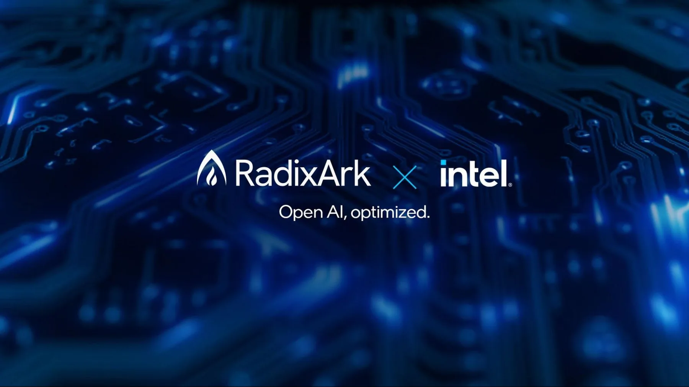
  </a>
  <figcaption>Intel and RadixArk announce their collaboration on open AI inference.</figcaption>
</figure>
<figure class="summit-figure">
  <a href="/images/blog/sglang-summit-2026/sglang-neuron-release.webp" target="_blank" rel="noopener noreferrer" aria-label="SGLang-Neuron v0.1.0 brings SGLang’s serving stack to AWS Trainium. — view larger (opens in a new tab)">
    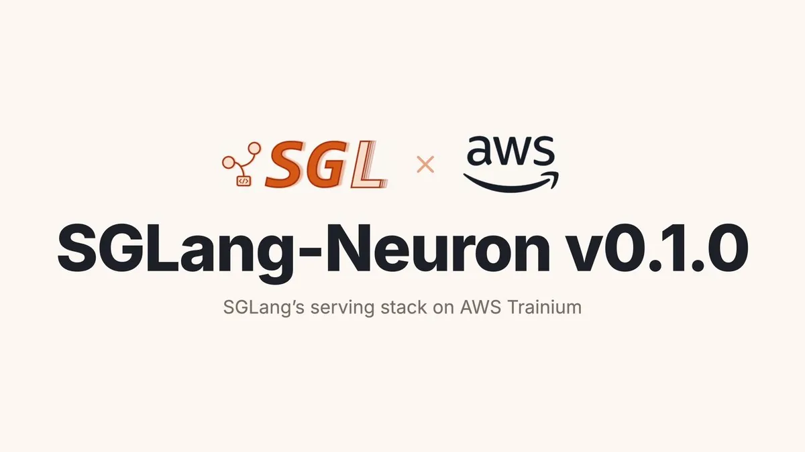
  </a>
  <figcaption>SGLang-Neuron v0.1.0 brings SGLang’s serving stack to AWS Trainium.</figcaption>
</figure>

## Themes from the talks

### Hardware partners advance SGLang across platforms

Hardware partners shared how they are adapting SGLang to different architectures and agentic workloads. Ujval Kapasi, NVIDIA’s VP of AI & HPC Frameworks and Libraries, highlighted work on Vera Rubin, Dynamo integration for cache-aware routing and distributed serving, and faster replica startup through Dynamo Snapshot and Model Express. He also discussed Vera CPUs for agent sandboxes and RL workloads. Luis Ceze, NVIDIA’s VP of AI Systems Software and Compilers, explored how agents can accelerate kernel optimization, with compiler feedback and independent correctness checks guiding development, and FlashInfer bringing improved kernels into SGLang.

Colin Brace, VP of Technology at AWS’s Annapurna Labs, presented native SGLang on Trainium, developed with RadixArk using PyTorch and optimized Neuron kernels, including day-zero support for Kimi K3.1 Pro. Nancy Zheng, Cerebras’ VP of Engineering for Inference, showed how pairing GPU prefill with wafer-scale decode addresses the different compute and memory demands of inference, combining efficient input processing with fast token generation.

AMD’s SVP of AI, Vamsi Boppana, highlighted Muse Spark Open optimizations and day-zero Kimi K3.1 Pro support on AMD GPUs, alongside collaboration on MI455 and Miles. The fireside chat with Bill Jia, Google’s VP of Engineering for Core ML/AI, explored TorchTPU’s work with SGLang and Miles, workload-specific TPU design, and AI-generated kernels. Together, these sessions highlighted how open software and joint engineering give developers more flexibility in how they train and serve models.

<figure class="summit-figure">
  
  <figcaption>NVIDIA’s Ujval Kapasi on inference infrastructure.</figcaption>
</figure>
<figure class="summit-figure">
  <a href="/images/blog/sglang-summit-2026/gpu-programming-presentation.webp" target="_blank" rel="noopener noreferrer" aria-label="NVIDIA’s Luis Ceze on agents, compilers, and kernel optimization. — view larger (opens in a new tab)">
    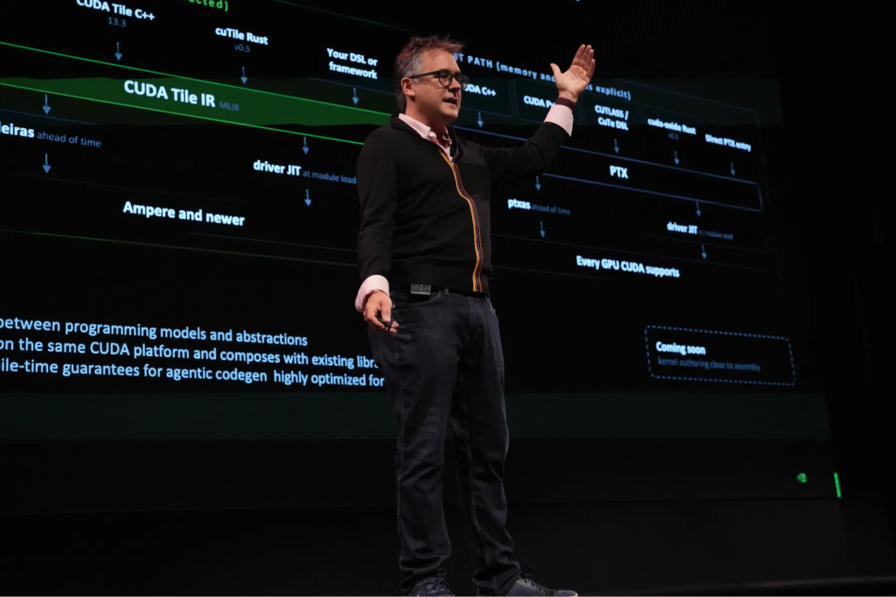
  </a>
  <figcaption>NVIDIA’s Luis Ceze on agents, compilers, and kernel optimization.</figcaption>
</figure>
<figure class="summit-figure">
  
  <figcaption>AWS’s Colin Brace on native SGLang on Trainium.</figcaption>
</figure>
<figure class="summit-figure">
  <a href="/images/blog/sglang-summit-2026/keynote-speaker.webp" target="_blank" rel="noopener noreferrer" aria-label="Cerebras’ Nancy Zheng on GPU prefill and wafer-scale decode. — view larger (opens in a new tab)">
    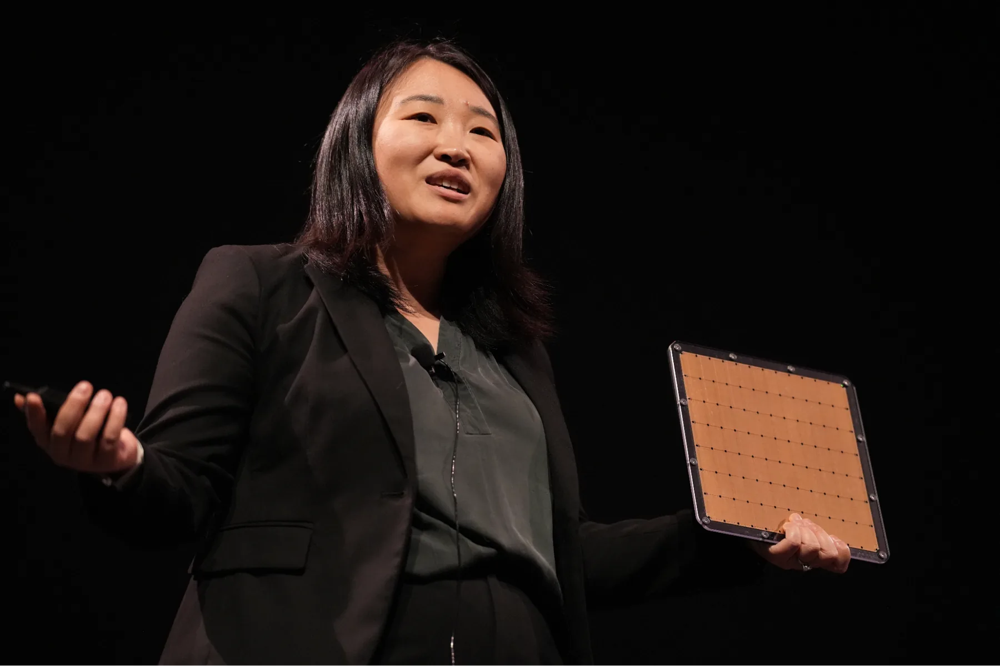
  </a>
  <figcaption>Cerebras’ Nancy Zheng on GPU prefill and wafer-scale decode.</figcaption>
</figure>
<figure class="summit-figure">
  
  <figcaption>AMD’s Vamsi Boppana in conversation with Lianmin Zheng.</figcaption>
</figure>
<figure class="summit-figure">
  
  <figcaption>Google’s Bill Jia on TPUs and open AI infrastructure.</figcaption>
</figure>

### Production lessons take center stage

Over the past year, SGLang has grown from a handful of early adopters to 332 organizations across the AI ecosystem. That growth took sustained engineering work: helping teams bring up new workloads, debugging production issues together, supporting more hardware, and earning trust one deployment at a time. Every team that gave SGLang a chance, shared feedback, or contributed a fix helped make this progress possible.

<figure class="summit-figure">
  <a href="/images/blog/sglang-summit-2026/sglang-community-keynote.webp" target="_blank" rel="noopener noreferrer" aria-label="Lianmin Zheng shares SGLang’s growth to 332 organizations. — view larger (opens in a new tab)">
    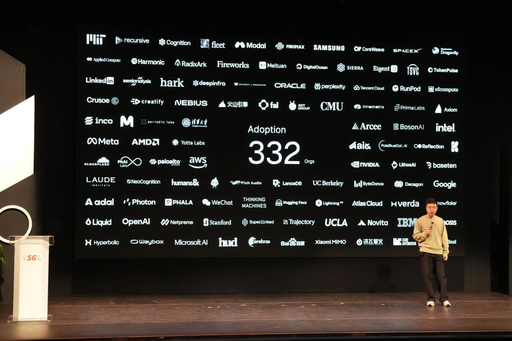
  </a>
  <figcaption>Lianmin Zheng shares SGLang’s growth to 332 organizations.</figcaption>
</figure>

At Meta, SGLang powers production inference for products serving billions of users. On the main stage, Meta’s Lianmin Zheng showed how the SGLang runtime supports Muse App, Muse Code, Model API, the Meta family of apps, and image and video workloads, with an infrastructure spanning NVIDIA GPUs, AMD GPUs, Google TPUs, and Meta MTIA.

Meta also reported more than 2× GPU savings after migrating from its prior inference solutions, validated at large scale across multiple hardware platforms. The team highlighted three reasons for choosing SGLang: a strong community with fast feedback and shared engineering, an efficient engine core built around scheduling, caching, and kernels, and the flexibility to extend it for production integration.

Together, these results show what SGLang can deliver under the demands of large-scale production: measurable infrastructure savings across diverse applications and hardware.

<figure class="summit-figure">
  <a href="/images/blog/sglang-summit-2026/meta-serving-presentation.webp" target="_blank" rel="noopener noreferrer" aria-label="SGLang supports inference across Meta’s products and hardware platforms. — view larger (opens in a new tab)">
    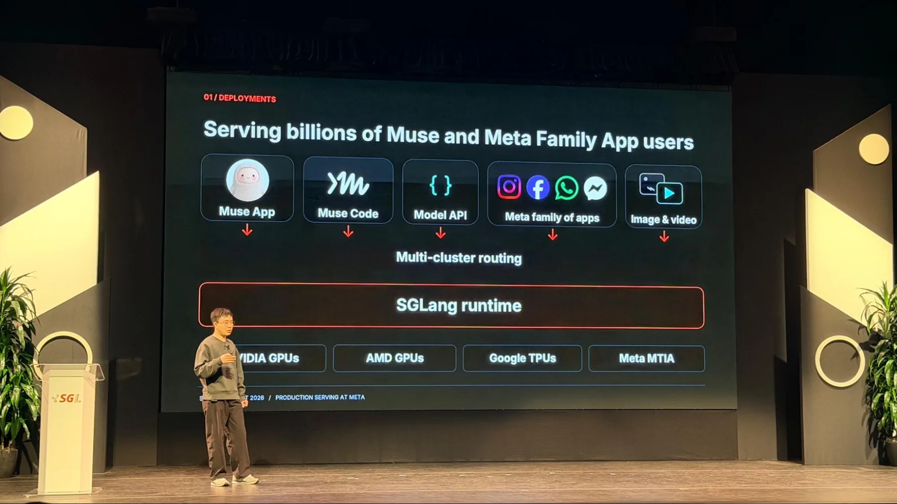
  </a>
  <figcaption>SGLang supports inference across Meta’s products and hardware platforms.</figcaption>
</figure>
<figure class="summit-figure">
  <a href="/images/blog/sglang-summit-2026/meta-sglang-talk.webp" target="_blank" rel="noopener noreferrer" aria-label="Meta’s production experience: community, engine efficiency, and flexibility. — view larger (opens in a new tab)">
    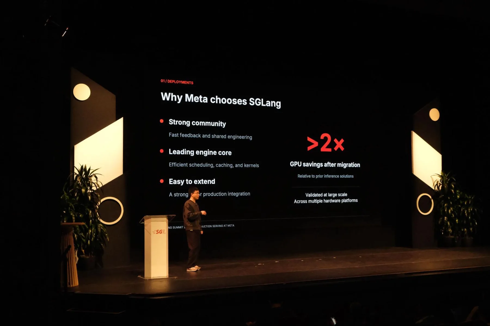
  </a>
  <figcaption>Meta’s production experience: community, engine efficiency, and flexibility.</figcaption>
</figure>

Across the two days, teams from Modal, Cloudflare, Crusoe, Fireworks, Baseten, DigitalOcean, LinkedIn, and others added perspectives from their own production environments. Their sessions brought practical engineering questions into focus: how to serve demanding workloads, integrate inference into complete applications, and maintain performance under real operating conditions.

The production discussion extended from inference to training and post-training, connecting SGLang’s serving capabilities with the reinforcement learning workflows being developed around Miles. Sessions on Meta’s work with TorchTitan and Miles explored the training infrastructure behind these workflows.

humans& CEO Eric Zelikman discussed the training and infrastructure needed to build AI that collaborates with people over time. Speakers from humans&, Applied Compute, and Mercor explored advances in post-training, from scaling reinforcement learning infrastructure to training agents for real-world work.

<figure class="summit-figure">
  <a href="/images/blog/sglang-summit-2026/ai-compute-panel.webp" target="_blank" rel="noopener noreferrer" aria-label="The AI Compute Panel brings together perspectives from production deployments. — view larger (opens in a new tab)">
    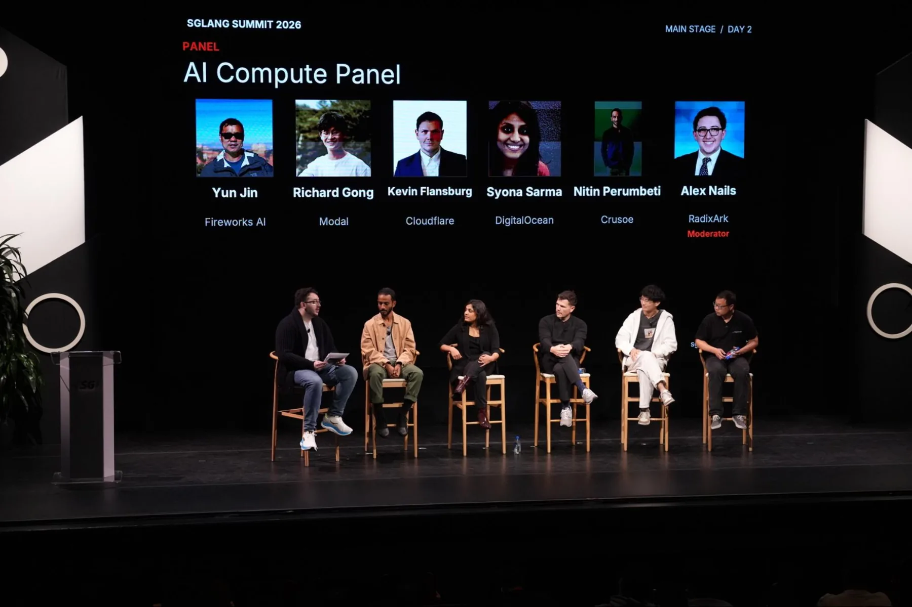
  </a>
  <figcaption>The AI Compute Panel brings together perspectives from production deployments.</figcaption>
</figure>
<figure class="summit-figure">
  
  <figcaption>The post-training panel connects model development with production infrastructure.</figcaption>
</figure>

These examples help shape the engineering agenda for SGLang and Miles. Production experience brings concrete requirements back to the projects: improvements must hold up across complete applications, diverse hardware, changing workloads, and full training runs. Thank you to every team that shared both its results and the engineering lessons behind them.

### AI leaders discuss what comes next

Main stage sessions featured fireside conversations with Intel CEO Lip-Bu Tan, OpenAI’s Lilian Weng, Thinking Machines Lab CTO Soumith Chintala, and Periodic Labs co-founder and co-CEO Liam Fedus, along with Perplexity co-founder and CEO Aravind Srinivas’s presentation, “Building the Next Computer.”

Intel CEO Lip-Bu Tan spoke about the need for new chip architectures to reduce AI’s power demands. He compared the energy required by large computing systems with the human brain, which he noted uses about 20 watts. Over the next 10 to 15 years, he hopes to help develop architectures beyond CPUs and GPUs, raising neuromorphic computing as one possibility for delivering more performance with far less power.

Lilian Weng described how coding agents are changing the way researchers work. Ideas that once had to wait because of limited time or resources can now be tested more quickly. She likened the researcher’s role to that of a team lead: directing agents as they handle implementation, with more time to explore higher-level questions.

<figure class="summit-figure">
  <a href="/images/blog/sglang-summit-2026/fireside-chat-summit-stage.webp" target="_blank" rel="noopener noreferrer" aria-label="Intel’s Lip-Bu Tan discusses the future of AI hardware. — view larger (opens in a new tab)">
    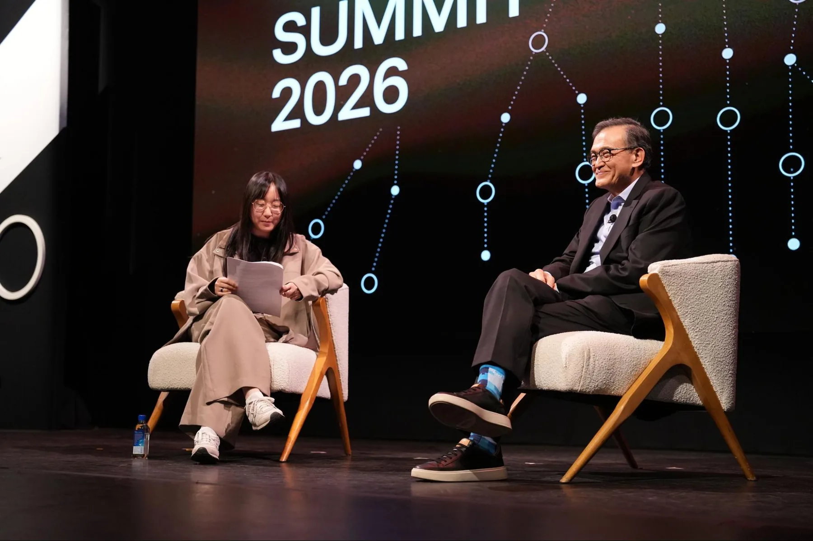
  </a>
  <figcaption>Intel’s Lip-Bu Tan discusses the future of AI hardware.</figcaption>
</figure>
<figure class="summit-figure">
  <a href="/images/blog/sglang-summit-2026/lilian-weng-fireside-chat.webp" target="_blank" rel="noopener noreferrer" aria-label="Lilian Weng discusses how coding agents are changing research. — view larger (opens in a new tab)">
    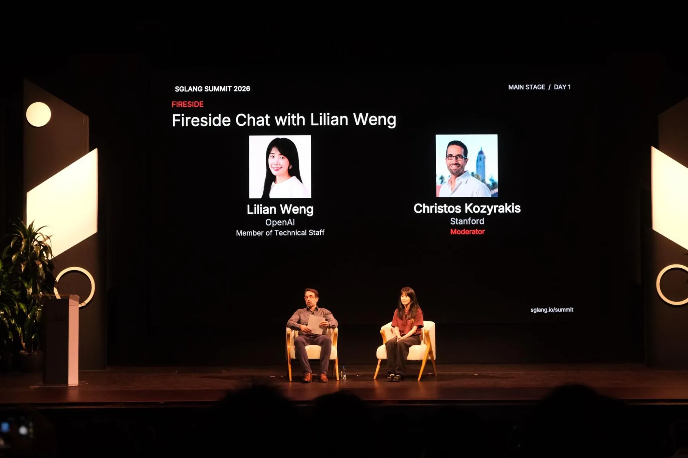
  </a>
  <figcaption>Lilian Weng discusses how coding agents are changing research.</figcaption>
</figure>

Thinking Machines Lab CTO Soumith Chintala discussed how frontier model capabilities could evolve, including the possibility of surpassing human abilities. He reflected on the difficulty of predicting what that future will look like and whether previous technological revolutions offer a useful guide.

Periodic Labs co-founder and co-CEO Liam Fedus discussed how open-source infrastructure can help accelerate scientific discovery. His fireside conversation explored the opportunity for emerging AI labs to turn advances in model capabilities into scientific progress, and the shared tools and infrastructure that can support that work.

Aravind Srinivas outlined a vision of agents carrying out sustained work across local and cloud environments. His presentation connected that vision to concrete requirements: grounding work in search, preserving recoverable state, and enforcing boundaries around execution. It also described local agents retaining control while selectively seeking help from the cloud.

<figure class="summit-figure">
  <a href="/images/blog/sglang-summit-2026/main-stage-conversation.webp" target="_blank" rel="noopener noreferrer" aria-label="Thinking Machines Lab’s Soumith Chintala on frontier model capabilities. — view larger (opens in a new tab)">
    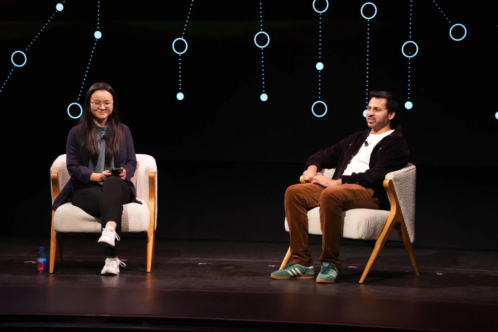
  </a>
  <figcaption>Thinking Machines Lab’s Soumith Chintala on frontier model capabilities.</figcaption>
</figure>
<figure class="summit-figure">
  <a href="/images/blog/sglang-summit-2026/fireside-conversation-main-stage.webp" target="_blank" rel="noopener noreferrer" aria-label="Periodic Labs’ Liam Fedus on AI and scientific discovery. — view larger (opens in a new tab)">
    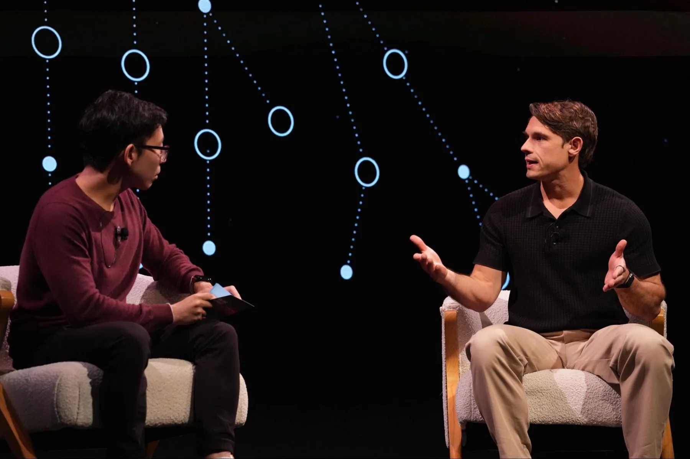
  </a>
  <figcaption>Periodic Labs’ Liam Fedus on AI and scientific discovery.</figcaption>
</figure>
<figure class="summit-figure">
  <a href="/images/blog/sglang-summit-2026/search-grounded-computing-talk.webp" target="_blank" rel="noopener noreferrer" aria-label="Perplexity’s Aravind Srinivas presents “Building the Next Computer.” — view larger (opens in a new tab)">
    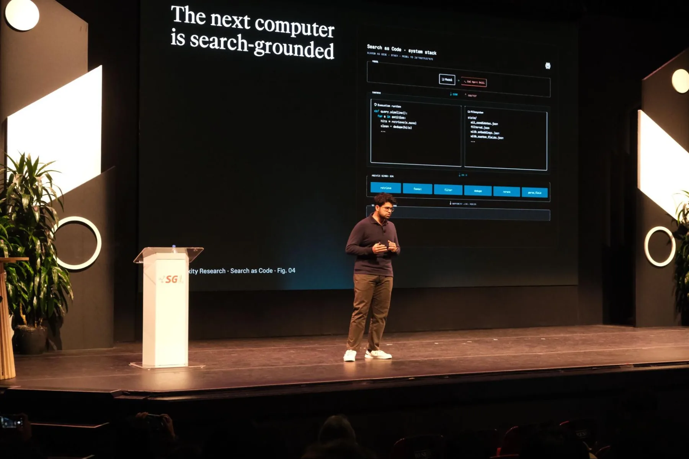
  </a>
  <figcaption>Perplexity’s Aravind Srinivas presents “Building the Next Computer.”</figcaption>
</figure>

## Breakout sessions: building the engine for the agentic era

AI is moving from answering questions to getting things done, and SGLang is becoming the engine behind that shift. Across six breakout rooms and more than 90 technical talks, we saw SGLang evolving on every front for AI agents. Sessions on HiCache and Mooncake showed how SGLang can remember and reuse an agent’s ever-growing context across GPU memory, CPU memory, and shared storage, reporting a 60% reduction in the median wait for the first response. It has also become the rollout engine for reinforcement learning, powering frameworks like Miles. Speakers also presented weight-sync techniques that keep rollout fleets up to date while sending only about 1% of the model per update.

Other sessions explored how AI agents can improve the infrastructure they run on. Speakers reported up to 1.4× faster decoding with GPU megakernels written by AI agents, with output bitwise-identical to the original. Agents also helped bring SGLang to a new chip in just one week. These talks offered a look at how agent-assisted development could help improve performance and extend hardware support.

<figure class="summit-figure">
  
  <figcaption>Technical sessions bring the community together around the inference stack.</figcaption>
</figure>
<figure class="summit-figure">
  <a href="/images/blog/sglang-summit-2026/breakout-session-discussion.webp" target="_blank" rel="noopener noreferrer" aria-label="Attendees compare ideas across six breakout rooms. — view larger (opens in a new tab)">
    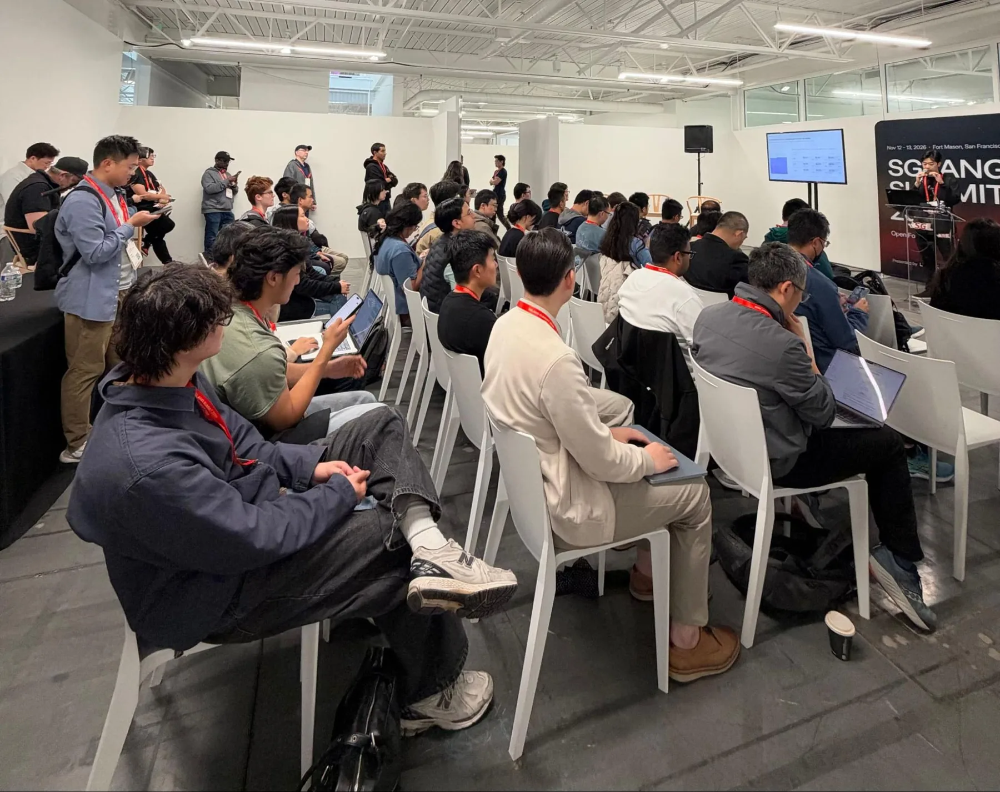
  </a>
  <figcaption>Attendees compare ideas across six breakout rooms.</figcaption>
</figure>
<figure class="summit-figure">
  <a href="/images/blog/sglang-summit-2026/breakout-room-presenter.webp" target="_blank" rel="noopener noreferrer" aria-label="Engineers share implementation details and lessons from their work. — view larger (opens in a new tab)">
    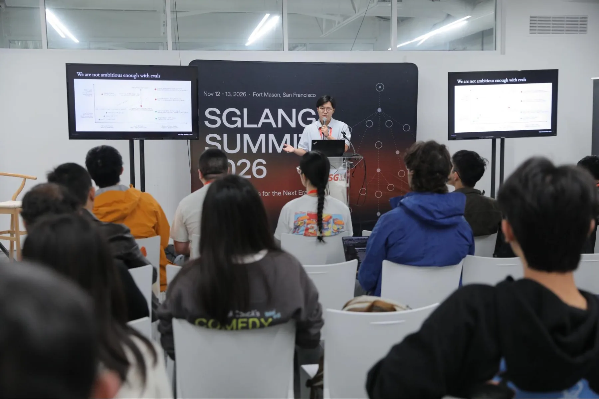
  </a>
  <figcaption>Engineers share implementation details and lessons from their work.</figcaption>
</figure>
<figure class="summit-figure">
  <a href="/images/blog/sglang-summit-2026/breakout-session-presentation.webp" target="_blank" rel="noopener noreferrer" aria-label="Breakout talks connect new techniques with practical deployments. — view larger (opens in a new tab)">
    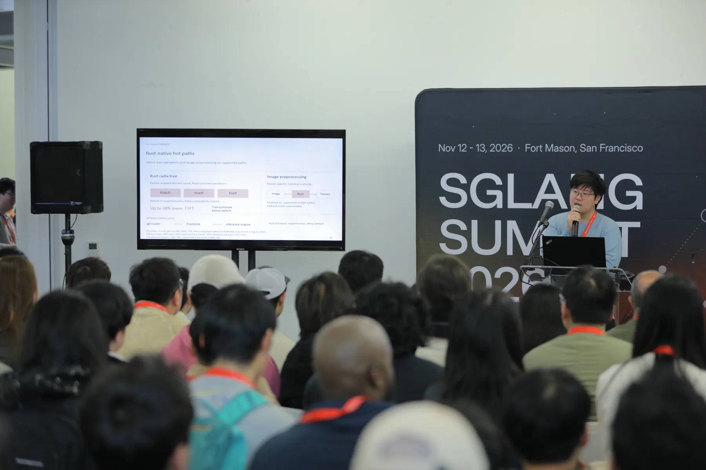
  </a>
  <figcaption>Breakout talks connect new techniques with practical deployments.</figcaption>
</figure>

## Hands-on workshops put SGLang and Miles to work

Alongside the main stage, six partner-led workshops gave attendees a chance to run the stack themselves. NVIDIA took people from an introduction to Miles straight into a working RL loop, with each attendee running real training on two H100s in a Jupyter notebook. AMD showed where the time goes in agentic RL on Instinct MI355X and how a series of optimizations lifted throughput 3.5×, before attendees launched multi-turn RL training themselves.

On the inference side, the Local AI Coding Lab, hosted by the SGLang and NVIDIA teams, had participants use a fully local coding agent, powered by Qwen3.8-27B on a single RTX PRO 6000 Blackwell, to debug and repair optimizations in Mini-SGLang. Nebius walked through inference optimization across the stack, from Vera Rubin hardware features and model compression to GB300 serving and agent-written CUDA kernels. Crusoe had attendees deploy SGLang on Managed Kubernetes and tune it under load. Modal supplied the “why,” deriving from first principles how today’s models and serving systems are designed.

<figure class="summit-figure">
  <a href="/images/blog/sglang-summit-2026/technical-workshop-presenter.webp" target="_blank" rel="noopener noreferrer" aria-label="Working through the stack together in a hands-on workshop. — view larger (opens in a new tab)">
    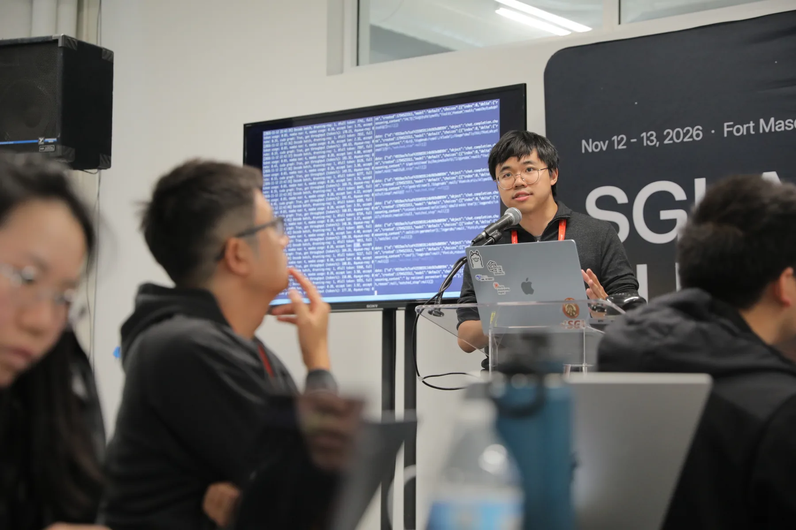
  </a>
  <figcaption>Working through the stack together in a hands-on workshop.</figcaption>
</figure>
<figure class="summit-figure">
  <a href="/images/blog/sglang-summit-2026/hands-on-workshop.webp" target="_blank" rel="noopener noreferrer" aria-label="Workshop discussions connect the concepts to running code. — view larger (opens in a new tab)">
    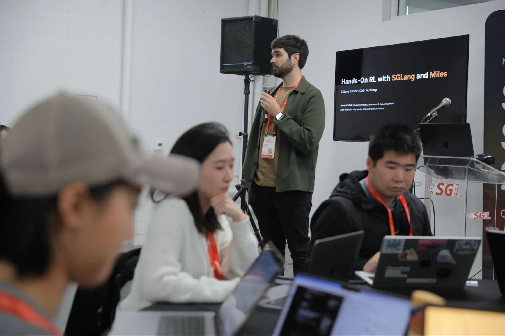
  </a>
  <figcaption>Workshop discussions connect the concepts to running code.</figcaption>
</figure>
<figure class="summit-figure">
  
  <figcaption>Attendees put inference and training techniques into practice.</figcaption>
</figure>

## Moments with the SGLang community

SGLang grows through collaboration across the stack. That breadth was reflected throughout the summit program, from AI hardware and inference infrastructure to training, agents, real-time AI, science, and robotics.

Bringing these communities together creates room for conversations across teams and disciplines: sharing production challenges, comparing approaches, and finding opportunities to work together.

### Expo booths

Those conversations continued across the expo floor. Sponsor booths brought teams and attendees together around demos, technical questions, and the practical challenges of building AI systems. For people who knew one another through code, issues, or online discussions, the summit was also a chance to finally meet face to face.

Select any photo to view it larger.

<figure class="summit-figure">
  <a href="/images/blog/sglang-summit-2026/upstairs-exhibition-area.webp" target="_blank" rel="noopener noreferrer" aria-label="Conversations continue across the expo floor. — view larger (opens in a new tab)">
    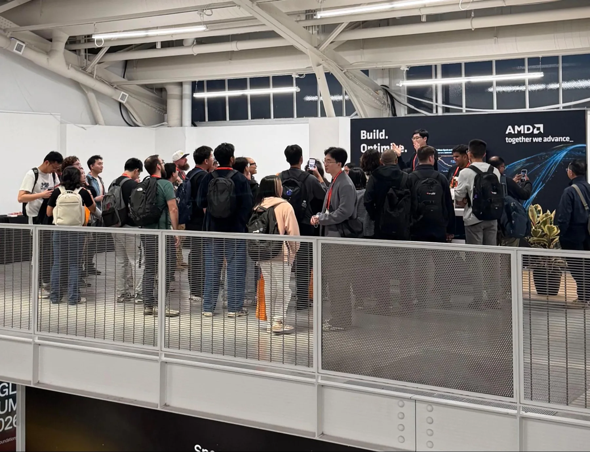
  </a>
  <figcaption>Conversations continue across the expo floor.</figcaption>
</figure>
<figure class="summit-figure">
  <a href="/images/blog/sglang-summit-2026/google-cloud-booth.webp" target="_blank" rel="noopener noreferrer" aria-label="Google Cloud — view larger (opens in a new tab)">
    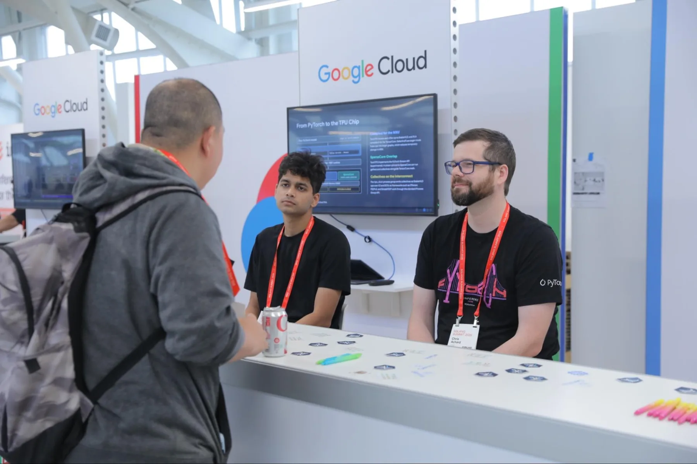
  </a>
  <figcaption>Google Cloud</figcaption>
</figure>
<figure class="summit-figure">
  <a href="/images/blog/sglang-summit-2026/pytorch-meta-booth.webp" target="_blank" rel="noopener noreferrer" aria-label="Meta and PyTorch — view larger (opens in a new tab)">
    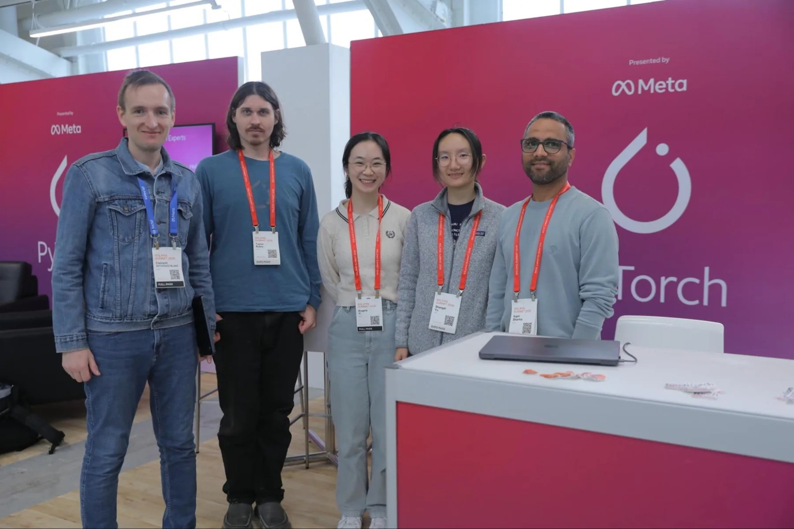
  </a>
  <figcaption>Meta and PyTorch</figcaption>
</figure>
<figure class="summit-figure">
  <a href="/images/blog/sglang-summit-2026/intel-booth.webp" target="_blank" rel="noopener noreferrer" aria-label="Intel — view larger (opens in a new tab)">
    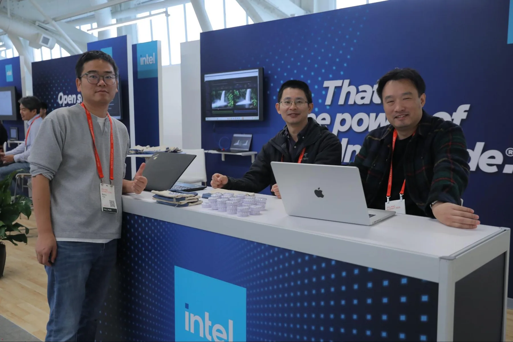
  </a>
  <figcaption>Intel</figcaption>
</figure>
<figure class="summit-figure">
  <a href="/images/blog/sglang-summit-2026/lancedb-booth.webp" target="_blank" rel="noopener noreferrer" aria-label="LanceDB — view larger (opens in a new tab)">
    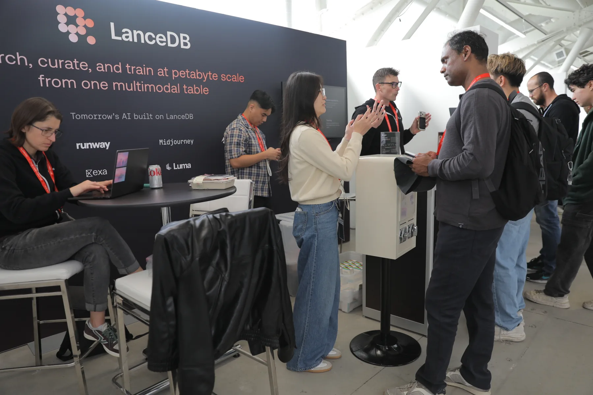
  </a>
  <figcaption>LanceDB</figcaption>
</figure>
<figure class="summit-figure">
  <a href="/images/blog/sglang-summit-2026/snowflake-booth.webp" target="_blank" rel="noopener noreferrer" aria-label="Snowflake — view larger (opens in a new tab)">
    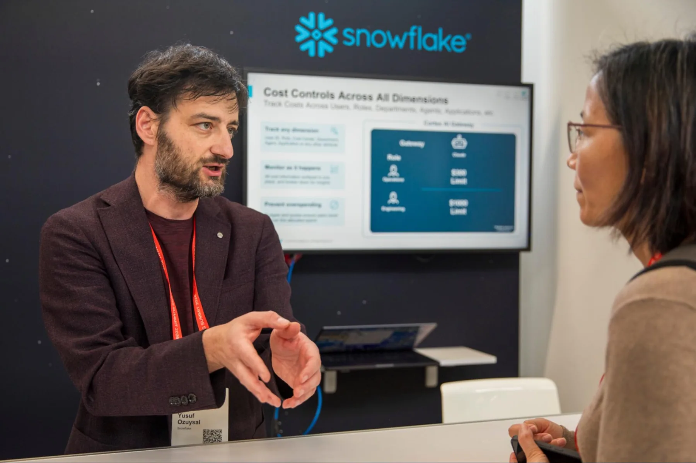
  </a>
  <figcaption>Snowflake</figcaption>
</figure>
<figure class="summit-figure">
  <a href="/images/blog/sglang-summit-2026/hardware-booth-demonstration.webp" target="_blank" rel="noopener noreferrer" aria-label="Demos and discussions — view larger (opens in a new tab)">
    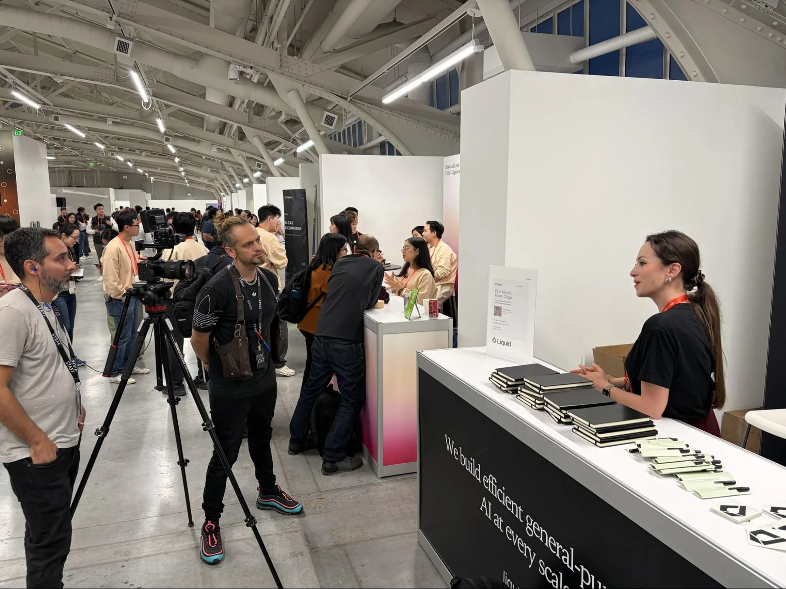
  </a>
  <figcaption>Demos and discussions</figcaption>
</figure>
<figure class="summit-figure">
  <a href="/images/blog/sglang-summit-2026/exhibition-floor-conversations.webp" target="_blank" rel="noopener noreferrer" aria-label="Meeting the teams behind the tools — view larger (opens in a new tab)">
    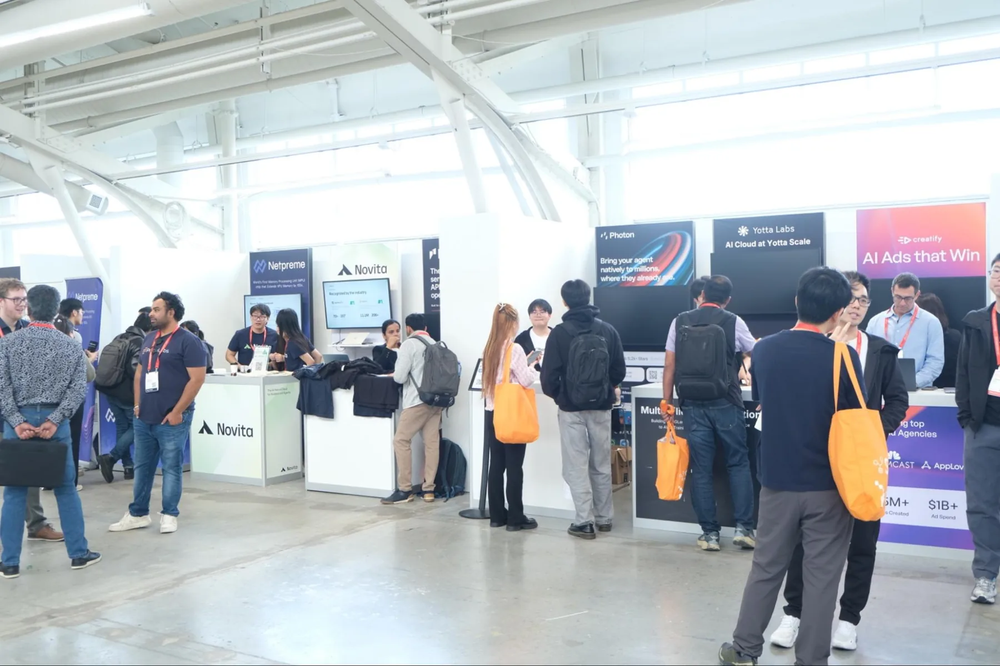
  </a>
  <figcaption>Meeting the teams behind the tools</figcaption>
</figure>
<figure class="summit-figure">
  
  <figcaption>Crusoe</figcaption>
</figure>
<figure class="summit-figure">
  <a href="/images/blog/sglang-summit-2026/liquid-booth.webp" target="_blank" rel="noopener noreferrer" aria-label="Liquid — view larger (opens in a new tab)">
    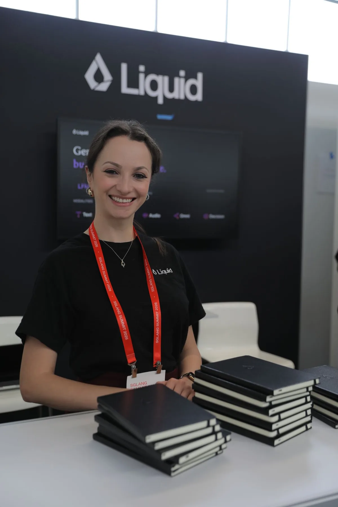
  </a>
  <figcaption>Liquid</figcaption>
</figure>
<figure class="summit-figure">
  <a href="/images/blog/sglang-summit-2026/aix-booth.webp" target="_blank" rel="noopener noreferrer" aria-label="ai&amp; — view larger (opens in a new tab)">
    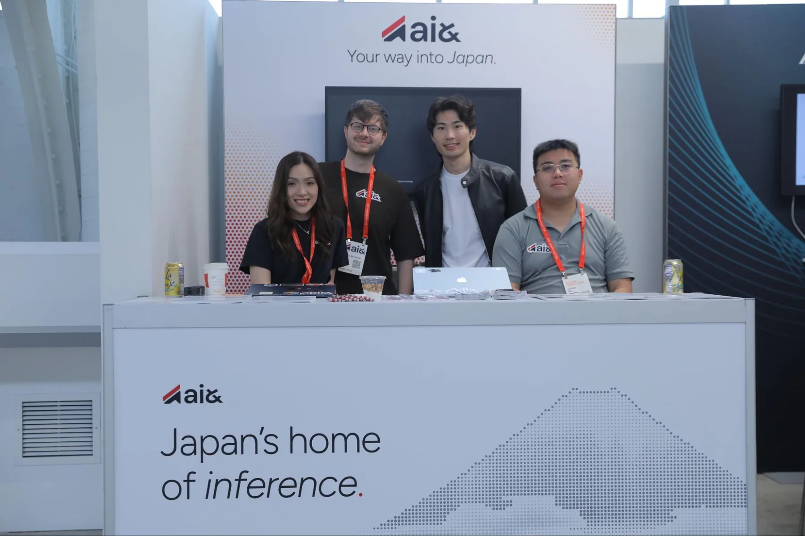
  </a>
  <figcaption>ai&amp;</figcaption>
</figure>
<figure class="summit-figure">
  
  <figcaption>Arcee</figcaption>
</figure>
<figure class="summit-figure">
  
  <figcaption>Baseten</figcaption>
</figure>
<figure class="summit-figure">
  
  <figcaption>Netpreme</figcaption>
</figure>
<figure class="summit-figure">
  <a href="/images/blog/sglang-summit-2026/expo-booth-visitors.webp" target="_blank" rel="noopener noreferrer" aria-label="Exploring the expo together — view larger (opens in a new tab)">
    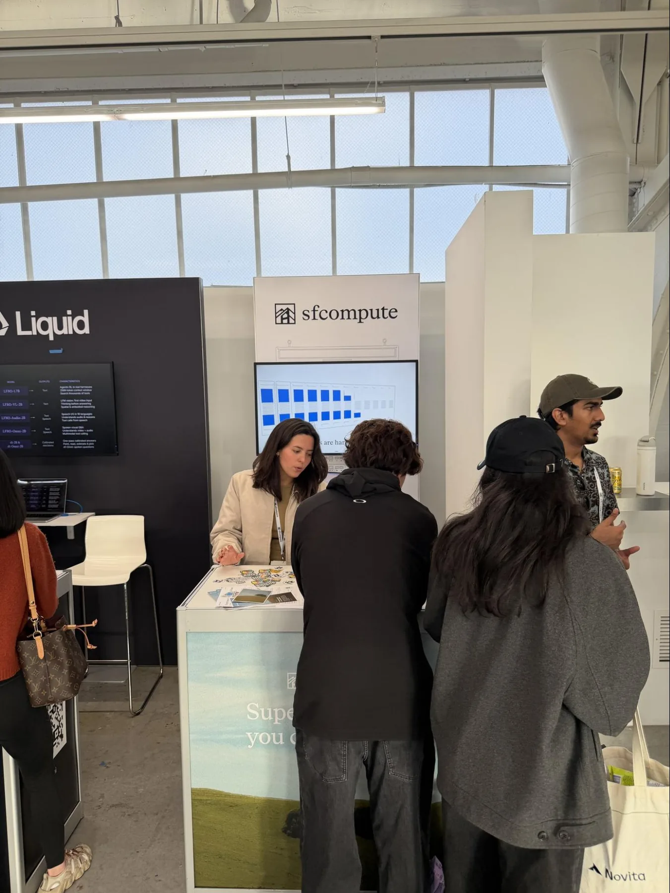
  </a>
  <figcaption>Exploring the expo together</figcaption>
</figure>
<figure class="summit-figure">
  <a href="/images/blog/sglang-summit-2026/novita-booth.webp" target="_blank" rel="noopener noreferrer" aria-label="Novita — view larger (opens in a new tab)">
    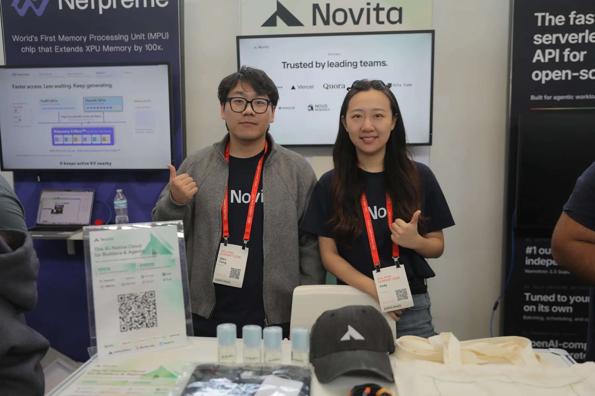
  </a>
  <figcaption>Novita</figcaption>
</figure>
<figure class="summit-figure">
  <a href="/images/blog/sglang-summit-2026/community-networking.webp" target="_blank" rel="noopener noreferrer" aria-label="A busy afternoon on the expo floor — view larger (opens in a new tab)">
    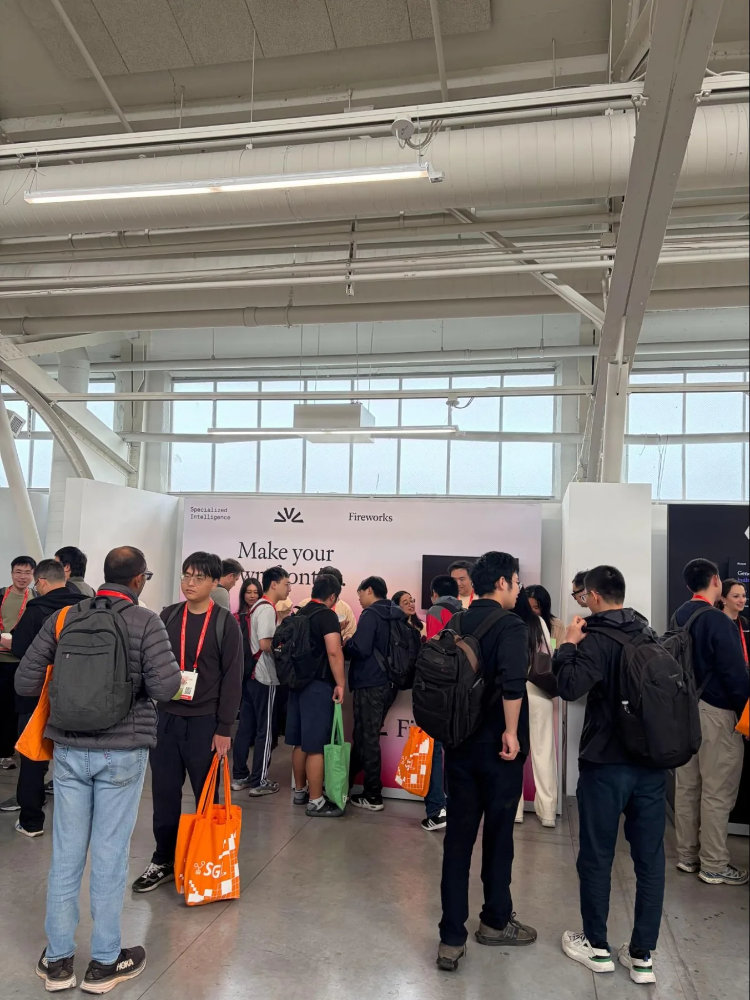
  </a>
  <figcaption>A busy afternoon on the expo floor</figcaption>
</figure>

Seeing so many teams represented in one place made the breadth of the SGLang ecosystem tangible. Across hardware, cloud infrastructure, models, and applications, people brought different perspectives on shared challenges and a chance to learn directly from one another.

Thank you to every exhibitor and workshop host who brought their work into the room, walked attendees through a demo, and took the time to answer questions. Those exchanges are an important part of how this ecosystem moves forward.

### GPU Expo

The GPU Expo brought the hardware side of the ecosystem into focus, giving attendees a closer look at the GPUs behind AI training and inference. Alongside the summit’s technical sessions, it offered another way to explore the infrastructure that supports the models and applications being built with SGLang.

<figure class="summit-figure">
  
  <figcaption>A closer look at the systems behind AI training and inference.</figcaption>
</figure>
<figure class="summit-figure">
  <a href="/images/blog/sglang-summit-2026/nvidia-hardware-display.webp" target="_blank" rel="noopener noreferrer" aria-label="The GPU Expo puts the hardware within reach. — view larger (opens in a new tab)">
    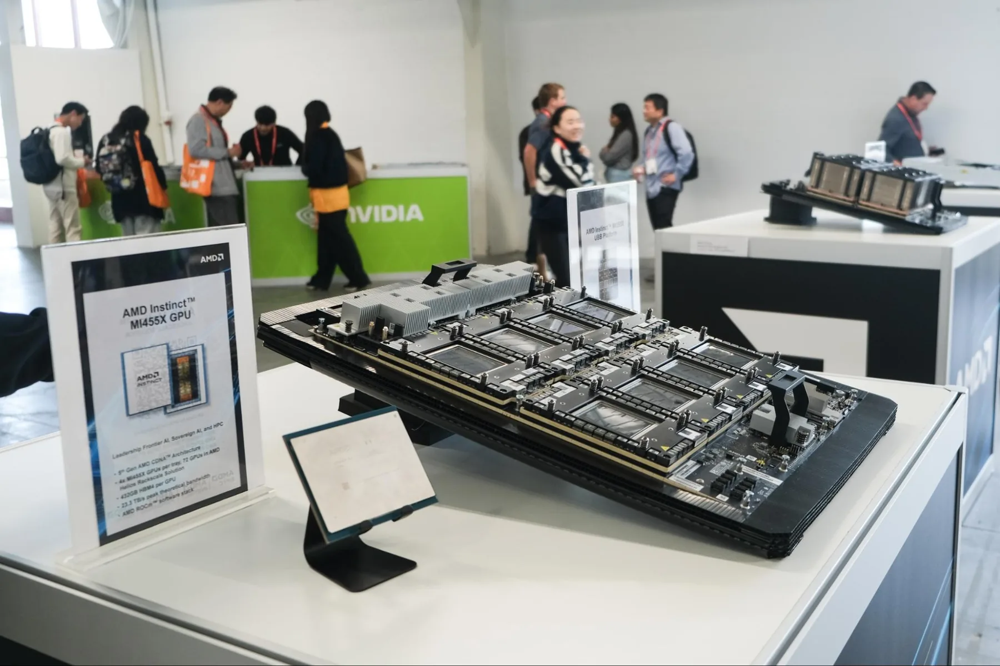
  </a>
  <figcaption>The GPU Expo puts the hardware within reach.</figcaption>
</figure>

### Beyond the booths

The summit also made room for people to relax, meet someone new, and enjoy the day together. Between sessions, attendees could grab a drink from Kyoto Matcha or Hedge Coffee, enjoy tanghulu, and continue conversations over breakfast and lunch.

<figure class="summit-figure">
  
  <figcaption>A sweet break between sessions.</figcaption>
</figure>
<figure class="summit-figure">
  
  <figcaption>Coffee and conversation at Hedge Coffee.</figcaption>
</figure>
<figure class="summit-figure">
  <a href="/images/blog/sglang-summit-2026/exo-hardware-demo.webp" target="_blank" rel="noopener noreferrer" aria-label="New connections across the SGLang community. — view larger (opens in a new tab)">
    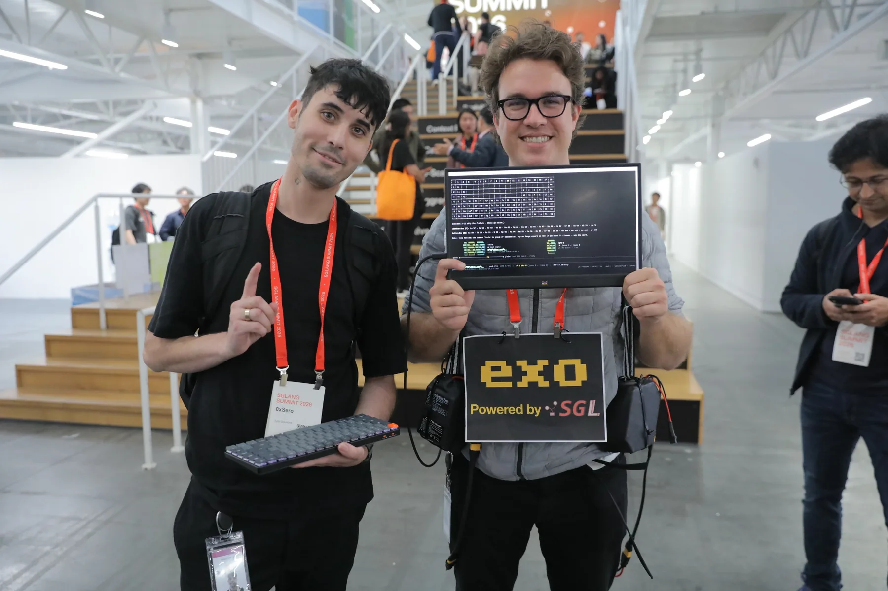
  </a>
  <figcaption>New connections across the SGLang community.</figcaption>
</figure>
<figure class="summit-figure">
  
  <figcaption>Attendees gather for a session at Fort Mason.</figcaption>
</figure>

Conversations over coffee, photos with new friends, and shared snacks were part of the summit, too. Thank you to everyone who helped make the summit a welcoming place to spend two days with the SGLang community.

## Thank you

We are grateful to the sponsors and community partners who helped make this gathering possible. Their support brought space, resources, and expertise to an event built around sharing and collaboration.

Thank you to our Platinum sponsors: Google, Intel, RadixArk, NVIDIA, Meta, and AMD; our Gold sponsors: AWS, Crusoe, DigitalOcean, Fireworks AI, Inco AI, LanceDB, Modal, Nebius, and Snowflake; and all our Silver, Star, Spark, and Community partners.

<figure class="summit-figure summit-figure--graphic">
  <a href="/images/blog/sglang-summit-2026/summit-sponsors.webp" target="_blank" rel="noopener noreferrer" aria-label="Thank you to the sponsors and community partners of SGLang Summit 2026. — view larger (opens in a new tab)">
    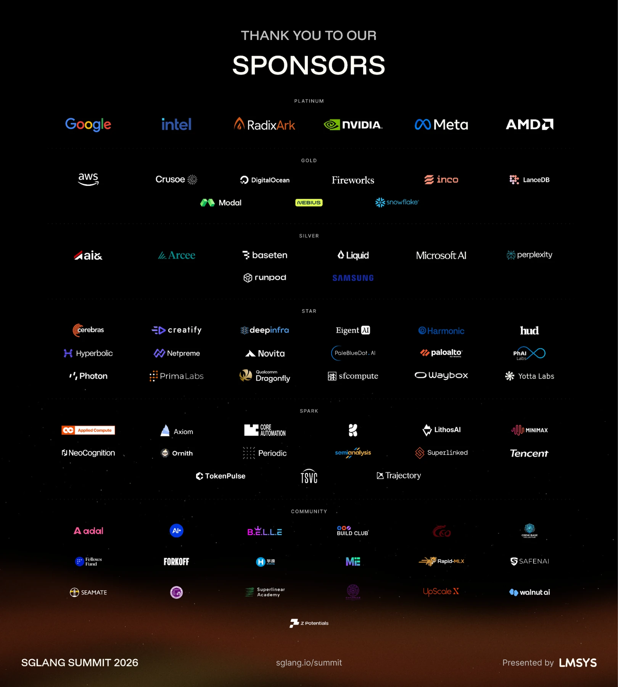
  </a>
  <figcaption>Thank you to the sponsors and community partners of SGLang Summit 2026.</figcaption>
</figure>

Most of all, thank you to everyone who joined us. To the speakers sharing their experience, the contributors improving the software, the teams building with SGLang, and the volunteers helping the event come together: each of you brought something to these two days.

The summit brought a broad ecosystem into one place. The work continues across teams, organizations, and time zones, and we’re excited to keep building it together.

Thank you for being part of SGLang.

<figure class="summit-figure">
  
  <figcaption>SGLang Summit 2026 at Fort Mason.</figcaption>
</figure>
<figure class="summit-figure">
  
  <figcaption>The community that made it possible.</figcaption>
</figure>

