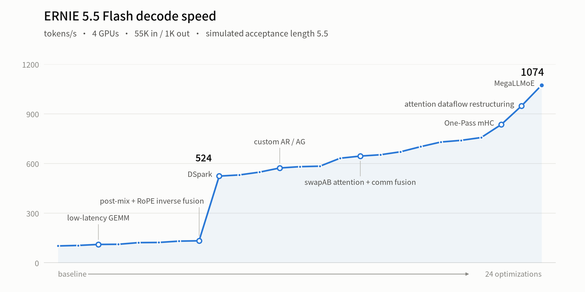
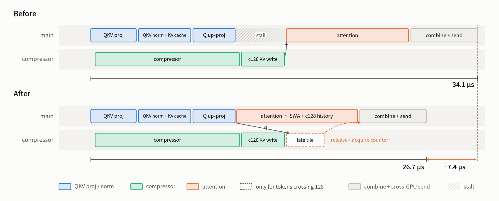
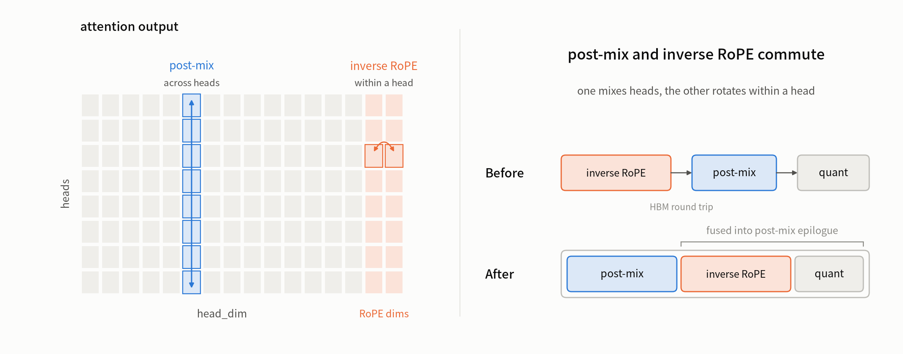
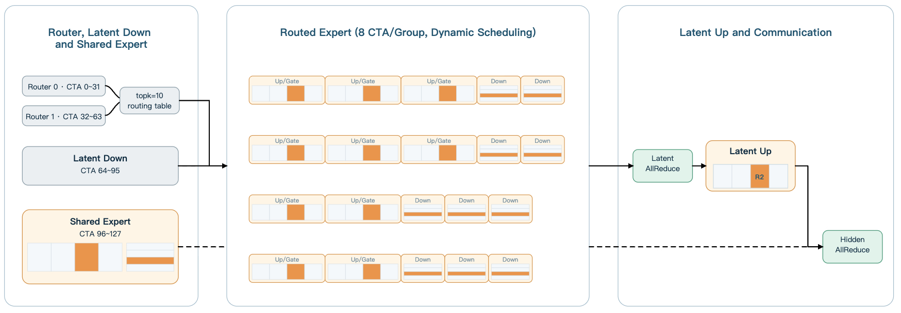
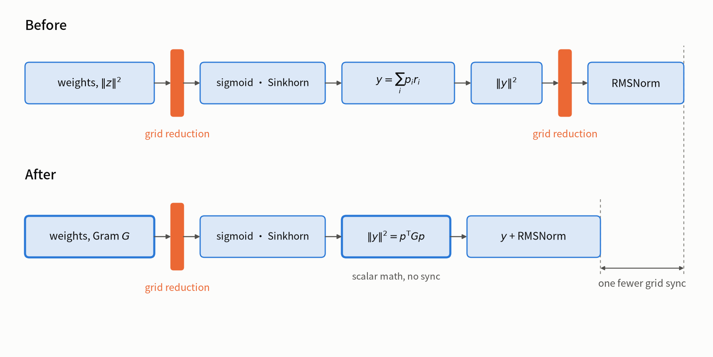

We have added low-latency decoding support for ERNIE 5.5 Flash to SGLang and optimized it end to end. On four SM100 GPUs, BS=1, 55K input tokens and 1K output tokens, we introduced low-latency GEMM and tensor parallelism, integrated DSpark speculative decoding, iteratively tuned compute-communication fusion, multi-stream execution and PDL, and completed optimizations including MegaLLMoE, attention dataflow restructuring and One-Pass mHC. With the final configuration of attention TP4 and MoE TP4, **decoding reaches 1074 tokens/s at a simulated mean DSpark acceptance length of 5.5, and about 1310 tokens/s with DSpark block size 7 at a simulated acceptance length of 7.2.**



Each point shows the end-to-end decoding speed after an optimization was merged, in merge order, with several key optimizations annotated. The first point is the naive DP/EP implementation, and TP4 is used from the second point on. All measurements after DSpark is enabled use a simulated acceptance length of 5.5.

## The Bottlenecks of Low-Latency Decoding

LLM decoding is autoregressive: each step depends on the output of the previous one. Pushing decoding speed to its limit generally means optimizing aggressively for low concurrency, where very few tokens take part in each step: one in regular decoding, and only a handful even with speculative decoding. Measured by the roofline model, its arithmetic intensity is far too low, making it a classic memory-bound workload. ERNIE 5.5 Flash is a large sparse MoE model that uses mHC to maintain multiple residual streams across layers. In this setting, every fine-grained architectural detail adds memory traffic, synchronization and communication overhead. Decoding here is therefore fundamentally latency-bound rather than compute-bound. The per-step time is determined by a serial critical path, which carries three main kinds of overhead: weight reads bounded by HBM bandwidth; scheduling, synchronization and other overheads unrelated to the amount of computation; and communication latency introduced by multi-GPU collaboration. The smaller the computation, the larger the share of the latter two, until they dominate the latency.

Decoding speed is the number of tokens produced per step divided by the per-step latency, so the optimization work splits into two directions. The first is to reduce the number of decoding steps: speculative decoding verifies multiple candidate tokens in parallel within one forward pass, yielding more decoded tokens at a small extra cost while raising arithmetic intensity. The second is to cut per-step latency: targeting the three kinds of overhead on the critical path, we push weight reads toward the bandwidth limit, cut fixed overheads through operator fusion, and hide communication latency by overlapping it with computation.

## A Low-Latency Foundation: Parallelism, Hardware Utilization, Operator Fusion and Kernel Overlap

**Moving Away from DP/EP: less communication, better load balance.** In low-latency scenarios, the choice of parallelism is driven by critical-path latency rather than throughput. Our analysis shows that if attention runs with data parallelism, all memory access and computation fall on a subset of ranks while the remaining ranks sit idle waiting for the heavily loaded ones. Tensor parallelism instead spreads computation and weight reads evenly across all ranks at the cost of a small amount of communication, which both uses the full compute of every GPU and shortens the serial time of the heavily loaded rank. The same holds for MoE. EP requires a round of cross-GPU exchange before and after expert computation, and each step has too little computation to hide the waiting. TP only needs to reduce the expert outputs, which lowers both the communication volume and the number of synchronizations. It also splits every expert evenly across all GPUs, eliminating the load skew caused by uneven routing under EP, so the layer latency is no longer bounded by the most heavily loaded GPU.

**Fine-grained GEMM: keeping SMs busy.** Blackwell's new FP8 UMMA instructions are designed for large matrices: each instruction covers a large matrix block, and tiles are partitioned coarsely when combined with TMA. At batch size 1 with TP partitioning, matrix dimensions are very small, and tiles cut at this granularity cannot fill all SMs, leaving much of the compute and memory bandwidth idle. We emulate the m16n8k32 MMA instruction to cut tiles more finely so that more SMs participate, and when there are fewer than 8 tokens we apply swapAB, mapping the token dimension to the N dimension to reduce padding. On per-rank TP4 decode shapes, this is up to 1.9× faster than DeepGEMM's FP8 GEMM (2048×1024 at M=6: 4.30 → 2.23 µs, PDL enabled for both). For routed experts, where weight reads dominate, we further adopt W4A8 mixed precision, pairing FP4 weights with FP8 activations. This halves weight memory traffic compared with FP8 and directly shortens read time under the bandwidth limit.

**Operator fusion: tight handoff between communication and computation.** Model inference involves many scattered small operators such as Norm, RoPE and merge. Each costs little to compute, yet each pays separately for kernel launch and for reading and writing intermediate activations, and these overheads are especially pronounced in low-latency scenarios. We merge adjacent small operators, removing thousands of kernel launches and memory reads and writes per decoding step. Cross-GPU communication is folded into computation as well: with symmetric memory, communication avoids the overhead of a collective-communication library and reduces to a few remote write instructions at the tail of the adjacent compute kernel, with arrival signaled by the data itself and no extra synchronization.

**Multi-stream execution and PDL: the critical path determines latency.** Even with more balanced work distribution and operator fusion, inference latency is still limited by serial kernel launch scheduling on the critical path. We therefore dispatch mutually independent computations to different streams to run in parallel, and cap the number of SMs available to off-critical-path kernels so that they do not take resources from critical-path kernels. In addition, almost all kernels in the model forward pass are launched with PDL (Programmatic Dependent Launch), so the launch and teardown overheads of adjacent kernels overlap. Some kernels also issue memory accesses that do not depend on preceding results ahead of time, further hiding serial overhead on the critical path.

## Attention Dataflow Restructuring: Keeping Sparse Operations off the Critical Path

ERNIE 5.5 Flash's attention uses the HCA and MLA-DSA sparse structures and includes two distinctive structural designs: cross-head low-rank post-mixing (VHA post-mix), which lets the outputs of different heads interact, and gated attention, which uses a gating projection to improve model quality. The cross-head interaction introduced by VHA also shapes the computation of attention post-processing.

Within attention itself, more than 80% of ERNIE 5.5 Flash's layers use HCA attention. In a conventional implementation, attention depends on the current layer's query together with keys and values from both the SWA window and the compressor. We observed that the compressor produces new compressed keys and values only once it has accumulated a full compression block of tokens, yet its execution chain sits ahead of the attention kernel and delays the kernel's launch; meanwhile, the compressor itself has very low GPU utilization. We therefore separate the compressor, together with the attention over the one KV block that depends on the newly compressed KV (late tile attention), from the main attention body and run them on a side stream using idle SMs. A lightweight release/acquire signal then notifies the combine kernel on the main stream to collect the result, avoiding kernel-level synchronization. This takes the compressor off the critical path of the HCA layer.



Building on this pipeline, we designed an attention kernel for 16 heads per rank under TP that folds the tail block: key/value cache blocks are scheduled independently; the query's RMSNorm and RoPE are fused into the attention prologue, with TMA hiding their cost; and the combined attention output is broadcast directly to every rank, eliminating a separate communication step.

The VHA post-mix structure linearly mixes across heads after inverse RoPE has been applied to the attention output. In this order, the inverse RoPE result must first be written back to HBM and then read in by post-mix, an unavoidable HBM round trip. We observed that inverse RoPE applies the same rotation within each head, while post-mix acts on an orthogonal dimension, so by associativity the two can be applied in either order. Exploiting this property, we swap the order of inverse RoPE and post-mix, and then merge inverse RoPE with the quantization for the output projection into the post-mix stage, avoiding two HBM round trips. Together with the cross-GPU write-back in the combine kernel, the four post-processing steps that were previously separated by communication are reduced to two kernels.



## MegaLLMoE: A Low-Latency MoE Megakernel

In ERNIE 5.5 Flash's Multi-Router Latent MoE layer, two groups of routers select 10 of 512 experts for each token. Routed experts compute in a 2048-dimensional latent space, while shared experts process the 4096-dimensional hidden input. In small-batch decoding, each stage has little computation, so kernel launches, inter-stage waiting and intermediate reads and writes noticeably increase per-step latency. **MegaLLMoE** fuses routing, expert computation and cross-GPU reduction into a single CUDA kernel, so each rank completes the forward pass of the whole layer with one kernel launch. It attacks per-step latency on three fronts: task parallelism, expert load balancing and cross-GPU communication.



* **Task orchestration by data dependency.** The router, Latent Down and the shared experts read the same input and can be computed in parallel by different CTAs (thread blocks). Latent Down/Up and expert computation both support Split-K to increase task parallelism, with partial sums added within a thread block cluster. The kernel marks data readiness with counters and bitmaps and uses lightweight release/acquire semantics for efficient synchronization between stages.
* **Weight tiling and dynamic task scheduling.** In small-batch decoding, active experts process few tokens and weight reads become the main bottleneck. The model uses a W4A8 mixed-precision scheme with FP4 weights and FP8 activations, reducing the overall amount of data read. Gate and Up weights are stored interleaved, loaded as whole blocks by TMA, and multiplied by UMMA. Groups of 8 CTAs cooperate on the same expert: within a group, CTAs compute the expert's projection in parallel along output channels, and across groups, Up/Gate and Down tasks are scheduled dynamically to balance load.
* **Overlapping communication with computation.** MegaLLMoE uses tensor parallelism to partition the FFN weights of both routed and shared experts, performing only one AllReduce each in the latent and hidden spaces. Both reductions use single-round NVLS multicast and detect data readiness through a Lamport slot protocol. The first reduction transfers routed-expert outputs block by block as they become ready, so communication overlaps with the computation of the remaining blocks.

## One-Pass mHC: Breaking the Serial Dependency with Bilinear Expansion

ERNIE 5.5 Flash uses mHC (Manifold-Constrained Hyper-Connections) to build multiple residual streams across layers: the input of each sublayer is obtained by weighted aggregation and normalization of the residual streams. Both the aggregation weights and the normalization scale depend on global reductions, and the two form a serial data dependency; this two-pass execution chain limits inference performance. In small-batch decoding, mHC's computation is negligible, and its performance is bounded almost entirely by the latency of the serial reduction chain.

The bilinearity of the inner product offers a way to break this dependency: we expand the squared norm of the aggregated result into a quadratic form of the aggregation weights over the Gram matrix of the residual streams. Since the Gram matrix depends only on the inputs, we compute it in the same reduction as the aggregation weights, and the normalization scale then follows from inexpensive scalar arithmetic. The two serial reductions thus merge algebraically into a single pass, and mHC is no longer a bottleneck.



On top of this, we fuse the cross-GPU communication between layers, mHC and low-precision quantization into a single kernel, with reduction results written directly into peer memory through symmetric memory. The Sinkhorn iterations that project the residual mixing matrix onto the doubly stochastic manifold have no data dependency on the MoE, so we schedule them on a separate stream to run in parallel, moving them off the critical path.

## DSpark Speculative Decoding: Multiple Tokens per Forward Pass

We introduced DSpark, a parallel speculative decoding scheme, in the post-training stage of ERNIE 5.5 Flash. Unlike MTP, which drafts autoregressively one token at a time, DSpark generates a whole block of candidates in parallel in a single forward pass, so the drafting cost does not grow linearly with the speculation length. The target model verifies multiple tokens in one forward pass, which shifts the critical-path bottleneck; we adjusted the partitioning of attention and the LM head accordingly to suit multi-token verification. While per-step time increases by less than half, the number of tokens produced per step multiplies.

## Performance Data and Reproduction

We use 4 SM100-architecture GPUs with CUDA 13.0, PyTorch 2.14.1 and HALOps 0.2.0. SGLang is built from [PR #52603](https://github.com/sgl-project/sglang/pull/52603). Both `--model-path` and `--speculative-draft-model-path` point to the same ERNIE 5.5 Flash checkpoint, which already contains the DSpark draft layers; download it separately.

Launch the server and run the benchmark as follows. Setting SGLANG_ERNIE55_LOW_LATENCY_DECODE=1 enables the low-latency backend, and the other three environment variables simulate an acceptance length of 5.5:

```bash
export SGLANG_ERNIE55_LOW_LATENCY_DECODE=1
export SGLANG_SIMULATE_ACC_LEN=5.5
export SGLANG_SIMULATE_ACC_GREEDY=1
export SGLANG_DSPARK_SIMULATE_FOLD=1

python -m sglang.launch_server \
  --model-path <model_path> \
  --speculative-algorithm DSPARK \
  --speculative-draft-model-path <model_path> \
  --speculative-dspark-block-size 5 \
  --tp-size 4 --quantization fp8 --bf16-gemm-backend torch \
  --max-running-requests 1 --cuda-graph-max-bs-decode 1 \
  --mem-fraction-static 0.8 --context-length 131072 \
  --trust-remote-code --port 30085
```
Reproduce the performance data with 55K input tokens and 1K output tokens:

```bash
python -m sglang.benchmark.serving \
  --backend sglang-oai-chat --base-url http://127.0.0.1:30085 \
  --dataset-name random --dataset-path <ShareGPT_V3_unfiltered_cleaned_split.json> \
  --random-input-len 56320 --random-output-len 1024 --random-range-ratio 1.0 \
  --num-prompts 10 --max-concurrency 1 --warmup-requests 1 \
  --extra-request-body '{"ignore_eos": true, "temperature": 0.0, "top_p": 1.0, "seed": 42}'
```
The table below shows the performance at the main optimization stages. After DSpark was integrated, data are measured at a simulated acceptance length of 5.5. Since the optimizations landed incrementally, we recorded the decoding speed and per-step time at each stage. Decoding speed is derived from the benchmark's mean TPOT (time per output token, excluding the first token) as 1 / TPOT, and per-step time is TPOT multiplied by the acceptance length.

| **Optimization**                                           | **Per-step time (ms)** | **Decoding speed (tokens/s)** |
| :--------------------------------------------------------- | :--------------------- | :---------------------------- |
| Naive DP/EP implementation                                 | 9.80                   | 102                           |
| Low-latency backend / TP                                   | 7.52                   | 133                           |
| DSpark speculative decoding                                | 10.5                   | 524                           |
| Communication-computation fusion / multi-stream / PDL      | 7.27                   | 757                           |
| One-Pass mHC / quantization fusion                         | 6.58                   | 836                           |
| Attention dataflow restructuring / multi-stream management | 5.80                   | 948                           |
| MegaLLMoE                                                  | 5.12                   | **1074**                      |

With DSpark block size 7 (`--speculative-dspark-block-size 7`) and a simulated acceptance length of 7.2 (`SGLANG_SIMULATE_ACC_LEN=7.2`), the per-step time rises to 5.50 ms, but each step yields more tokens, and decoding reaches about 1310 tokens/s.

Part of this work was done with the help of AI RSI. ERNIE Evolve contributed many valuable optimization ideas and practices, and the capability and creativity of AI RSI are reshaping how we do research and development. The core kernels in this article, including low-latency GEMM, the MegaLLMoE fused operator and One-Pass mHC, are open-sourced in the [HALOps repository](https://www.github.com/paddlepaddle/halops), which also contains more of our high-performance work for efficient LLM inference. Discussion and contributions are welcome.

## Acknowledgments

We thank the SGLang community for its high-performance open-source inference framework; the speculative decoding, CUDA Graph and benchmarking workflows in this article are built directly on SGLang. We thank DeepSeek for open-sourcing FlashMLA and DeepGEMM, which provided the starting point and baseline for our attention and GEMM optimizations. We thank the Triton team, whose Gluon let us quickly write and iterate on communication-fused kernels on Blackwell. We thank NVIDIA for the Blackwell platform and the CUDA ecosystem; features such as PDL underpin many of the overlap optimizations in this article.
