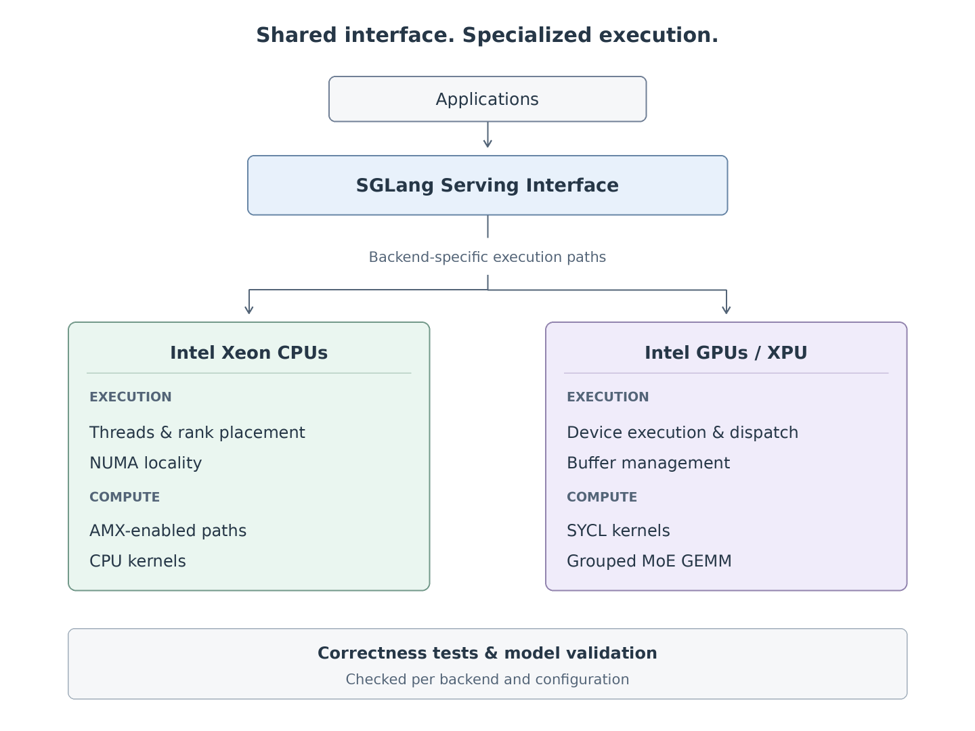
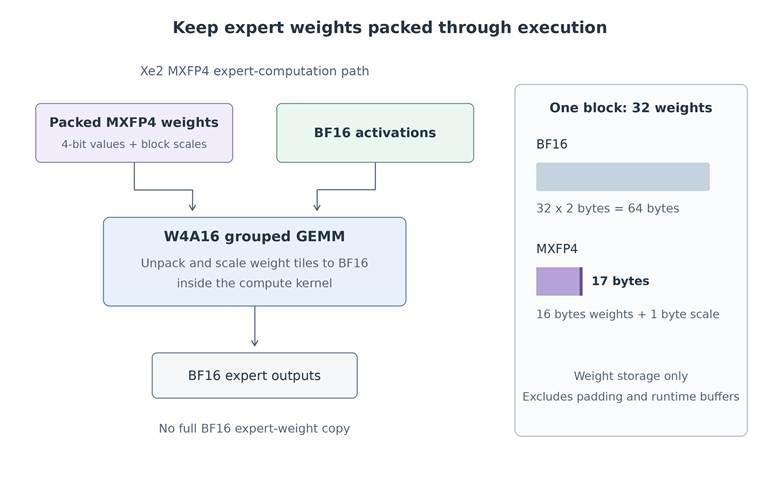
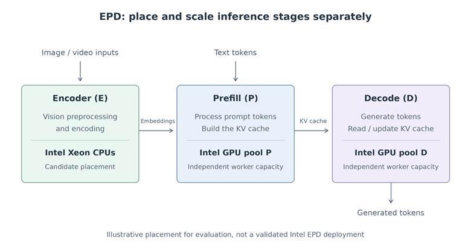

Efficient LLM inference on Intel Xeon CPUs and Intel GPUs depends on optimizations tailored to each architecture. This post examines [RadixArk and Intel’s collaborative work](https://www.intc.com/news-events/press-releases/detail/1787/intel-radixark-collaborate-to-advance-open-ai-inference-on) on Intel Advanced Matrix Extensions (Intel AMX)-enabled computation, thread placement, and compiled execution on Intel Xeon, alongside attention and MoE kernels and graph execution on Intel GPUs. In particular, we take a closer look at the Xe2 MXFP4 path, which keeps expert weights compressed in device memory and converts weight tiles inside the compute kernel. We also describe the supported configurations and limitations of these paths.

## A Shared Serving Interface, Specialized Execution Paths

SGLang provides a common serving interface, while each backend specializes the execution and compute paths underneath. As shown below, compute kernels implement operations such as attention and expert GEMM; the execution layer organizes the threads, buffers, and data placement needed to run them. Their interaction matters: kernel efficiency depends on the shapes, layouts, and memory access patterns produced by the surrounding execution path.

*Figure 1. Shared serving interface, hardware-specific execution. Support is validated per backend and configuration; the diagram does not imply feature parity or automatic CPU-GPU workload placement.*

Intel's upstream work in SGLang started with CPU enablement and has progressively expanded across both Intel CPU and Intel GPU (XPU) backends, covering optimized kernels, attention and MoE, quantization, graph execution, distributed inference, model enablement, alongside continuous integration to validate changes on Intel hardware. Together, these efforts address both the performance-critical execution paths and the integration work needed to maintain backend support as SGLang evolves.

On Intel Xeon, this means combining Intel AMX-enabled compute with thread placement and NUMA locality. On Intel GPUs, device dispatch and buffer organization support SYCL kernels, including grouped MoE GEMM. Both paths must preserve tensor and model semantics at the framework boundary, with correctness checked through operator tests and model-level validation. The following sections examine these CPU and GPU execution paths in more detail.

## Intel Xeon: CPU-Native Inference

SGLang's Xeon path combines matrix-compute acceleration with CPU-specific execution controls. The optimizations address both the arithmetic inside operators and the topology and runtime overhead around them:

- **Intel AMX-enabled matrix compute.** On supported Xeon processors, Intel AMX accelerates matrix operations in the CPU backend. This matters for dense projections and expert computation, although the benefit depends on matrix shape and batch size.

- **W8A8 INT8 inference.** The CPU path supports compatible checkpoints with 8-bit weights and activations, selected through `--quantization w8a8_int8`. This reduces operand storage relative to BF16; quantization scales and model compatibility remain part of the execution contract.

- **NUMA-aware execution and memory locality.** SGLang groups physical cores using NUMA or L3-cache topology, including Xeon sub-NUMA clusters where exposed. `SGLANG_CPU_OMP_THREADS_BIND` provides explicit per-rank affinity control. Aligning core assignment with memory locality helps limit remote-memory traffic; adding tensor-parallel ranks also introduces communication costs.

- **Compiled CPU execution.** On Intel AMX systems, `--enable-torch-compile` enables CPU graph execution to reduce Python overhead. Decode uses batch-size buckets; optional prefill graphs use total-token buckets. The full prefill backend remains experimental and requires explicit enablement.

These controls should be tuned together against the model, context length, and concurrency. Faster matrix kernels alone do not eliminate KV-cache traffic, NUMA effects, or parallel communication overhead.

## Intel GPUs: Building a Native XPU Serving Stack

Intel GPU support in SGLang has followed a similar progression, moving from PyTorch XPU device enablement toward a broader optimized serving backend. SGLang's Intel GPU backend combines SYCL kernels with serving-level execution optimizations through PyTorch's XPU path. The work spans attention, expert computation, low precision, and generation overhead:

- **Optimized attention kernels.** The XPU kernel library includes Flash Attention and Multi-head Latent Attention (MLA) implementations, with dedicated prefill and decode paths. These paths address different query sizes and KV-cache access patterns rather than treating all attention workloads as the same computation.

- **MoE acceleration.** Grouped GEMM kernels process expert computations with different token counts. The surrounding GPU operations organize inputs and combine expert results, keeping the MoE execution path on the device rather than driving expert computation through a Python loop.

- **Low-precision computation.** The kernel library includes FP8 and MXFP4 expert-computation paths. These implementations pair quantized weights with the required scale handling and GEMM kernels. Availability depends on GPU architecture, checkpoint format, and the selected execution path; the documented Xe2 MXFP4 example is detailed below.

- **Speculative decoding.** EAGLE-style draft-and-verify workflows propose multiple candidate tokens before target-model verification. The XPU implementation includes tree-construction, verification, and speculative-sampling kernels. The potential decoding benefit depends on candidate acceptance rates and the cost of drafting and verification; model and backend compatibility still require validation.

- **XPU graph execution.** Graph capture and replay reduce repeated host-side kernel-launch overhead. The experimental XPU paths capture decode graphs by batch size and prefill graphs by token-length bucket, with a segmented prefill option. Both decode and prefill graph execution are opt-in and depend on the selected model and backend configuration.

These optimizations address different bottlenecks: device computation, target-model decoding steps, and host launch overhead. Their combined effect must be evaluated at the serving level. The next section examines the format and kernel contracts behind low-precision expert computation.

## Low-Precision MoE: A Closer Look at MXFP4

The Xe2 MXFP4 MoE path keeps expert weights compressed in device memory and converts weight tiles inside grouped GEMM. This avoids materializing a full BF16 copy of the expert weights while retaining BF16 activations.

*Figure 2. Packed-weight execution and raw storage per 32-weight block. The storage comparison is not a model-memory or throughput measurement.*

- **Compact expert-weight storage.** Each block of 32 MXFP4 values uses 16 bytes for weights and one byte for its scale, versus 64 bytes for BF16 weights, before padding.

- **Conversion inside the compute kernel.** W4A16 combines 4-bit stored weights with 16-bit activations. On this Xe2 path, weight tiles are unpacked and scaled to BF16 inside the kernel; W4A16 does not imply native FP4 arithmetic.

- **Selective quantization.** For the documented GPT-OSS-20B example, MoE expert weights use MXFP4, while attention, router, embeddings, and output-head layers remain BF16. KV cache, activations, and workspaces still contribute to total memory.

This documented path targets Xe2 / BMG (Arc B-Series and Arc Pro B-Series). Expert parallelism is not yet validated for it; other devices and checkpoints require separate validation.

## Exploring Heterogeneous Inference with EPD

Heterogeneous inference can mean assigning different stages of a request to different resources, rather than choosing one device for the entire pipeline. SGLang's Encoder-Prefill-Decode (EPD) disaggregation provides a framework for separating these stages in vision-language model serving:

- **Encoder.** Processes visual inputs into embeddings. Its compute demand depends on the vision encoder, image resolution, and number of images or video frames.

- **Prefill.** Processes text tokens and visual embeddings to initialize the language model's KV cache. Longer prompts increase this stage's compute and memory requirements.

- **Decode.** Generates tokens autoregressively, repeatedly accessing weights and the growing KV cache. Memory bandwidth and latency often become important constraints.

One candidate deployment to evaluate is a suitably sized vision encoder on Intel Xeon, with prefill and decode in separate Intel GPU worker pools. Separating the roles allows capacity to be provisioned independently as the mix of visual inputs, prompt lengths, and output lengths changes.

*Figure 3. Illustrative heterogeneous EPD placement, not a validated Intel configuration. Arrows show logical dataflow; routing, control-plane details, and associated request-state transfers are omitted.*

The trade-off is additional embedding and KV-cache transfer, plus coordination between worker pools. This mapping requires validation of encoder support on CPU, GPU execution paths, tensor and KV-cache formats, and cross-backend transport. It is an architectural example, not a claim that arbitrary CPU-GPU combinations already work or improve performance.

For Intel Xeon deployments, start with the CPU server guide and check processor capabilities, core topology, memory capacity, and the intended precision. For Intel GPUs, use the XPU guide to select a documented device and model configuration. The sgl-kernel-xpu repository contains the lower-level kernels, tests, and benchmarks; building that library alone is not a complete SGLang serving installation.

## Co-Engineering the Future of Open AI Infrastructure

Making Intel CPUs and GPUs first-class platforms in SGLang is the result of a deep, strategic co-engineering effort between RadixArk and Intel.

Rather than working in silos, our engineering teams are collaborating across the entire AI stack—from redefining serving architectures to co-designing hardware-aware compute abstractions. This joint innovation ensures that the SGLang framework seamlessly extracts the maximum potential from Intel's comprehensive Xeon and XPU product lines, empowering developers to deploy scalable AI solutions with unprecedented flexibility.

Together, we are addressing complex deployment bottlenecks at the most effective layer. Whether this involves co-developing highly tuned kernels for Intel hardware, refining memory management for complex CPU topologies, or elevating SGLang’s shared abstractions to natively support advanced heterogeneous workflows, the mutual goal is to deliver a unified, frictionless developer experience.

A cornerstone of this partnership is our joint commitment to an "upstream-first" philosophy. By integrating these collaborative innovations directly into the core SGLang repository, we ensure that Intel platform support evolves organically alongside the framework's rapidly advancing features. This continuous joint effort benefits the broader open-source community by strengthening device abstractions, broadening platform validation, and paving the way for a truly hardware-agnostic AI serving ecosystem.

<blockquote style="margin: 2.6em 0; padding-left: 1.5em; border-left: 2px solid var(--orange); font-size: 1.125em; line-height: 1.6; font-style: normal;">
  
“Efficient inference asks for systematic solutions: kernels, memory management, and serving execution have to be tuned together for the hardware. Our collaboration with Intel brings that work into upstream SGLang, with optimizations tailored to Intel Xeon CPUs and Intel GPUs. Maintaining and validating those execution paths as models and inference techniques evolve is equally important. Working with Intel and the SGLang community, we’re building a stronger foundation for developers to choose the hardware that fits their workloads.”

  
— <strong>Banghua Zhu</strong>, CTO, RadixArk

</blockquote>

<blockquote style="margin: 2.6em 0; padding-left: 1.5em; border-left: 2px solid var(--orange); font-size: 1.125em; line-height: 1.6; font-style: normal;">
  
“Our work with RadixArk is about putting the developer experience first. By co-engineering directly in upstream SGLang, we are providing highly optimized, out-of-the-box inference across Intel CPUs and GPUs. We want developers to deploy state-of-the-art open models through the same SGLang experience, with the flexibility to move workloads across hardware backends without heavy refactoring or artificial constraints.”

  
— <strong>Bill Pearson</strong>, Vice President, Data Center Software, Intel

</blockquote>

## What's Next

For Intel GPUs, ongoing work includes emerging LLM and diffusion workloads, new attention architectures, quantized GEMM and MoE, graph execution, distributed serving, and future Intel GPU platforms.

For Intel Xeon, areas of focus include low-precision computation, GEMM and MoE, cache and NUMA optimization, graph execution, long-context workloads, and upcoming Xeon platforms.

Across both platforms, the goal of the RadixArk and Intel collaboration is straightforward:

Make Intel CPUs and GPUs first-class SGLang platforms while preserving the developer experience that makes SGLang compelling: an open serving framework, rapid support for state-of-the-art models and inference techniques, and increasing flexibility to choose the hardware that best fits a workload.

There is more work ahead to reach that vision across the full breadth of models and SGLang features. RadixArk and Intel look forward to continuing that engineering upstream and working with the SGLang community to make heterogeneous inference increasingly practical.

## Get Started on Intel Platforms

SGLang provides platform-specific guides for deploying on Intel Xeon CPUs and Intel GPUs. Follow the guides below for environment setup, installation, and launching the serving engine:

- [Intel Xeon CPUs](https://docs.sglang.io/docs/hardware-platforms/cpu_server): Configure the CPU environment and serving process, with guidance on Intel AMX-enabled execution, thread affinity, NUMA placement, and supported quantization paths.

- [Intel GPUs (XPU)](https://docs.sglang.io/docs/hardware-platforms/xpu): Set up GPU drivers and PyTorch XPU dependencies, install SGLang, and select the attention and quantization settings for your deployment.

Start with a documented model and precision configuration, then tune parallelism and optional features for your workload. For model-specific examples and kernel development, see:

- [SGLang model deployment cookbook](https://docs.sglang.io/cookbook/intro)

- [sgl-kernel-xpu: kernels, tests, and benchmarks](https://github.com/sgl-project/sgl-kernel-xpu)
